# Sidekick

🦸 Your private, real-time AI meeting copilot. Sidekick listens to a live conversation in any meeting app (Teams, Zoom, Google Meet, Webex and others), keeps running notes, detects questions as they're asked (especially ones addressed to you by name), and suggests answers with sources from your documents, the meeting so far and your screen. Answers appear in a translucent overlay that is hidden from screen sharing, so only you see it.

> **Status:** Phase 1 (MVP) and the Phase 3 features are built and tested on Windows, macOS and Linux in CI, and macOS was verified on a real machine (T-051). Still to do: the Windows hardware checks (Phase 5), a few fixes from real use that need a live call (Phase 6), the MVP acceptance pass and the release pipeline. Progress is tracked task by task in [docs/Task.md](docs/Task.md).

## Contents

- [Screenshots](#screenshots)
- [What it does](#what-it-does)
- [Documentation](#documentation)
- [Tech stack](#tech-stack)
- [Getting started](#getting-started)
- [Running the app](#running-the-app)
- [Running the tests](#running-the-tests)
- [Repository layout](#repository-layout)
- [Design system](#design-system)
- [Contributing](#contributing)
- [Responsible use](#responsible-use)

## Screenshots

The overlay sits beside your meeting window at 420 × 640 by default; Settings is a separate window. These are the real UI with the mocked backend and canned answers; `pnpm docs:screenshots` takes them again (see [Running the tests](#running-the-tests)).

<table>
  <tr>
    <td width="33%">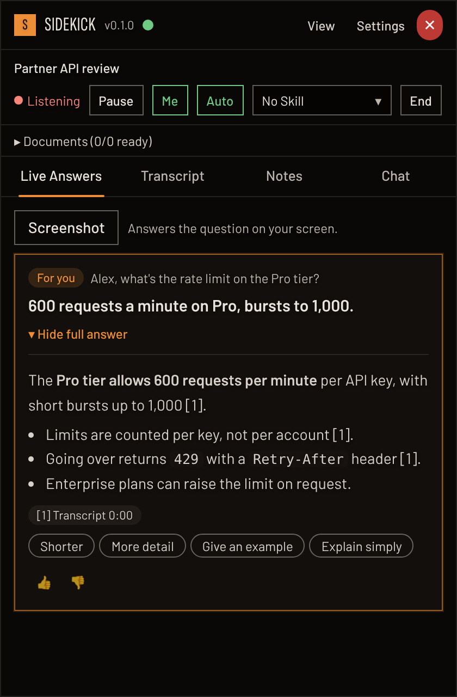</td>
    <td width="33%">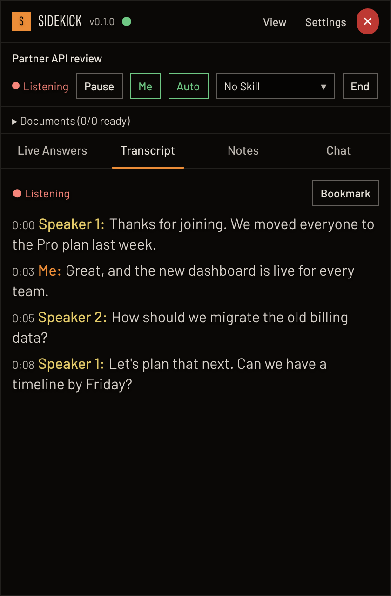</td>
    <td width="33%">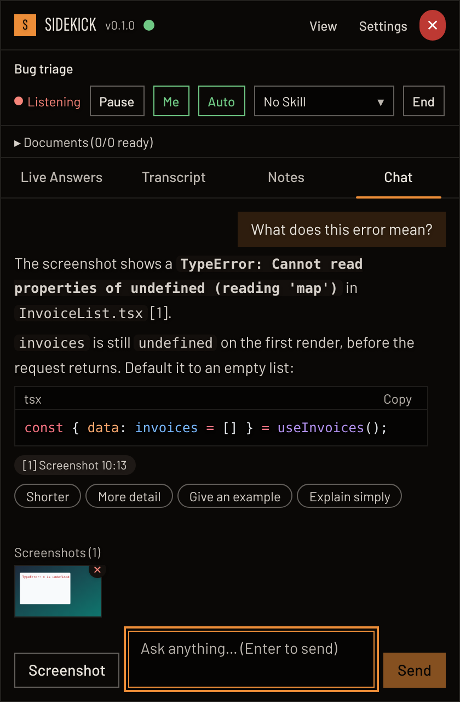</td>
  </tr>
  <tr>
    <td><b>Live Answers.</b> A question that uses your name is marked "For you": a one-line cue first, then the full answer with numbered sources, follow-up chips and feedback.</td>
    <td><b>Transcript.</b> The other people and you, as separate streams, with timestamps, speaker labels and bookmarks.</td>
    <td><b>Chat about your screen.</b> Capture a window, an area or the whole screen and ask about it; code comes highlighted with a Copy button.</td>
  </tr>
  <tr>
    <td>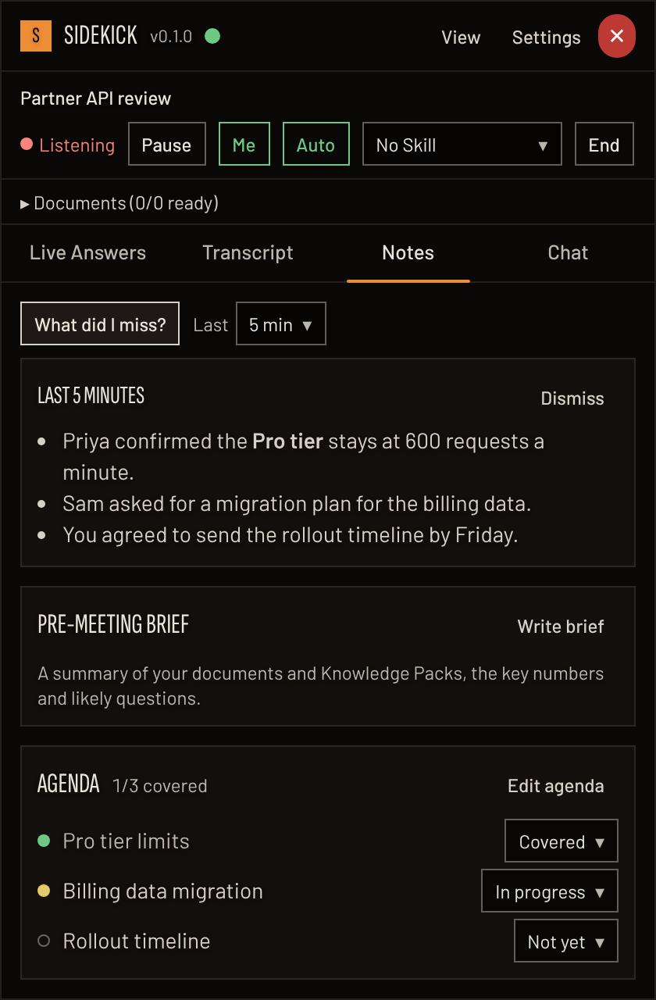</td>
    <td>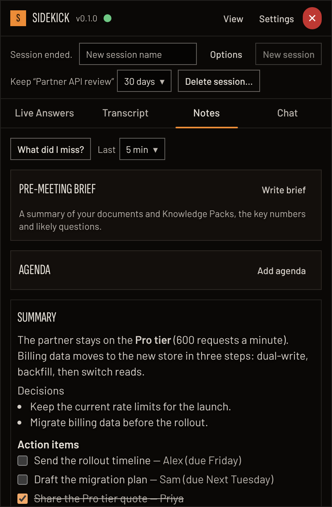</td>
    <td>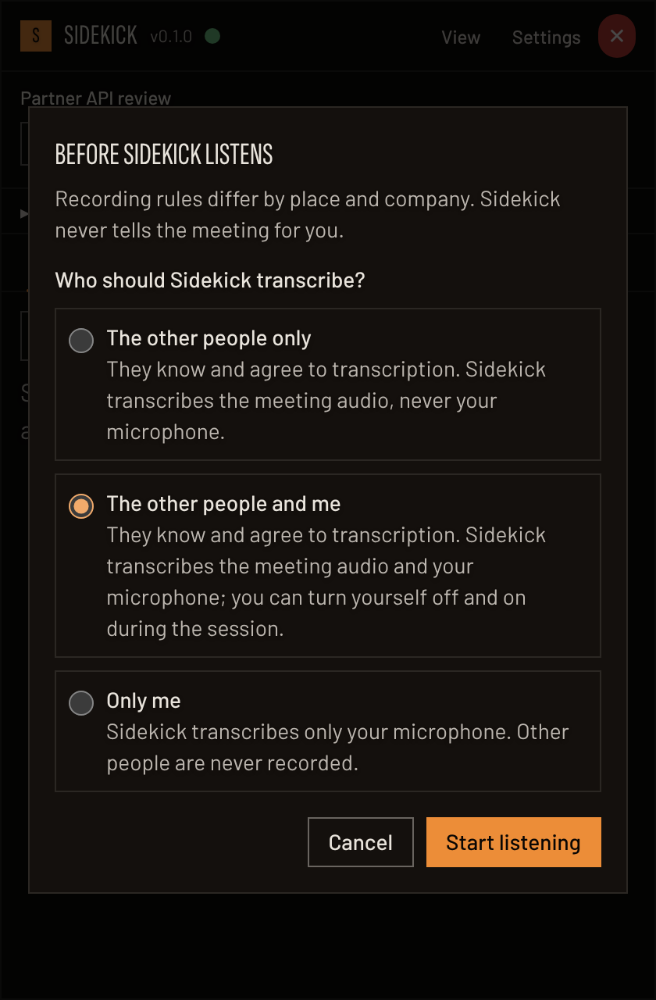</td>
  </tr>
  <tr>
    <td><b>Notes.</b> "What did I miss?" recaps the last minutes; the agenda tracks itself as topics come up; rolling notes every 45 seconds.</td>
    <td><b>After the meeting.</b> Summary, decisions and action items with owners and due dates, ready to tick off.</td>
    <td><b>Consent first.</b> Choose who is transcribed before Sidekick listens: the other people, the other people and you, or only you.</td>
  </tr>
  <tr>
    <td>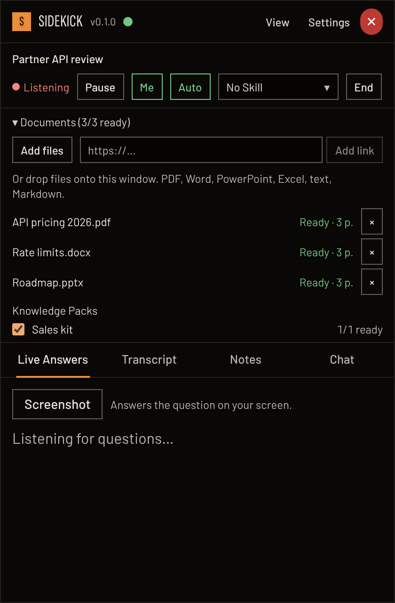</td>
    <td>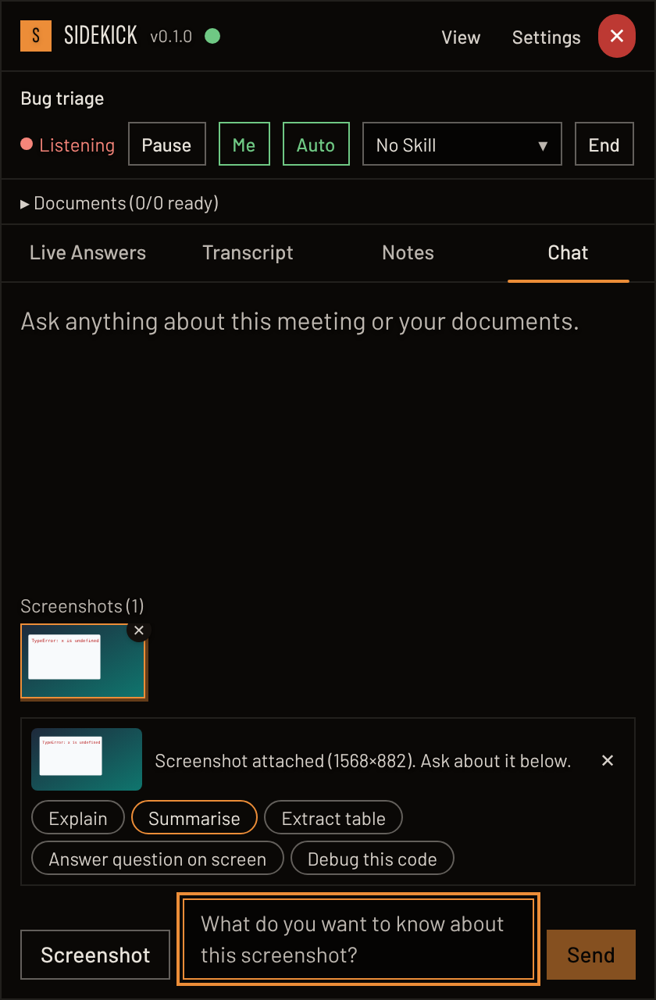</td>
    <td>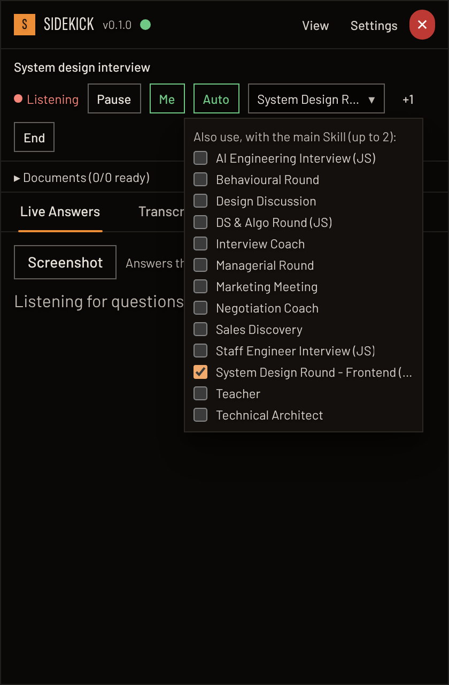</td>
  </tr>
  <tr>
    <td><b>Your documents.</b> Add files or links to a session, or turn on a Knowledge Pack; answers cite them.</td>
    <td><b>Screenshot quick actions.</b> One click to explain, summarise, extract a table, answer the question on screen or debug code.</td>
    <td><b>Skills.</b> One main Skill per session (here the backend system design round), plus up to two more at once.</td>
  </tr>
  <tr>
    <td>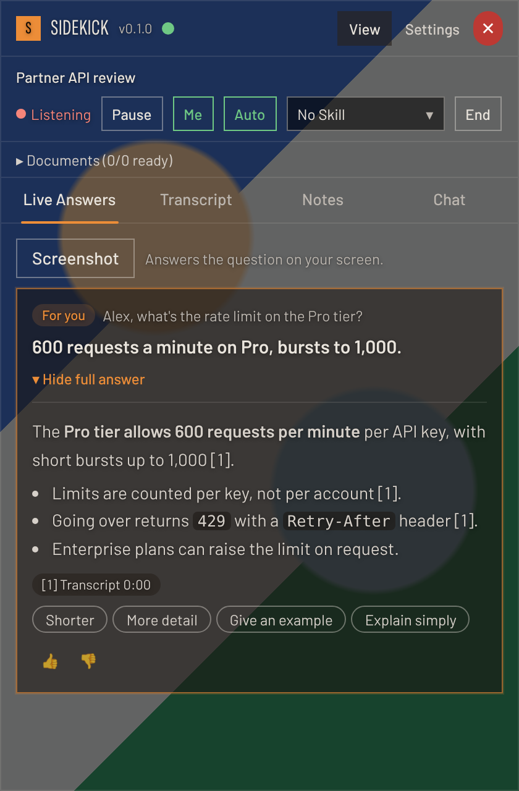</td>
    <td>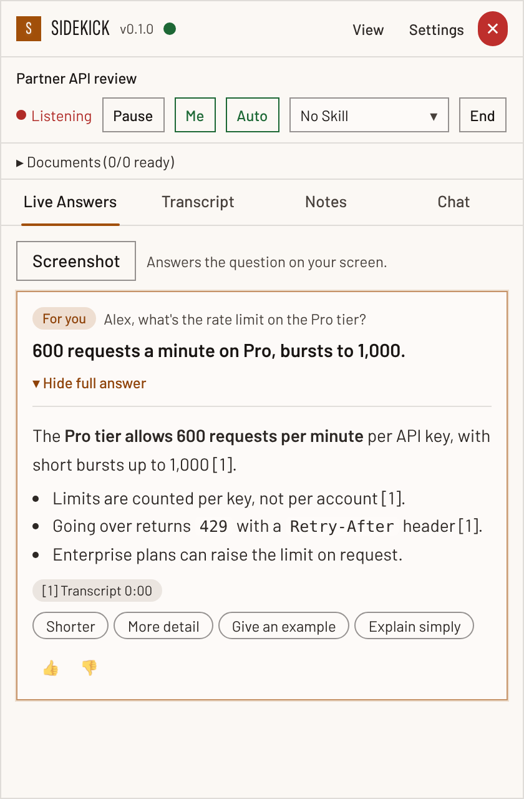</td>
    <td>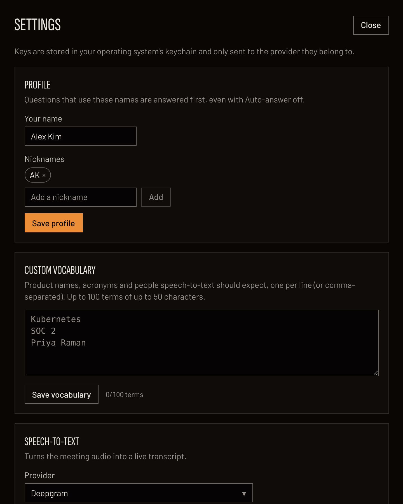</td>
  </tr>
  <tr>
    <td><b>Glass.</b> A translucent panel over the call (20–100% background); only the tint changes, text stays crisp.</td>
    <td><b>Themes.</b> Dark (Darkroom), light and high contrast, all WCAG AA.</td>
    <td><b>Settings.</b> Your name and nicknames, custom vocabulary, providers and keys (kept in the OS keychain).</td>
  </tr>
</table>

<table>
  <tr>
    <td width="34%">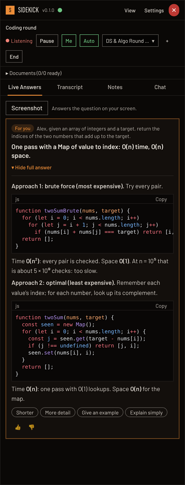</td>
    <td width="33%">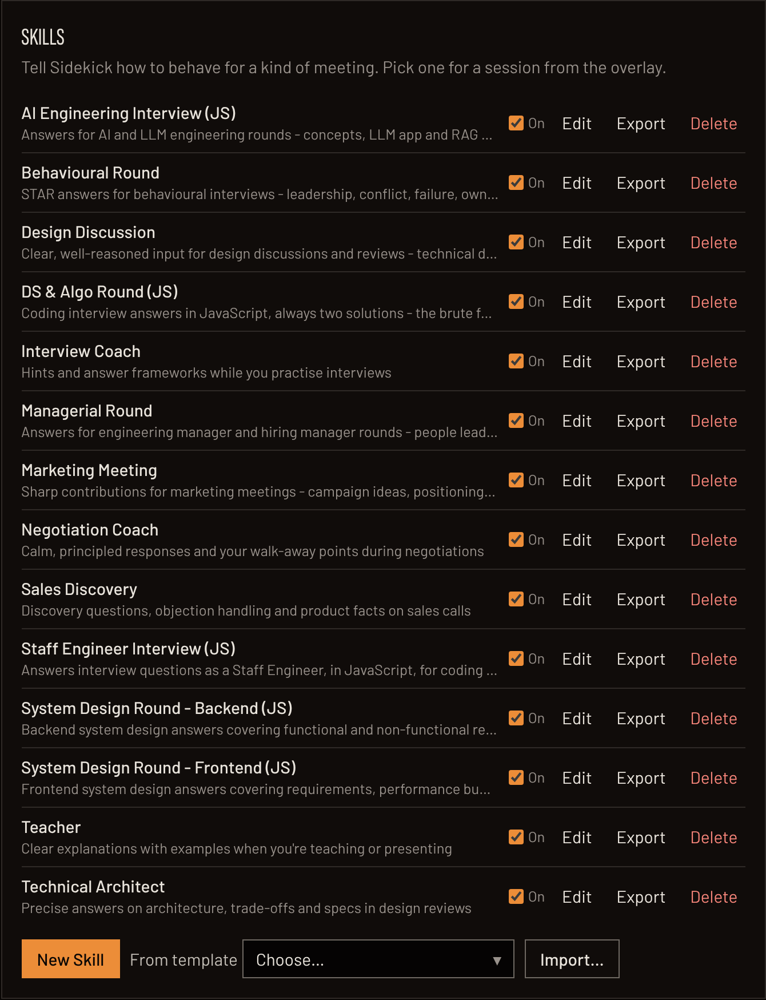</td>
    <td width="33%">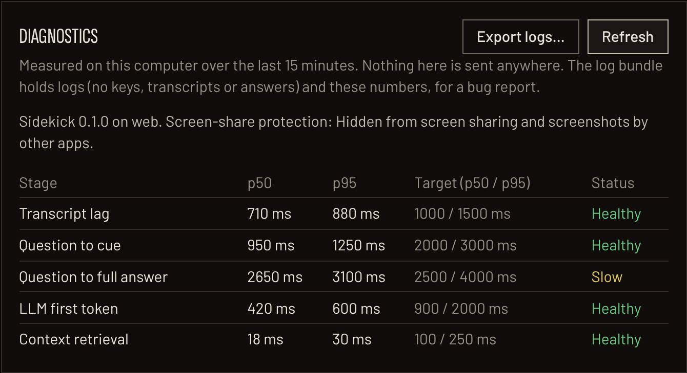</td>
  </tr>
  <tr>
    <td><b>Interview round Skills.</b> DS &amp; Algo answers give the brute-force and the optimal solution in JavaScript, each with its complexity; system design rounds cover FR, NFR, estimates and trade-offs.</td>
    <td><b>Skill builder.</b> Turn built-in Skills on or off, edit them, write your own from a template, and import or export them as files.</td>
    <td><b>Diagnostics.</b> Latency for every stage against its target, the screen-share protection status, and a log bundle for bug reports (no keys or meeting content).</td>
  </tr>
</table>

## What it does

| Area             | Capabilities                                                                                                                                                                                                                                                                                                                                                                                                                                                                                                                                                                                                                                                                                                                              |
| ---------------- | ----------------------------------------------------------------------------------------------------------------------------------------------------------------------------------------------------------------------------------------------------------------------------------------------------------------------------------------------------------------------------------------------------------------------------------------------------------------------------------------------------------------------------------------------------------------------------------------------------------------------------------------------------------------------------------------------------------------------------------------- |
| Listening        | Microphone and system audio as separate streams. Live transcript with speaker labels, timestamps, bookmarks, pause and resume. Choose who is transcribed: the other people only, the other people and you, or only you, with a **Me** switch to turn your own voice off and on during a call. Room mode when system audio isn't available. Echo of the other side picked up by your microphone is dropped                                                                                                                                                                                                                                                                                                                                 |
| Speech-to-text   | Deepgram, AssemblyAI, Soniox, or local Whisper (audio never leaves the computer). Each pause is finalised at once, so a line never waits for the next speaker. Custom vocabulary (product names, acronyms, people) boosts recognition. A silent-microphone warning when permission is missing                                                                                                                                                                                                                                                                                                                                                                                                                                             |
| Answers          | Detects questions, especially ones that use your name or nicknames, including interview tasks ("design a…", "walk me through…"). **Auto** answers every question; off, only the ones for you. A one-line cue first, then a full answer with numbered sources; from general knowledge, clearly labelled, when your context doesn't cover it. Code blocks with highlighting and Copy; follow-up chips (Shorter, More detail, Give an example, Explain simply); thumbs up and down                                                                                                                                                                                                                                                           |
| Context          | Your documents (PDF, Word, PowerPoint, spreadsheets, text, Markdown, web pages) by picker, drag and drop or link, searched with hybrid vector and keyword search. Knowledge Packs: named document sets you reuse across sessions. The meeting so far. Optional web search (Tavily or Brave)                                                                                                                                                                                                                                                                                                                                                                                                                                               |
| Screenshots      | A window, an area or the whole screen. Ask about it, or use a quick action: Explain, Summarise, Extract table, Answer question on screen, Debug this code. The screenshot button on Live Answers answers the question on screen. Every capture kept in a strip, with re-ask and delete                                                                                                                                                                                                                                                                                                                                                                                                                                                    |
| Chat             | Ask your own questions with the whole session as context, follow-ups, Shift+Enter for new lines, and capture-and-ask                                                                                                                                                                                                                                                                                                                                                                                                                                                                                                                                                                                                                      |
| Meeting memory   | Pre-meeting brief from your documents and packs. Agenda that tracks itself (covered, in progress, not yet). "What did I miss?" recap of the last 2, 5 or 10 minutes. Rolling notes every 45 seconds. When the meeting ends: summary, decisions and action items with owners and due dates                                                                                                                                                                                                                                                                                                                                                                                                                                                 |
| Skills           | Tell Sidekick how to answer for a kind of meeting. Interview rounds, with code in JavaScript: DS & Algo (a brute-force and an optimal solution, each with its complexity), System Design Backend and Frontend (requirements, NFRs, back-of-the-envelope estimates, APIs, data model, a simple and a scaled design, trade-offs), AI Engineering, Behavioural (STAR), Managerial, and Staff Engineer Interview (JS). Meetings: Marketing Meeting, Design Discussion, Sales Discovery, Technical Architect, Teacher, Negotiation Coach and Interview Coach. Or write your own. Up to three at once. Agent Skills can use tools (document search, web search, calculator) before answering. Build, edit, import and export Skills in Settings |
| Models           | Anthropic (Claude), OpenAI, Google Gemini, or local Ollama, with your own keys in the OS keychain. Per-session overrides for the speech-to-text and answer providers                                                                                                                                                                                                                                                                                                                                                                                                                                                                                                                                                                      |
| Overlay          | Always on top, hidden from screen sharing where the OS supports it, with a visible protection status. Glass background (20–100%), compact mode, click-through so clicks reach the meeting below, dark, light and high-contrast themes. Global shortcuts for show and hide, Ask, screenshot, Auto, pause and resume, switch Skill, bookmark and click-through; dropdowns drawn inside the window so they never show in a screen share                                                                                                                                                                                                                                                                                                      |
| Privacy and data | Everything stored encrypted on your computer (SQLCipher). Retention per session; delete a session or everything at any time. Consent before listening to anyone but you. Logs never contain keys or meeting content. No hosted backend: the app talks only to the providers you choose                                                                                                                                                                                                                                                                                                                                                                                                                                                    |
| Reliability      | Startup recovery screen instead of a crash if the keychain or database has a problem. Speech-to-text status in the session bar. Diagnostics with per-stage latency targets and a log bundle for bug reports                                                                                                                                                                                                                                                                                                                                                                                                                                                                                                                               |

## Documentation

| Document                                                    | What's in it                                                                                                           |
| ----------------------------------------------------------- | ---------------------------------------------------------------------------------------------------------------------- |
| [Product requirements (PRD)](docs/PRD.md)                   | Problem, users, requirements with IDs (CTX, LIS, MEM, QA, SCR, MOD, SKL, UI, KEY), consent and ethics, roadmap         |
| [Technical documentation](docs/TECHNICAL.md)                | Architecture, data model, IPC contract, setup, coding standards, design system, testing, release, security, operations |
| [Implementation tasks](docs/Task.md)                        | Every task to build Sidekick end to end, its tests and its current status                                              |
| [Phase 0 manual checks](docs/phase-0-manual-checks.md)      | Step-by-step hardware checks that close Phase 0                                                                        |
| [Phase 1 manual checks](docs/phase-1-manual-checks.md)      | Hardware and live-meeting checks for Phase 1 tasks (shortcuts, screenshots, speech-to-text providers, multi-monitor)   |
| [macOS test report](docs/Macos_testing_report.md)           | What was tested on macOS for each task (T-051), with a screenshot of every Playwright test                             |
| [End-to-end tests](tests/e2e/README.md)                     | How the full-app WebdriverIO suite builds, runs and is written                                                         |
| [Architecture decision records](docs/adr/README.md)         | One file per significant decision (ADR-001 onwards)                                                                    |
| [Module boundaries](docs/TECHNICAL.md#78-module-boundaries) | How the code is split and the rules that keep it modular                                                               |
| [User guide](docs/TECHNICAL.md#12-user-guide)               | Install, first run, features, shortcuts, FAQs                                                                          |

The technical doc is the single source of truth for engineering: when code and doc disagree, fix whichever is wrong in the same pull request.

## Tech stack

- **Desktop app:** Tauri 2 for Windows and macOS (Linux builds and runs for development and CI).
- **Core:** Rust, as a Cargo workspace with one crate per module (`crates/`): audio, speech-to-text, gateway (LLM providers), ingest, retrieval, store (SQLCipher + sqlite-vec), sessions, skills, capture, settings, diagnostics and more.
- **UI:** React 19 + TypeScript, Tailwind CSS 4 with design tokens, Zustand, Barlow and Sofia Sans Extra Condensed.
- **IPC:** typed commands and events generated from Rust with tauri-specta (`src/ipc/bindings.ts`).
- **No hosted backend:** the app calls the providers you choose directly, with your own keys.
- **Tests:** `cargo test`, Vitest + React Testing Library, Playwright with axe, WebdriverIO.

## Getting started

### Prerequisites

| Tool                 | Windows                                                                                                 | macOS                                         | Linux (development only)                    |
| -------------------- | ------------------------------------------------------------------------------------------------------- | --------------------------------------------- | ------------------------------------------- |
| Rust                 | [rustup](https://rustup.rs); the version is pinned in `rust-toolchain.toml` and installed automatically | Same                                          | Same                                        |
| Node.js 22+ and pnpm | Node 24 LTS recommended; `corepack enable` provides pnpm                                                | Same                                          | Same                                        |
| C/C++ build tools    | Microsoft C++ Build Tools ("Desktop development with C++")                                              | Xcode Command Line Tools                      | `build-essential`                           |
| WebView              | WebView2 (preinstalled on Windows 11)                                                                   | Built in                                      | `libwebkit2gtk-4.1-dev` and friends (below) |
| CMake and Clang      | Only for local Whisper                                                                                  | Only for local Whisper (`brew install cmake`) | Only for local Whisper                      |

On Linux, install the Tauri system libraries first:

```bash
sudo apt-get install -y libwebkit2gtk-4.1-dev libgtk-3-dev librsvg2-dev libssl-dev libasound2-dev
```

More detail, including troubleshooting, is in [technical doc section 6](docs/TECHNICAL.md#6-setup-and-installation).

### Install

```bash
git clone https://github.com/coderArchitech/Sidekick.git
```

```bash
cd Sidekick && pnpm install
```

## Running the app

Run the desktop app with hot reload:

```bash
pnpm tauri dev
```

Add provider keys in **Settings** (they're checked before saving and stored in the OS keychain), or try everything without keys and without a microphone using mock providers and a recorded audio file:

```bash
SIDEKICK_MOCK_PROVIDERS=1 SIDEKICK_AUDIO_FIXTURE=path/to/meeting.wav SIDEKICK_DATA_DIR=/tmp/sidekick-dev pnpm tauri dev
```

On Windows PowerShell, set the variables first, for example `$env:SIDEKICK_MOCK_PROVIDERS = "1"`.

Work on the UI alone in a browser, with a mocked backend and a short demo transcript:

```bash
pnpm dev:web
```

Build an installer (unsigned):

```bash
pnpm tauri build
```

On a Mac you test on, build with a stable local signature instead, so macOS keeps the keychain's **Always Allow** and the Microphone permission across rebuilds (an unsigned build looks like a new app every time, and asks again). Create the certificate once, then build:

```bash
scripts/macos-local-signing.sh
```

```bash
pnpm build:mac-local
```

Or build installers for both platforms on GitHub: **Actions → Build installers → Run workflow**, pick the branch and `all`, `windows` or `macos`. When it finishes, download them from the run page: `sidekick-windows` (`.msi` and setup `.exe`), `sidekick-macos-apple-silicon` and `sidekick-macos-intel` (`.dmg`). They're unsigned, so Windows SmartScreen and macOS Gatekeeper warn on first open. The button appears once the workflow is on `main`.

Build with local Whisper speech-to-text (needs CMake and Clang):

```bash
pnpm tauri dev -- --features local-whisper
```

### Environment variables

| Variable                     | Default            | Purpose                                                                                       |
| ---------------------------- | ------------------ | --------------------------------------------------------------------------------------------- |
| `SIDEKICK_MOCK_PROVIDERS`    | `0`                | `1` replaces every provider with a deterministic mock; keys stay in memory                    |
| `SIDEKICK_AUDIO_FIXTURE`     | unset              | A WAV file played instead of the microphone and system audio                                  |
| `SIDEKICK_MOCK_TRANSCRIPT`   | unset              | Mock mode: a text file with one utterance per line; each burst of audio becomes the next line |
| `SIDEKICK_MOCK_LLM_FAIL`     | `0`                | Mock mode: `1` makes every answer fail, to see how the app copes with an outage               |
| `SIDEKICK_DATA_DIR`          | OS app data folder | Use a separate data folder (database, logs, Skills, models)                                   |
| `SIDEKICK_LOG`               | `info`             | Log level: `error`, `warn`, `info`, `debug`, `trace`                                          |
| `SIDEKICK_DISABLE_EXCLUSION` | `0`                | `1` lets screenshots of the overlay be taken, for docs                                        |
| `OLLAMA_HOST`                | `localhost:11434`  | Where the Ollama server runs                                                                  |

Logs are JSON lines in the OS log folder (`%LOCALAPPDATA%\com.sidekick.app\logs` on Windows, `~/Library/Logs/com.sidekick.app` on macOS) or `<SIDEKICK_DATA_DIR>/logs`. Settings → Diagnostics → **Export logs…** saves them with a diagnostics snapshot for bug reports.

## Running the tests

### At a glance

| Suite                       | What it covers                                                                                                                                                                    | Command                                | Runs in CI             |
| --------------------------- | --------------------------------------------------------------------------------------------------------------------------------------------------------------------------------- | -------------------------------------- | ---------------------- |
| Rust unit and integration   | Every crate: audio, speech-to-text adapters (with a local WebSocket server), gateway (with a mock HTTP server), database, ingest, retrieval, sessions, retention, skills, logging | `cargo test --workspace`               | Ubuntu, Windows, macOS |
| Frontend unit and component | Orchestrator logic, stores and every component, with mocked IPC                                                                                                                   | `pnpm test`                            | Ubuntu                 |
| UI (Playwright)             | Real frontend in Chromium with the mocked backend: user flows and accessibility (axe, WCAG 2.1 AA)                                                                                | `pnpm test:ui`                         | Ubuntu                 |
| End-to-end (WebdriverIO)    | The real app with mock providers and fixture audio, from consent to a cited answer                                                                                                | `pnpm build:e2e`, then `pnpm test:e2e` | Ubuntu, Windows, macOS |
| Lint, format and types      | ESLint, Prettier, TypeScript, rustfmt, Clippy (warnings are errors)                                                                                                               | part of `pnpm verify`                  | Ubuntu, Windows, macOS |

Run everything CI runs except the UI and end-to-end suites with one command:

```bash
pnpm verify
```

### Rust

All crates:

```bash
cargo test --workspace
```

One crate (crates are named `sidekick-<folder>`):

```bash
cargo test -p sidekick-session
```

One test file or one test by name:

```bash
cargo test -p sidekick-session --test retention
```

```bash
cargo test -p sidekick-gateway streams_an_answer
```

Lints and formatting:

```bash
cargo clippy --workspace --all-targets -- -D warnings
```

```bash
cargo fmt --all --check
```

Some tests need real hardware or files and are skipped by default (`#[ignore]`). Run them on a machine that has what they need:

| Test                             | Needs                                                                                                                                          | Command                                                                           |
| -------------------------------- | ---------------------------------------------------------------------------------------------------------------------------------------------- | --------------------------------------------------------------------------------- |
| Real microphone and system audio | A microphone, audio playing, and on macOS the Microphone and System Audio Recording permissions                                                | `cargo test -p sidekick-audio -- --ignored`                                       |
| Real OS keychain round trip      | The OS keychain (CI runs it on every OS)                                                                                                       | `cargo test -p sidekick-secrets --test real_keychain -- --ignored`                |
| Local Whisper accuracy           | A Whisper model, a short English WAV and its words ([phase 1 checks](docs/phase-1-manual-checks.md#t-027-speech-to-text-providers-30-minutes)) | `cargo test -p sidekick-stt --features local-whisper --test whisper -- --ignored` |

### Frontend unit and component tests (Vitest)

```bash
pnpm test
```

Watch mode, or one file:

```bash
pnpm test:watch
```

```bash
pnpm test src/features/chat
```

Type checks and lint:

```bash
pnpm typecheck
```

```bash
pnpm lint
```

### UI tests (Playwright)

The suite in `tests/ui/` starts the frontend with `vite --mode uitest` (mocked backend, no demo transcript) and drives it in Chromium at the overlay's size (420 × 640) and the Settings window's size. It covers the consent dialog (mouse and keyboard), Auto-answer, Chat and capture-and-ask, shortcuts, copying code, settings dropdowns, and runs axe accessibility checks (including colour contrast) on every tab and dialog.

Install the browser once:

```bash
pnpm exec playwright install chromium
```

Run the suite:

```bash
pnpm test:ui
```

One spec, with a visible browser, or the HTML report after a run:

```bash
pnpm test:ui tests/ui/chat.spec.ts --headed
```

```bash
pnpm exec playwright show-report test-results/ui-report
```

Failures keep a trace, a screenshot and an error context in `test-results/ui/`.

### README screenshots

The pictures in [Screenshots](#screenshots) come from `tests/screenshots/readme.spec.ts`: the same mocked frontend, with canned model replies so answers read like real ones, saved at 2× to `docs/screenshots/app/`. Take them again after a UI change:

```bash
pnpm docs:screenshots
```

### End-to-end tests (WebdriverIO)

The suite in `tests/e2e/` drives the real desktop app through a WebDriver server built into a special debug build, so it works on Windows, macOS and Linux. The app runs with mock providers, a generated audio fixture and a scripted mock transcript. The specs cover consent to a cited answer, screenshot capture and ask, adding, testing and removing a key, and an LLM outage that leaves the transcript running. After each run, every log line is scanned for keys and meeting content.

Build the E2E app once (and again after Rust or UI changes):

```bash
pnpm build:e2e
```

Run the suite:

```bash
pnpm test:e2e
```

On Linux without a display:

```bash
xvfb-run -a pnpm test:e2e
```

One spec:

```bash
pnpm test:e2e --spec tests/e2e/specs/session.e2e.ts
```

Failing tests save screenshots in `test-results/e2e-screens/`. The E2E build is the only one that contains the WebDriver plugins; normal and release builds never do. More in [tests/e2e/README.md](tests/e2e/README.md).

Check any log folder for leaked keys or content yourself:

```bash
node scripts/scan-logs.mjs <logs-folder>
```

### Manual checks

Some things need real hardware or a live meeting: audio devices, hiding from screen sharing in each meeting app, shortcuts while a meeting app has focus, multi-monitor placement, live provider latency. Step-by-step instructions are in [Phase 0 manual checks](docs/phase-0-manual-checks.md) and [Phase 1 manual checks](docs/phase-1-manual-checks.md). Record the results in [docs/Task.md](docs/Task.md).

### Continuous integration

Every pull request runs `.github/workflows/ci.yml`:

| Job                     | OS                                       | Runs                                                                                  |
| ----------------------- | ---------------------------------------- | ------------------------------------------------------------------------------------- |
| Frontend                | Ubuntu                                   | `pnpm lint`, `pnpm typecheck`, `pnpm test`, `pnpm build`                              |
| Rust                    | Ubuntu, Windows, macOS                   | `cargo fmt --check`, `cargo clippy`, `cargo test --workspace`, the real keychain test |
| IPC bindings up to date | Ubuntu                                   | Regenerates `src/ipc/bindings.ts` and fails if it changed                             |
| UI (Playwright, axe)    | Ubuntu                                   | `pnpm test:ui`; uploads the report on failure                                         |
| E2E                     | Ubuntu (virtual display), Windows, macOS | `pnpm build:e2e` and `pnpm test:e2e`; uploads screenshots and logs on failure         |

## Repository layout

```text
src/              React frontend
  app/            App shell (picks the overlay or the Settings window)
  features/       One folder per feature: overlay, session, transcript, answers, chat, notes, library, packs, recovery, settings, skills
  orchestrator/   Question detection, prompts, answering, chat, notes jobs
  ipc/            The only route to Rust: generated bindings, browser mocks, events
  lib/            Small shared helpers (batching, logging)
  styles.css      Design tokens and shared component styles
src-tauri/        Thin Tauri shell: IPC commands, capabilities, app config, E2E build config
crates/           Rust domain crates, one per module (core, store, audio, stt, gateway, ingest, retrieval, session, skills, capture, ...)
schemas/          skill.schema.json
skills/           Built-in Skill templates and their golden-answer cases
tests/ui/         Playwright UI tests
tests/screenshots/ README screenshots (pnpm docs:screenshots)
tests/e2e/        WebdriverIO end-to-end tests
scripts/          IPC generation, E2E runner, log scanner
docs/             PRD, technical documentation, tasks, manual checks, ADRs
.github/          CI workflow
```

The full tree is in [section 7.1](docs/TECHNICAL.md#71-repository-structure).

## Design system

The UI uses the Hallmark **Darkroom** theme: a warm print-black ground, fibre-white text, one amber accent for the main action and the current selection, square corners, [Barlow](https://fonts.google.com/specimen/Barlow) for text and [Sofia Sans Extra Condensed](https://fonts.google.com/specimen/Sofia+Sans+Extra+Condensed) capitals for headings (both bundled, so they work offline). Light and high-contrast variants are under Settings → Appearance. Colours, fonts and shared component styles are defined once, as semantic tokens in [`src/styles.css`](src/styles.css): `surface`, `line`, `fg`, `accent`, `success` and so on, plus `btn`, `field`, `card` and `badge` classes. Components use only these, so the theme changes in one place. Every text colour meets WCAG AA contrast, and the UI test suite checks it. The overlay is glass: a translucent panel, so the call or slides behind it stay visible, with the background opacity (20–100%, default 80%) under **View**; only the tint changes, text stays crisp. Details are in [technical doc section 7.2](docs/TECHNICAL.md#72-coding-standards).

## Contributing

Work on short-lived branches (`feat/...`, `fix/...`, `chore/...`, `docs/...`) with [Conventional Commits](https://www.conventionalcommits.org/), and open a pull request even when working solo. Before pushing, run `pnpm verify`, plus `pnpm test:ui` for UI changes and `pnpm build:e2e && pnpm test:e2e` for changes to flows the end-to-end suite covers. The checklist is in [section 7.4](docs/TECHNICAL.md#74-code-review-and-pull-requests). New documents go in `docs/` and get a row in the documentation table above.

## Responsible use

Sidekick processes other people's voices, so it asks you to confirm participants are aware of transcription before it listens to anyone but you. Interview features are for practice and preparation, not live hiring assessments or exams. See [PRD section 8](docs/PRD.md#8-trust-consent-legal-and-ethical-considerations).
