# macOS test report

T-051 macOS device verification, 9 November 2026. Every task that was in progress in [Task.md](Task.md) was tested on a Mac and closed. Checks that need Windows moved to [Phase 5: Windows testing](Task.md#phase-5-windows-testing) (T-050, T-052 to T-063). Checks that need live provider keys moved to T-039, and reference-laptop baselines to T-038. Screenshots show the screen at the end of each Playwright test, run in WebKit.

## Environment

|                     |                                                               |
| ------------------- | ------------------------------------------------------------- |
| Machine             | Mac17,8, Apple Silicon, 48 GB, one display                    |
| OS                  | macOS 26.7                                                    |
| Browser engine      | Playwright WebKit 26.6, the engine of the macOS Tauri webview |
| Toolchain           | Node 22.23, Rust 1.97.0, Playwright 1.63                      |
| Backend in UI tests | Mocked IPC, deterministic mock providers, no real keys        |

## Results

| Suite                     | Where it runs                                              | Result       |
| ------------------------- | ---------------------------------------------------------- | ------------ |
| Playwright UI suite       | WebKit, overlay 420×640 and Settings 720×900               | ✅ 53 / 53   |
| Playwright UI suite       | Chromium (the repo's CI config)                            | ✅ 53 / 53   |
| WebdriverIO end-to-end    | The real Tauri app on macOS, mock providers, fixture audio | ✅ 13 / 13   |
| Vitest unit and component | jsdom                                                      | ✅ 277 / 277 |
| Rust workspace            | `cargo test --workspace`                                   | ✅ 292 / 292 |
| Device tests              | Real keychain, microphone, system audio                    | ✅ 3 / 3     |
| Lint, format, types       | ESLint, Prettier, TypeScript                               | ✅ Clean     |

The end-to-end log scan found no API keys or meeting content in the app's logs.

## Changes made while testing

- **15 new Playwright tests** in four specs: `library`, `overlay-controls`, `protection`, `diagnostics`. They cover T-011, T-012, T-017, T-019 and T-029, which had no Playwright coverage.
- **Bug fixed in the browser mock** (`src/ipc/sessionEvents.ts`). Under React StrictMode the mock event bus dropped a listener registered twice with the same function, so uploaded documents stayed on "Waiting" forever in `pnpm dev:web` and the UI tests. The real app was not affected.
- **`code-copy.spec.ts` runs on WebKit too.** Playwright has no clipboard permission for WebKit, so the spec uses an in-memory clipboard there and keeps the real clipboard on Chromium.
- **System audio:** the first unattended run hung, most likely on the one-time macOS permission prompt. With audio playing it passes in 0.32 s. In silence it fails after its 3 s timeout, which matches the check's "play any audio first" step.

## Tasks closed after macOS testing

### T-008 Settings window: providers and API keys

Status: ✅ Done

**Passed on macOS**

- ✅ Playwright: each provider kind has a dropdown with the defaults selected
- ✅ Playwright: keys are masked until shown
- ✅ Playwright: local Whisper shows its models and downloads one
- ✅ Playwright: saving a key unlocks the model dropdown; switching provider resets the model
- ✅ Real-app E2E: adds, tests and removes a key (mock provider)
- ✅ Real keychain round trip (device test)

**Not run on this Mac:** Saving a real Anthropic key and the keychain prompt → Windows: T-052

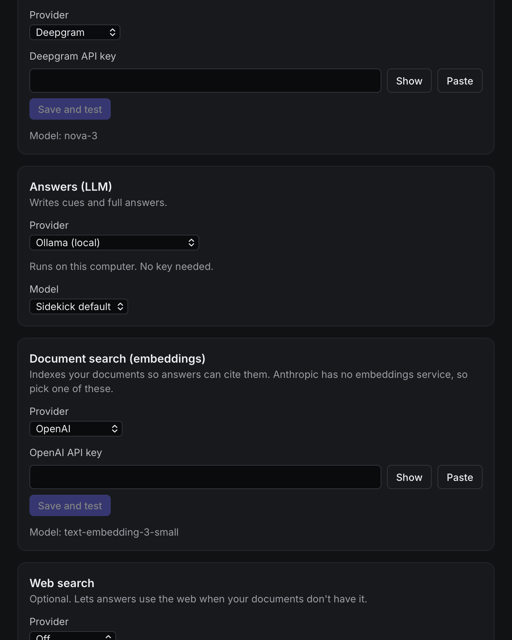 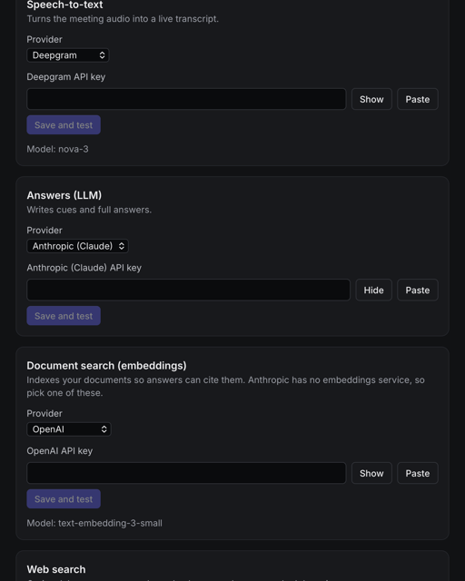

### T-009 Audio capture: microphone and system audio

Status: ✅ Done

**Passed on macOS**

- ✅ Device test: microphone frames on macOS 26.7
- ✅ Device test: system-audio frames with audio playing (0.32 s)
- ✅ Real-app E2E: consent → fixture audio → transcript → cited answer

**Not run on this Mac:** Glitch check in a real call; message when permission is denied → Windows: T-053

### T-010 Deepgram streaming

Status: ✅ Done

**Passed on macOS**

- ✅ Rust: Deepgram adapter against a local WebSocket server (cargo test, 292/292)

**Not run on this Mac:** Live latency with a real Deepgram key → T-039 · Windows: T-054

### T-011 Capture exclusion and protection status

Status: ✅ Done

**Passed on macOS**

- ✅ Playwright: Diagnostics shows the disabled reason after Refresh
- ✅ Playwright: Diagnostics shows the not_guaranteed reason after Refresh
- ✅ Playwright: Diagnostics shows the protected reason after Refresh
- ✅ Playwright: the header shield says plainly when the overlay is visible in a share
- ✅ Rust: protection status rules per OS version

**Not run on this Mac:** Hiding in live meeting apps with a second viewer; ADR-015 window titles → Windows: T-055

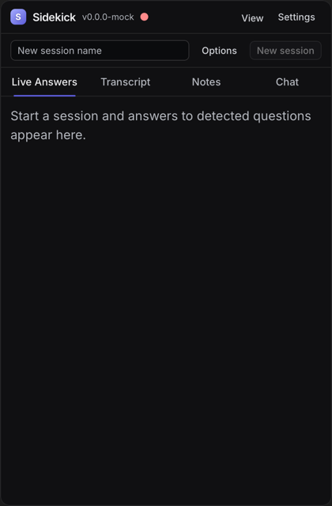 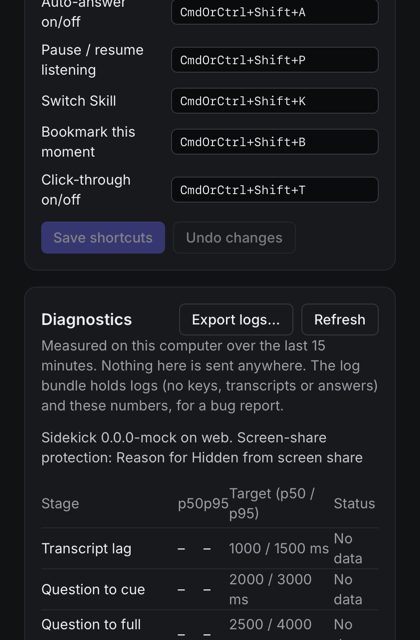

### T-012 Latency metrics and baselines

Status: ✅ Done

**Passed on macOS**

- ✅ Playwright: exporting logs reports the result, and cancelling does nothing
- ✅ Playwright: the latency table lists every stage with its target
- ✅ Rust: percentiles, rolling window, health verdicts

**Not run on this Mac:** Baselines on the 8 GB reference MacBook Air → T-038 · Windows: T-056

### T-015 Global shortcuts

Status: ✅ Done

**Passed on macOS**

- ✅ Playwright: Shift+Enter adds a line instead of sending
- ✅ Playwright: asks a question, gets a cited answer, then a follow-up
- ✅ Playwright: capture-and-ask: screenshot, then a question about it
- ✅ Playwright: the Ask shortcut opens Chat and focuses the input
- ✅ Playwright: the Auto shortcut toggles it too
- ✅ Playwright: with Auto off, only questions that use your name are answered
- ✅ Playwright: with Auto on, every detected question is answered
- ✅ Rust: shortcut validation and conflicts

**Not run on this Mac:** Shortcuts while a meeting app has focus → Windows: T-057

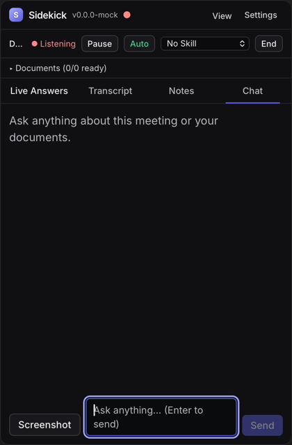 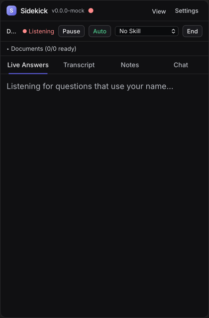

### T-017 Ingest: parse, chunk, embed

Status: ✅ Done

**Passed on macOS**

- ✅ Playwright: a damaged file fails, can be retried, and can be removed
- ✅ Playwright: add files with the picker and watch them become ready
- ✅ Playwright: an unsupported file is refused with the supported types
- ✅ Playwright: dropping files on the window opens the library and indexes them
- ✅ Playwright: links are added, validated, and removable
- ✅ Playwright: the library passes axe with documents and a failure showing
- ✅ Rust: PDF, Word, PowerPoint, spreadsheet and text parsing, chunking

**Not run on this Mac:** Image files through a vision model → T-039

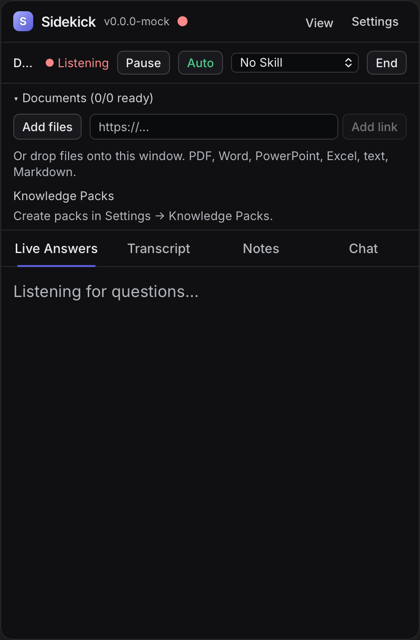

### T-019 Library: documents in a session

Status: ✅ Done

**Passed on macOS**

- ✅ Playwright: a damaged file fails, can be retried, and can be removed
- ✅ Playwright: add files with the picker and watch them become ready
- ✅ Playwright: an unsupported file is refused with the supported types
- ✅ Playwright: dropping files on the window opens the library and indexes them
- ✅ Playwright: links are added, validated, and removable
- ✅ Playwright: the library passes axe with documents and a failure showing

**Not run on this Mac:** Native macOS file picker and Finder drag → Windows: T-058

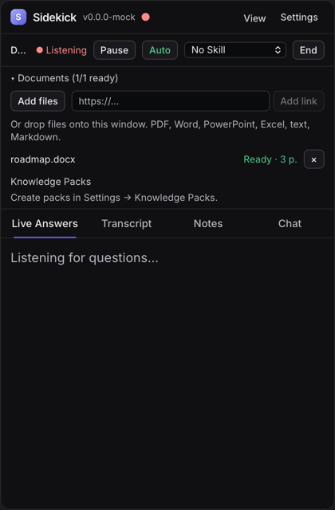 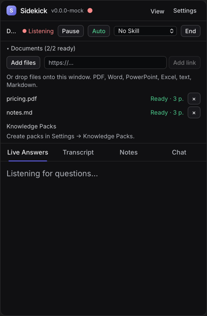 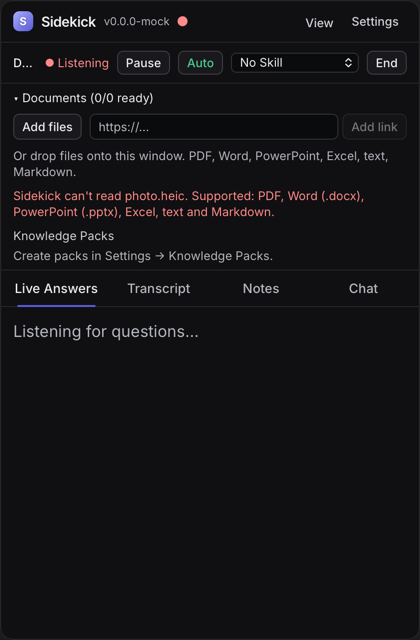

### T-021 Prompts, Skills, two-tier answers

Status: ✅ Done

**Passed on macOS**

- ✅ Playwright: an agent Skill uses the calculator before answering
- ✅ Playwright: more Skills can be used at once
- ✅ Real-app E2E: consent → transcript → detected question → cited answer

**Not run on this Mac:** Answer quality with live models → T-039

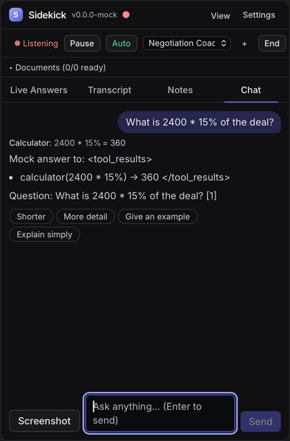

### T-025 Screenshots and answer from screen

Status: ✅ Done

**Passed on macOS**

- ✅ Playwright: Shift+Enter adds a line instead of sending
- ✅ Playwright: a quick action answers about the attached screenshot
- ✅ Playwright: asks a question, gets a cited answer, then a follow-up
- ✅ Playwright: capture-and-ask: screenshot, then a question about it
- ✅ Playwright: the Ask shortcut opens Chat and focuses the input
- ✅ Playwright: the strip keeps every capture, with re-ask and delete
- ✅ Real-app E2E: captures the screen and answers a question about it

**Not run on this Mac:** Capture during a live call; Screen Recording prompt → Windows: T-059

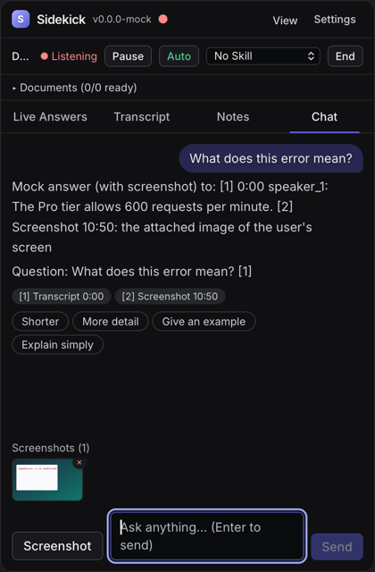

### T-027 STT providers: AssemblyAI, Soniox, local Whisper

Status: ✅ Done

**Passed on macOS**

- ✅ Playwright: each provider kind has a dropdown with the defaults selected
- ✅ Playwright: keys are masked until shown
- ✅ Playwright: local Whisper shows its models and downloads one
- ✅ Playwright: saving a key unlocks the model dropdown; switching provider resets the model
- ✅ Rust: AssemblyAI and Soniox adapters against local servers

**Not run on this Mac:** Live provider checks, Whisper accuracy, Hinglish comparison → T-039 · Windows: T-060

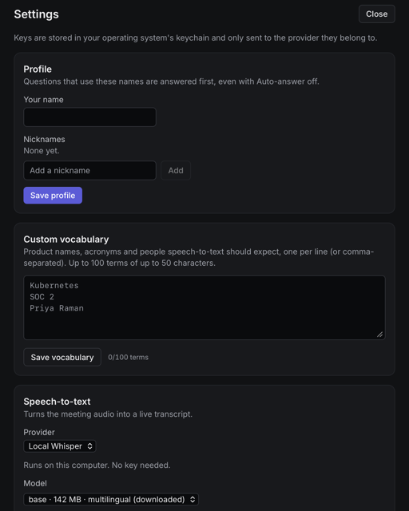

### T-029 Overlay controls and private display

Status: ✅ Done

**Passed on macOS**

- ✅ Playwright: Compact hides the session bar and documents, and brings them back
- ✅ Playwright: compact mode and the document panel pass axe
- ✅ Playwright: every overlay tab passes axe, empty and with content
- ✅ Playwright: text size steps within its limits
- ✅ Playwright: the background slider is limited to 20–100%
- ✅ Rust: snapping and per-monitor placement

**Not run on this Mac:** Position restore on two monitors (one display attached) → Windows: T-061

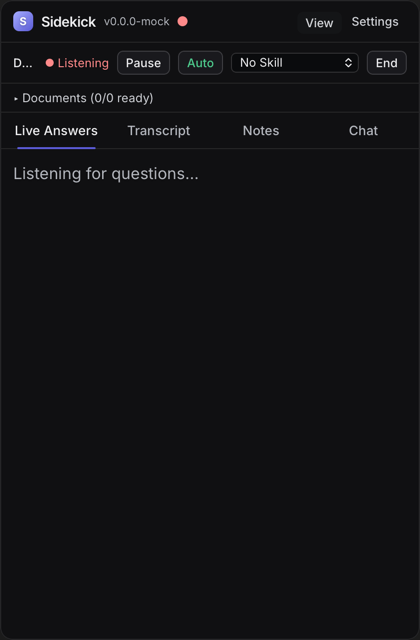 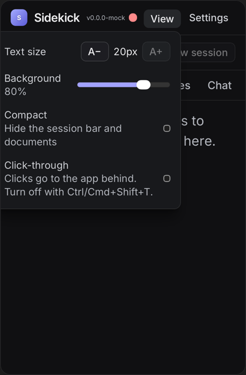

### T-041 Meeting memory: agenda, recap, action items

Status: ✅ Done

**Passed on macOS**

- ✅ Playwright: 'What did I miss?' recaps the last minutes
- ✅ Playwright: action items can be ticked off
- ✅ Playwright: agenda moves on as the meeting goes, and closes when it ends
- ✅ Real-app E2E: agenda, recap and end-of-meeting agenda status

**Not run on this Mac:** Agenda and recap quality with a live model → T-039

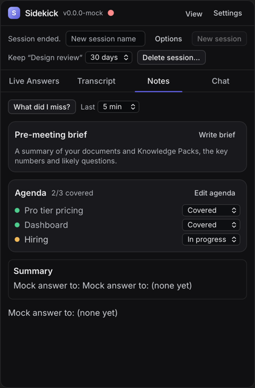 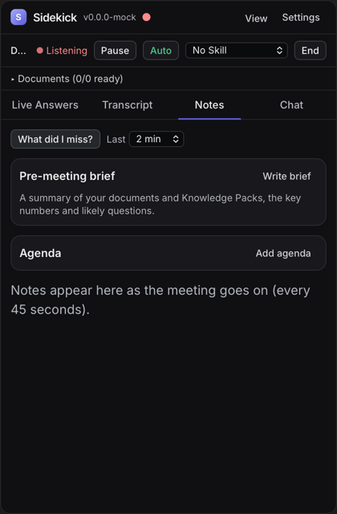

### T-042 Answer follow-up chips

Status: ✅ Done

**Passed on macOS**

- ✅ Playwright: a chip on a live answer asks its follow-up in Chat
- ✅ Playwright: chips on a chat answer chain back to the first question
- ✅ Real-app E2E: Shorter on a live answer answers in Chat

**Not run on this Mac:** Each chip reshapes the answer with a live model → T-039

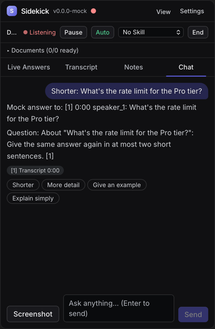

### T-043 Screenshot quick actions and strip

Status: ✅ Done

**Passed on macOS**

- ✅ Playwright: a quick action answers about the attached screenshot
- ✅ Playwright: the strip keeps every capture, with re-ask and delete
- ✅ Real-app E2E: quick action, strip, re-ask and delete

**Not run on this Mac:** Each action on real screenshots with a live model → T-039

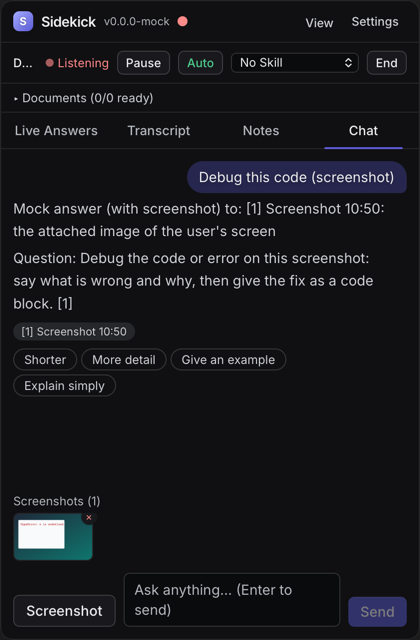

### T-044 Pre-meeting brief and Knowledge Packs

Status: ✅ Done

**Passed on macOS**

- ✅ Playwright: Overlay: a pack turned on is searched, and the brief reads it
- ✅ Playwright: Settings: create a pack and add a link
- ✅ Real-app E2E: pack from Settings → attached → cited in Chat → in the brief

**Not run on this Mac:** Brief quality with a live model → T-039

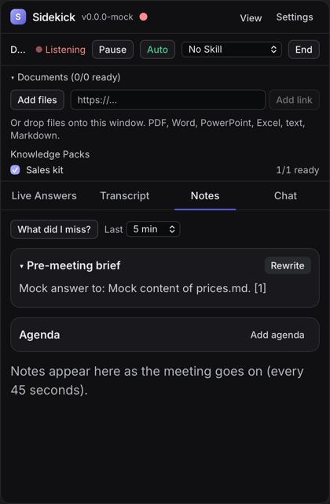

### T-045 Agents and multiple active Skills

Status: ✅ Done

**Passed on macOS**

- ✅ Playwright: an agent Skill uses the calculator before answering
- ✅ Playwright: more Skills can be used at once
- ✅ Real-app E2E: calculator step, then extra Skills

**Not run on this Mac:** Tool choice with a live model → T-039

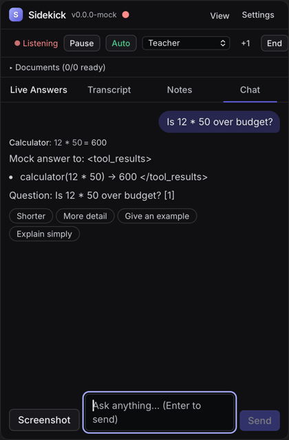

### T-046 Web search and per-session overrides

Status: ✅ Done

**Passed on macOS**

- ✅ Playwright: a session with its own providers; an agent searches the web
- ✅ Real-app E2E: own providers, then a web-searching agent
- ✅ Rust: Tavily and Brave against a mock HTTP server

**Not run on this Mac:** Live Tavily and Brave keys → T-039

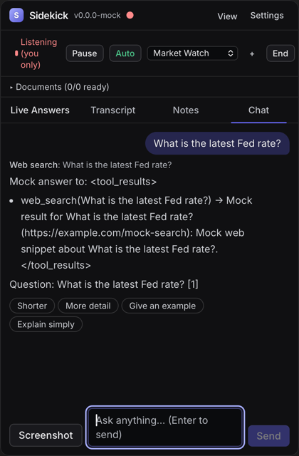

### T-047 Custom vocabulary

Status: ✅ Done

**Passed on macOS**

- ✅ Playwright: vocabulary is saved cleaned, with a count, and validated
- ✅ Real-app E2E: vocabulary is sent to speech-to-text when a session starts

**Not run on this Mac:** Accuracy with live providers → T-039

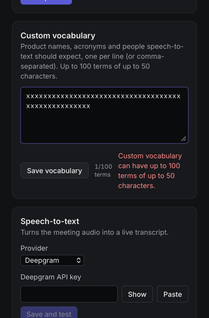

### T-048 Click-through mode and themes

Status: ✅ Done

**Passed on macOS**

- ✅ Playwright: Settings in dark passes axe
- ✅ Playwright: Settings in high_contrast passes axe
- ✅ Playwright: Settings in light passes axe
- ✅ Playwright: click-through: View menu on, notice shown, shortcut off
- ✅ Playwright: overlay in dark passes axe on every tab
- ✅ Playwright: overlay in high_contrast passes axe on every tab
- ✅ Playwright: overlay in light passes axe on every tab
- ✅ Real-app E2E: a Settings theme reaches the overlay; click-through on and off through the real window

**Not run on this Mac:** Physical clicks passing through to another app → Windows: T-062

 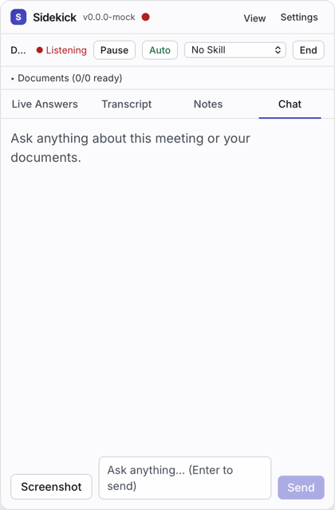

### T-049 Glass overlay

Status: ✅ Done

**Passed on macOS**

- ✅ Playwright: at full opacity the panel passes axe over a busy backdrop
- ✅ Playwright: the opacity setting tints only the background, never the text

**Not run on this Mac:** A look over a live video call → Windows: T-063

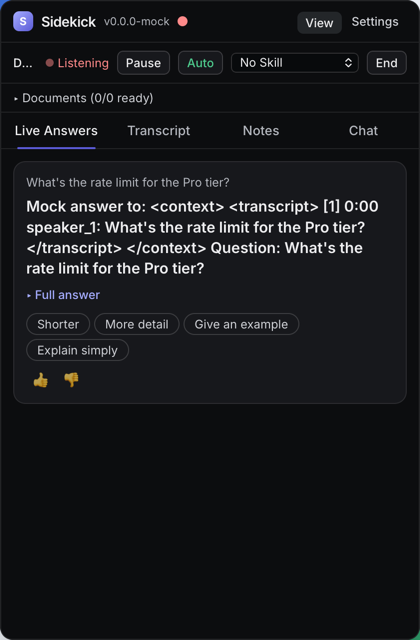 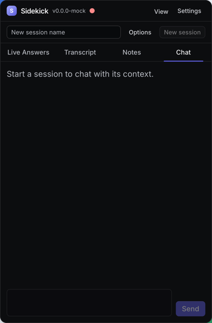

## Real-app end-to-end on macOS

WebdriverIO drives the real Tauri build (WebKit) with mock providers and a generated audio fixture. It saves screenshots only on failure, and nothing failed, so this suite has no pictures.

- ✅ consent → fixture audio → transcript → detected question → cited answer
- ✅ adds, tests and removes a key (mock provider)
- ✅ captures the screen and answers a question about it
- ✅ quick action, strip, re-ask and delete
- ✅ is sent to speech-to-text when a session starts
- ✅ click-through turns on from the View menu and off from the app
- ✅ a Settings theme reaches the overlay
- ✅ agenda, recap and end-of-meeting agenda status
- ✅ Shorter on a live answer answers in Chat
- ✅ pack from Settings → attached → cited in Chat → in the brief
- ✅ calculator step, then extra Skills
- ✅ own providers, then a web-searching agent
- ✅ shows the error on the answer and keeps the transcript running

## All 53 Playwright tests in WebKit

The screen at the end of each test, grouped by spec.

### `a11y.spec.ts`

Covers T-032, T-029.

| Test                                                    | Screenshot                                                                                                                                                        |
| ------------------------------------------------------- | ----------------------------------------------------------------------------------------------------------------------------------------------------------------- |
| ✅ every overlay tab passes axe, empty and with content |  |
| ✅ compact mode and the document panel pass axe         | 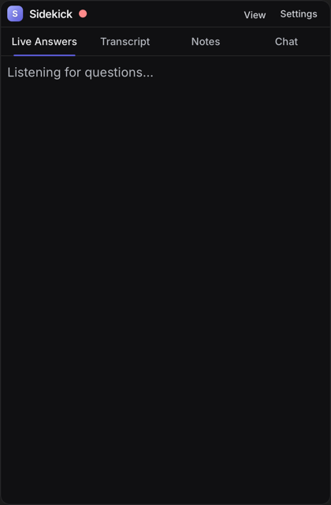                |

### `agents.spec.ts`

Covers T-045, T-021, T-028.

| Test                                                   | Screenshot                                                                                                                                                         |
| ------------------------------------------------------ | ------------------------------------------------------------------------------------------------------------------------------------------------------------------ |
| ✅ an agent Skill uses the calculator before answering |  |
| ✅ more Skills can be used at once                     |                                          |

### `auto-answer.spec.ts`

Covers T-020, T-022, T-015.

| Test                                                             | Screenshot                                                                                                                                                                                 |
| ---------------------------------------------------------------- | ------------------------------------------------------------------------------------------------------------------------------------------------------------------------------------------ |
| ✅ with Auto on, every detected question is answered             | 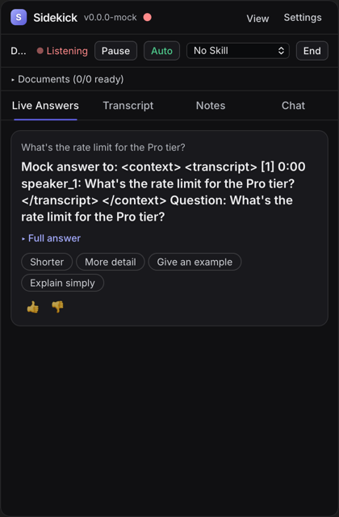                         |
| ✅ with Auto off, only questions that use your name are answered | 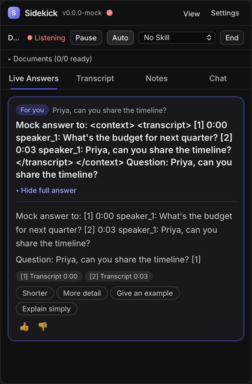 |
| ✅ the Auto shortcut toggles it too                              |                                                           |

### `chat.spec.ts`

Covers T-023, T-025, T-015.

| Test                                                      | Screenshot                                                                                                                                                           |
| --------------------------------------------------------- | -------------------------------------------------------------------------------------------------------------------------------------------------------------------- |
| ✅ asks a question, gets a cited answer, then a follow-up | 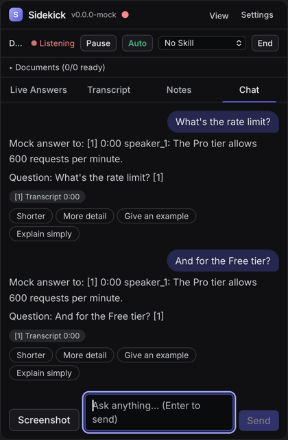 |
| ✅ Shift+Enter adds a line instead of sending             | 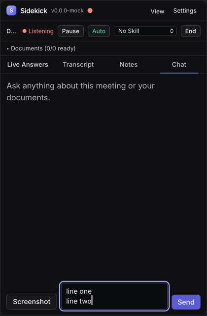                       |
| ✅ capture-and-ask: screenshot, then a question about it  |    |
| ✅ the Ask shortcut opens Chat and focuses the input      |          |

### `code-copy.spec.ts`

Covers T-022, T-023.

| Test                                                         | Screenshot                                                                                                                                                                        |
| ------------------------------------------------------------ | --------------------------------------------------------------------------------------------------------------------------------------------------------------------------------- |
| ✅ code in an answer is highlighted and copied only on click | 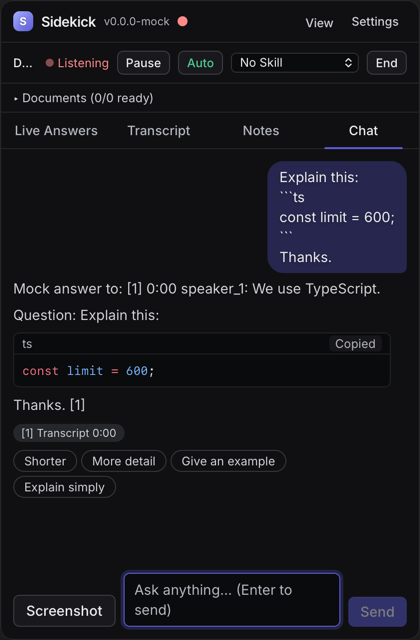 |

### `consent.spec.ts`

Covers T-013.

| Test                                                                     | Screenshot                                                                                                                                                                                            |
| ------------------------------------------------------------------------ | ----------------------------------------------------------------------------------------------------------------------------------------------------------------------------------------------------- |
| ✅ consent dialog needs a choice, can be cancelled, and starts listening | 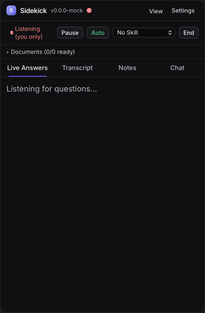 |
| ✅ the consent dialog works from the keyboard                            |                                                      |

### `diagnostics.spec.ts` (new)

Covers T-012, T-031.

| Test                                                              | Screenshot                                                                                                                                                                                   |
| ----------------------------------------------------------------- | -------------------------------------------------------------------------------------------------------------------------------------------------------------------------------------------- |
| ✅ the latency table lists every stage with its target            |                       |
| ✅ exporting logs reports the result, and cancelling does nothing | 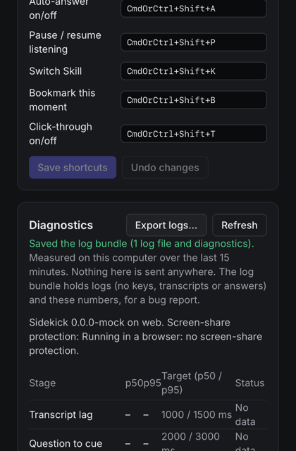 |

### `follow-ups.spec.ts`

Covers T-042.

| Test                                                       | Screenshot                                                                                                                                                                     |
| ---------------------------------------------------------- | ------------------------------------------------------------------------------------------------------------------------------------------------------------------------------ |
| ✅ a chip on a live answer asks its follow-up in Chat      |            |
| ✅ chips on a chat answer chain back to the first question | 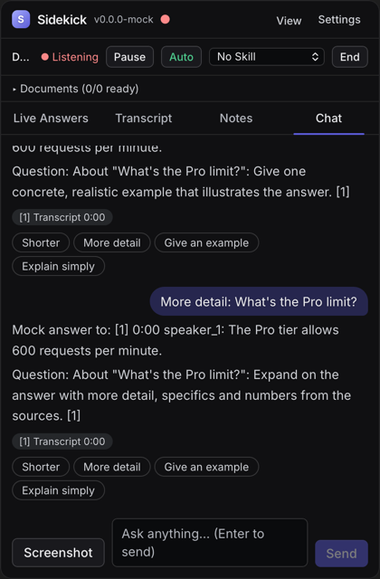 |

### `glass.spec.ts`

Covers T-049.

| Test                                                             | Screenshot                                                                                                                                                                           |
| ---------------------------------------------------------------- | ------------------------------------------------------------------------------------------------------------------------------------------------------------------------------------ |
| ✅ the opacity setting tints only the background, never the text |  |
| ✅ at full opacity the panel passes axe over a busy backdrop     |         |

### `knowledge-packs.spec.ts`

Covers T-044.

| Test                                                             | Screenshot                                                                                                                                                                                    |
| ---------------------------------------------------------------- | --------------------------------------------------------------------------------------------------------------------------------------------------------------------------------------------- |
| ✅ Settings: create a pack and add a link                        | 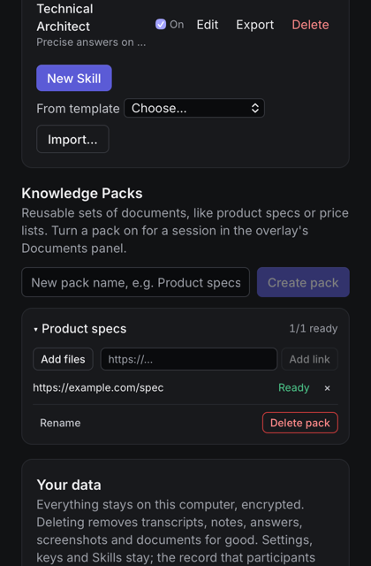                                              |
| ✅ Overlay: a pack turned on is searched, and the brief reads it |  |

### `library.spec.ts` (new)

Covers T-019, T-017.

| Test                                                               | Screenshot                                                                                                                                                                                  |
| ------------------------------------------------------------------ | ------------------------------------------------------------------------------------------------------------------------------------------------------------------------------------------- |
| ✅ add files with the picker and watch them become ready           |                      |
| ✅ dropping files on the window opens the library and indexes them |  |
| ✅ an unsupported file is refused with the supported types         |                  |
| ✅ a damaged file fails, can be retried, and can be removed        |                  |
| ✅ links are added, validated, and removable                       |                                                |
| ✅ the library passes axe with documents and a failure showing     | 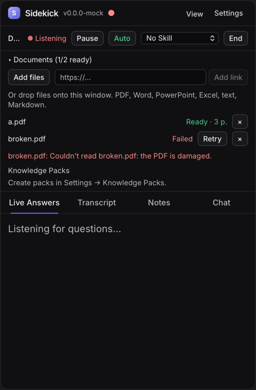         |

### `meeting-memory.spec.ts`

Covers T-041, T-024.

| Test                                                            | Screenshot                                                                                                                                                                                  |
| --------------------------------------------------------------- | ------------------------------------------------------------------------------------------------------------------------------------------------------------------------------------------- |
| ✅ agenda moves on as the meeting goes, and closes when it ends |  |
| ✅ 'What did I miss?' recaps the last minutes                   |                                        |
| ✅ action items can be ticked off                               | 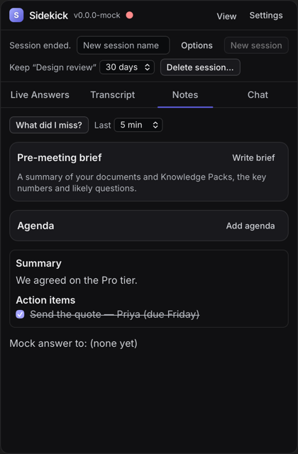                                                            |

### `overlay-controls.spec.ts` (new)

Covers T-029.

| Test                                                                 | Screenshot                                                                                                                                                                                             |
| -------------------------------------------------------------------- | ------------------------------------------------------------------------------------------------------------------------------------------------------------------------------------------------------ |
| ✅ text size steps within its limits                                 |                                                                |
| ✅ Compact hides the session bar and documents, and brings them back |  |
| ✅ the background slider is limited to 20–100%                       | 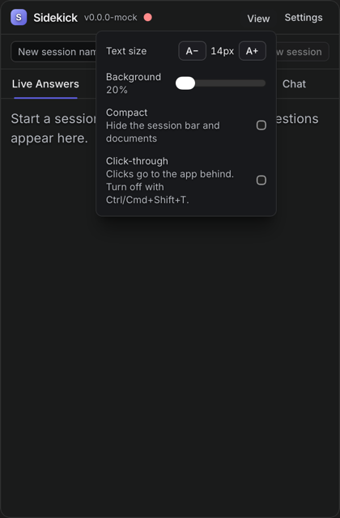                                            |

### `protection.spec.ts` (new)

Covers T-011.

| Test                                                                     | Screenshot                                                                                                                                                                                                 |
| ------------------------------------------------------------------------ | ---------------------------------------------------------------------------------------------------------------------------------------------------------------------------------------------------------- |
| ✅ the header shield says plainly when the overlay is visible in a share |  |
| ✅ Diagnostics shows the protected reason after Refresh                  |                                    |
| ✅ Diagnostics shows the not_guaranteed reason after Refresh             | 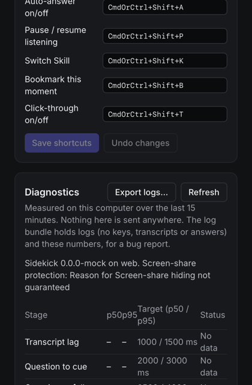                         |
| ✅ Diagnostics shows the disabled reason after Refresh                   | 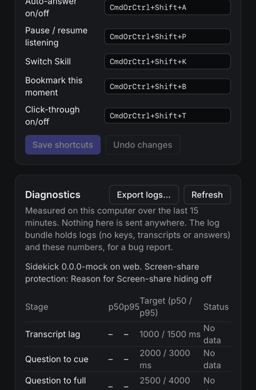                                     |

### `screenshot-actions.spec.ts`

Covers T-043, T-025.

| Test                                                     | Screenshot                                                                                                                                                                        |
| -------------------------------------------------------- | --------------------------------------------------------------------------------------------------------------------------------------------------------------------------------- |
| ✅ a quick action answers about the attached screenshot  | 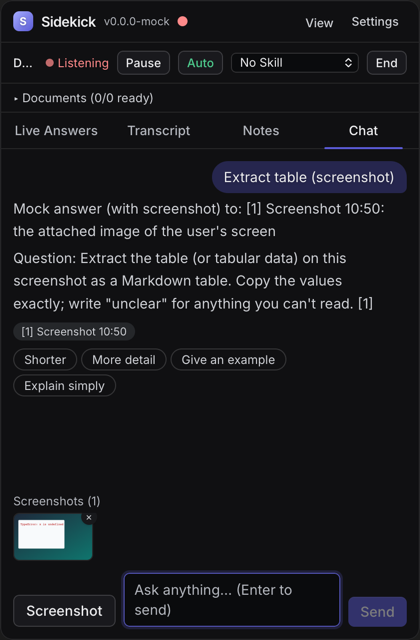  |
| ✅ the strip keeps every capture, with re-ask and delete |  |

### `settings.spec.ts`

Covers T-008, T-026, T-027.

| Test                                                                            | Screenshot                                                                                                                                                                                                        |
| ------------------------------------------------------------------------------- | ----------------------------------------------------------------------------------------------------------------------------------------------------------------------------------------------------------------- |
| ✅ each provider kind has a dropdown with the defaults selected                 | 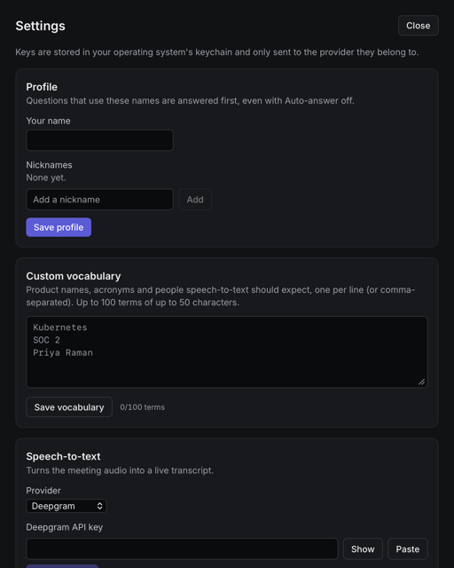                            |
| ✅ saving a key unlocks the model dropdown; switching provider resets the model |  |
| ✅ local Whisper shows its models and downloads one                             |                                                     |
| ✅ keys are masked until shown                                                  |                                                                                               |

### `themes.spec.ts`

Covers T-048.

| Test                                                       | Screenshot                                                                                                                                                              |
| ---------------------------------------------------------- | ----------------------------------------------------------------------------------------------------------------------------------------------------------------------- |
| ✅ overlay in light passes axe on every tab                |                             |
| ✅ Settings in light passes axe                            | 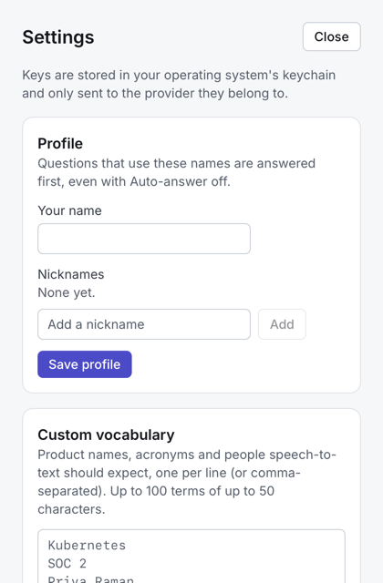                                                    |
| ✅ overlay in high_contrast passes axe on every tab        | 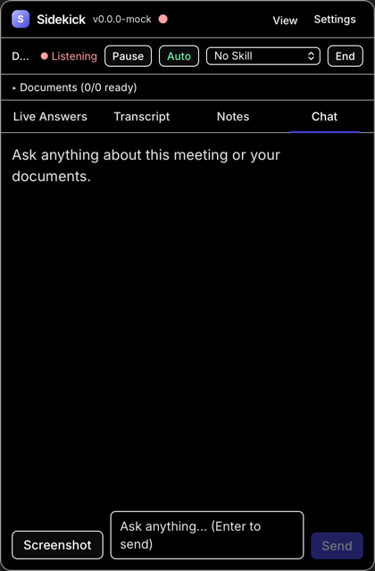            |
| ✅ Settings in high_contrast passes axe                    | 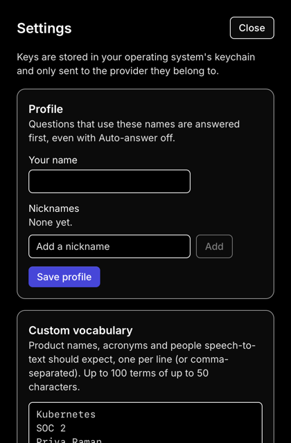                                    |
| ✅ overlay in dark passes axe on every tab                 | 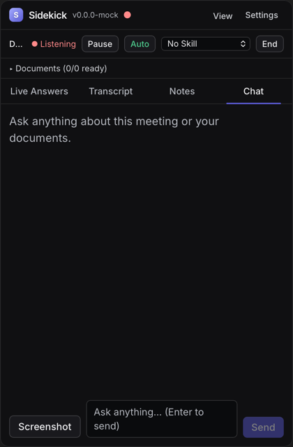                              |
| ✅ Settings in dark passes axe                             | 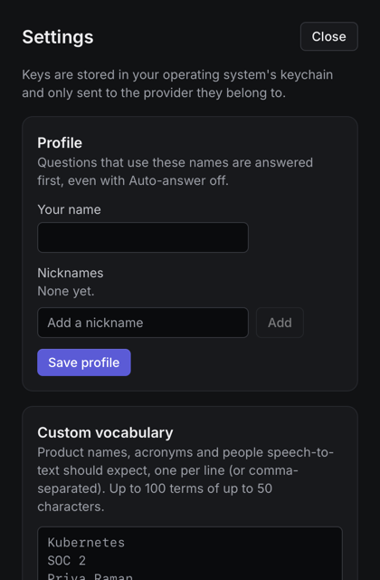                                                      |
| ✅ click-through: View menu on, notice shown, shortcut off |  |

### `vocabulary.spec.ts`

Covers T-047.

| Test                                                        | Screenshot                                                                                                                                                                     |
| ----------------------------------------------------------- | ------------------------------------------------------------------------------------------------------------------------------------------------------------------------------ |
| ✅ vocabulary is saved cleaned, with a count, and validated |  |

### `web-search-overrides.spec.ts`

Covers T-046.

| Test                                                           | Screenshot                                                                                                                                                                                      |
| -------------------------------------------------------------- | ----------------------------------------------------------------------------------------------------------------------------------------------------------------------------------------------- |
| ✅ a session with its own providers; an agent searches the web |  |

## Moved to Windows testing

These can't run from a Mac. They're in [Phase 5 of Task.md](Task.md#phase-5-windows-testing), all In progress, with steps for each.

| Task  | Check                                        | Status         |
| ----- | -------------------------------------------- | -------------- |
| T-050 | Windows setup and automated suite            | 🟡 In progress |
| T-052 | Settings keys in the real app (T-008)        | 🟡 In progress |
| T-053 | Audio capture (T-009)                        | 🟡 In progress |
| T-054 | Deepgram latency (T-010)                     | 🟡 In progress |
| T-055 | Screen-share hiding (T-011)                  | 🟡 In progress |
| T-056 | Baselines (T-012)                            | 🟡 In progress |
| T-057 | Shortcuts with a meeting app focused (T-015) | 🟡 In progress |
| T-058 | Native picker and Explorer drag (T-019)      | 🟡 In progress |
| T-059 | Screenshots during a live call (T-025)       | 🟡 In progress |
| T-060 | STT providers (T-027)                        | 🟡 In progress |
| T-061 | Two-monitor position restore (T-029)         | 🟡 In progress |
| T-062 | Click-through (T-048)                        | 🟡 In progress |
| T-063 | Glass over a live call (T-049)               | 🟡 In progress |
