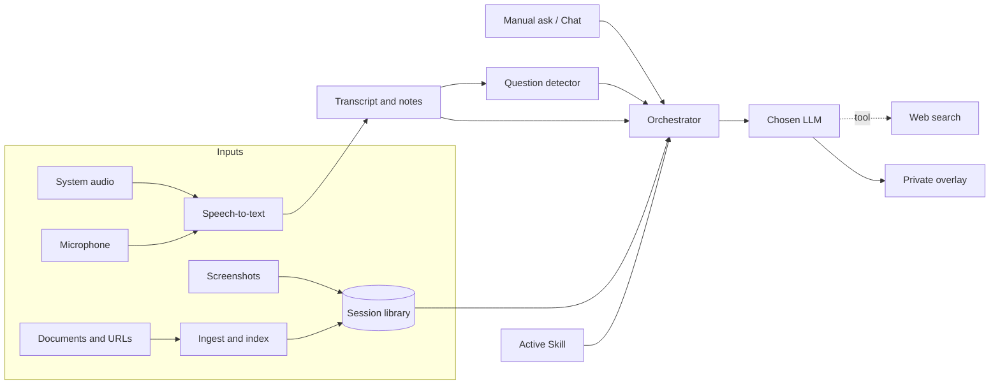

# Sidekick: Product Requirements Document

Nov 4, 2026 · @nitesh

## 1. Overview

Sidekick is a private, real-time AI copilot that listens to a live conversation, keeps a running understanding of it, and helps the user answer questions using their own documents, the meeting history, and the web.

**Problem.** In context-heavy meetings (client calls, technical reviews, interviews, status updates), people struggle to recall details from pre-read documents, earlier discussion, and prior decisions. When a question is directed at them, they have seconds to respond and no time to search.

**Vision.** Every professional walks into a conversation with a well-prepared assistant who has read every document, heard every word said so far, and can quietly hand them the right fact, cue, or full answer at the moment they need it.

**Product summary.** Before a meeting, the user loads context (agenda, specs, decks, AI-generated docs, screenshots) into a Sidekick session. During the meeting, Sidekick transcribes the conversation, maintains live notes, detects questions (especially those directed at the user by name), and surfaces grounded answers with citations in a translucent, resizable overlay that only the user sees. Users can pick the LLM they want and extend Sidekick with custom Skills and Agents, for example an interview coach persona for mock interview practice.

## 2. Goals, non-goals and success metrics

**Goals**

- Let users answer in-meeting questions accurately and confidently, grounded in their own documents and the conversation so far.
- Deliver a suggested answer within 3 seconds of a question being detected.
- Produce useful meeting notes, decisions, and action items with zero manual effort.
- Make Sidekick extensible through user-defined Skills and Agents.
- Stay unobtrusive: translucent, resizable, and private to the user's screen.

**Non-goals (v1)**

- Speaking on the user's behalf or auto-posting into the meeting chat.
- Acting as a full meeting recorder for the whole team (Sidekick is a personal assistant).
- Native mobile apps (desktop first).
- Supporting use in live hiring assessments or exams; interview features target practice and preparation.

**Success metrics**

| Metric | Target (6 months post-launch) |
| --- | --- |
| Answer latency (question detected to first token shown) | p50 under 2 s, p95 under 4 s |
| Question detection precision / recall | Above 85% / above 80% |
| Answers rated helpful by user (thumbs up) | Above 70% |
| Answers with at least one citation when docs are loaded | Above 90% |
| Weekly active users using Sidekick in 2 or more meetings per week | 40% of WAU |
| Sessions with context documents uploaded | Above 60% |
| Custom Skills created per active user | 1.5 on average |
| 4-week retention | Above 35% |

## 3. Target users and use cases

| Persona | Context | What they need from Sidekick |
| --- | --- | --- |
| Priya, Solutions Engineer | Client demos and technical Q&A calls | Instant, accurate product and spec answers with code snippets |
| Arjun, Engineering Manager | Back-to-back reviews, standups, planning | Recall of earlier decisions, live notes, action items |
| Meera, Consultant / Account Manager | Client status meetings driven by shared agendas and decks | Agenda tracking, figures from shared docs, follow-up drafts |
| Rahul, Job seeker | Mock interviews with friends, mentors or coaches | A coach persona that gives cues and structured answer frameworks (STAR, system design) |
| Neha, Student / Researcher | Lectures, study groups, viva practice | Explanations, references, summaries |

**Core use cases**

1. **Prepared meeting.** User loads the agenda and related docs, starts a session, and gets cues and answers grounded in those docs as the discussion moves.
2. **Directed question.** Someone says "Priya, what's the API rate limit?" Sidekick detects the name, pulls the answer from the spec, and shows it with a citation.
3. **Screenshot Q&A.** User captures a shared slide or diagram; Sidekick reads it and explains or answers questions about it.
4. **Mock interview practice.** User activates an "Interview Coach" skill with their resume and target job description; Sidekick gives hints and answer frameworks during practice sessions.
5. **Post-meeting wrap-up.** Sidekick produces a summary, decisions, action items with owners, and a draft follow-up email.

## 4. Functional requirements (MVP)

Priority: P0 = must ship in MVP, P1 = ship if time allows, P2 = later.

### 4.1 Session and context library

| ID | Requirement | Priority |
| --- | --- | --- |
| CTX-1 | User creates a Session (e.g. "Acme QBR, 4 Nov") and attaches documents before or during the meeting | P0 |
| CTX-2 | Supported inputs: PDF, DOCX, PPTX, XLSX, TXT, MD, images, URLs | P0 |
| CTX-3 | Documents are parsed, chunked, embedded and indexed in under 30 s for a 50-page doc | P0 |
| CTX-4 | Pre-meeting brief: auto-generated summary of all loaded docs, key numbers, and likely questions | P1 |
| CTX-5 | Reusable "Knowledge Packs" (e.g. product specs) attachable to any session | P1 |
| CTX-6 | Import from Google Drive, OneDrive/SharePoint, Notion | P2 |

### 4.2 Live listening and transcription

| ID | Requirement | Priority |
| --- | --- | --- |
| LIS-1 | Capture system audio (other participants) and microphone (user) as separate streams | P0 |
| LIS-2 | Streaming speech-to-text with under 1 s lag, English first, then Hindi and Hinglish | P0 |
| LIS-3 | Speaker separation: label the user as "Me" and others as Speaker 1, 2 (renameable) | P0 |
| LIS-4 | Works with any meeting app (Teams, Zoom, Meet, Webex) via OS-level audio capture, no bot joins the call | P0 |
| LIS-5 | Custom vocabulary (product names, acronyms, people) to boost accuracy | P1 |
| LIS-5a | The user's own name and nicknames (from QA-2) are always sent as vocabulary boosts, so directed questions are detected even when STT would misspell the name | P0 |
| LIS-6 | Pause / resume listening with one hotkey; clear visual "listening" indicator | P0 |

### 4.3 Live meeting memory

| ID | Requirement | Priority |
| --- | --- | --- |
| MEM-1 | Rolling meeting notes: topics, decisions, open questions, updated every 30 to 60 s | P0 |
| MEM-2 | Agenda tracking: mark agenda items as covered, in progress, or not yet discussed | P1 |
| MEM-3 | "What did I miss?" one-click recap of the last N minutes | P1 |
| MEM-4 | Action items extracted with owner and due date when mentioned | P1 |

### 4.4 Question detection and answering

| ID | Requirement | Priority |
| --- | --- | --- |
| QA-1 | Detect questions in the transcript (interrogatives and implicit asks like "walk us through...") | P0 |
| QA-2 | Name trigger: questions that address the user by name (plus configured nicknames) are prioritised and auto-answered | P0 |
| QA-3 | Modes: Auto (answer every detected question) or Directed only (name trigger), with Auto on by default, switched with a one-click Auto-answer button in the overlay header (and a hotkey); manual asks work in both modes | P0 |
| QA-4 | Retrieval order: meeting transcript and notes, then session documents, then web search (if enabled) | P0 |
| QA-5 | Answer format: a 1-line cue first, expandable to a full answer, then sources | P0 |
| QA-6 | Every answer cites its source (doc name and page, transcript timestamp, or URL); if nothing is found, Sidekick says so instead of guessing | P0 |
| QA-7 | Code snippets rendered with syntax highlighting and a one-click copy button | P0 |
| QA-8 | Chat section: a dedicated Chat tab where the user types or speaks their own questions at any time, with full session context (transcript, notes, documents, screenshots); supports code snippets and follow-ups, and keeps history per session | P0 |
| QA-9 | Follow-up chips: "Shorter", "More detail", "Give an example", "Explain simply" | P1 |

### 4.5 Screenshot and screen understanding

| ID | Requirement | Priority |
| --- | --- | --- |
| SCR-1 | Hotkey or overlay button to capture a region, window, or full screen at any point during a live meeting, without interrupting the call or notifying the meeting app | P0 |
| SCR-2 | Screenshot is added to session context so later questions can reference it | P0 |
| SCR-3 | Answer from screen: when a question is detected or asked in Chat, Sidekick combines the latest screenshot with the transcript and documents, and cites the screenshot as a source | P0 |
| SCR-4 | Capture-and-ask: take a screenshot and type or speak a question about it in one step (e.g. "What does this error mean?") | P0 |
| SCR-5 | Quick actions on a screenshot: Explain, Summarise, Extract table, Answer question on screen, Debug this code | P1 |
| SCR-6 | Screenshot strip: thumbnails of all captures in the session, with delete and re-ask | P1 |
| SCR-7 | Auto-capture (opt-in): when a question refers to the screen ("this slide", "on the screen"), capture automatically | P2 |

### 4.6 Model selection

| ID | Requirement | Priority |
| --- | --- | --- |
| MOD-1 | User picks the LLM per session (e.g. Claude, GPT, Gemini, local models via Ollama) | P0 |
| MOD-2 | Bring-your-own API key, stored in the OS keychain | P0 |
| MOD-3 | Separate model choices for fast cues (small, low latency) and full answers (large) | P1 |
| MOD-4 | Token and cost meter per session | P1 |

### 4.7 Skills and Agents

| ID | Requirement | Priority |
| --- | --- | --- |
| SKL-1 | A Skill = name, instructions (persona, tone, answer format), attached knowledge, and trigger rules | P0 |
| SKL-2 | No-code Skill builder plus import/export as a file (Markdown with metadata) | P0 |
| SKL-3 | Built-in templates: Interview Coach, Sales Discovery, Technical Architect, Teacher, Negotiation Coach | P1 |
| SKL-4 | Agents = Skills that can use tools (web search, doc search, calculator, code runner, calendar) | P1 |
| SKL-5 | Multiple Skills can be active; user switches with a hotkey or dropdown | P1 |
| SKL-6 | Community Skill gallery to share and install Skills | P2 |

### 4.8 Overlay UI

| ID | Requirement | Priority |
| --- | --- | --- |
| UI-1 | Always-on-top floating panel with adjustable opacity (20% to 100%) so the content behind stays readable | P0 |
| UI-2 | Resizable, draggable, snap to screen edges; remembers position per monitor | P0 |
| UI-3 | Font size controls and compact / expanded modes | P0 |
| UI-4 | Private display: when the user shares their screen (full screen or a window), the Sidekick panel is excluded from the share and from recordings in every meeting and screen-sharing app (Teams, Zoom, Google Meet, Webex, Slack huddles and others), because exclusion is applied at the OS window level rather than per app, so other participants see only what is behind it, like presenter notes | P0 |
| UI-4a | Protection status: the panel shows a clear indicator of whether exclusion is active for the current OS and meeting app | P0 |
| UI-4b | Fallback: if exclusion cannot be guaranteed, Sidekick warns the user and auto-hides when screen sharing starts, or moves answers to second-device mode | P0 |
| UI-4c | Screenshots and answers are never written to shared folders or the clipboard unless the user chooses to | P0 |
| UI-5 | Click-through mode: panel is visible but mouse clicks pass to the app behind it | P1 |
| UI-6 | Global hotkeys: show/hide, ask, screenshot, pause listening, switch Skill, Auto-answer on/off | P0 |
| UI-7 | Tabs: Live Answers, Transcript, Notes, Chat | P0 |
| UI-8 | Light, dark and high-contrast themes | P1 |

### 4.9 Settings: providers and API keys

The user decides which speech-to-text and LLM providers Sidekick uses, and adds their own keys in the app.

| ID | Requirement | Priority |
| --- | --- | --- |
| KEY-1 | Settings screen with separate sections for Speech-to-text, LLM, and Web search, each with a provider dropdown | P0 |
| KEY-2 | Speech-to-text dropdown: Deepgram (default), AssemblyAI, Soniox, Local Whisper (no key needed) | P0 |
| KEY-3 | LLM dropdown: Anthropic (Claude), OpenAI, Google Gemini, Ollama (local, no key needed), with a second dropdown to pick the model for the chosen provider | P0 |
| KEY-3a | Embeddings dropdown: OpenAI (default, `text-embedding-3-small`), Google Gemini, Voyage AI, Ollama (local); reuses a saved key for the same provider | P0 |
| KEY-4 | Key field per provider: masked input with show/hide and paste, plus a "Test connection" button that confirms the key works | P0 |
| KEY-5 | Keys are saved in the OS keychain, never in plain files or logs; after saving, only the last 4 characters are shown | P0 |
| KEY-6 | Keys can be saved for several providers at once; the dropdown selects which one is active, and switching needs no re-entry | P0 |
| KEY-7 | "Remove key" action per provider | P0 |
| KEY-8 | Web search dropdown: Tavily or Brave, with key | P1 |
| KEY-9 | Per-session override: pick a different speech-to-text or LLM provider when starting a session | P1 |
| KEY-10 | Usage view: minutes transcribed and tokens used per provider, with estimated cost | P1 |

## 5. Suggested additional features (V2 and beyond)

These are PM recommendations beyond the original brief, grouped by the value they add.

**Before the meeting**

- **Calendar integration:** auto-create a Session from a calendar invite and pull attached agenda and docs.
- **Prep mode:** "Quiz me" on the loaded docs, and a list of the 10 questions most likely to be asked.
- **Participant context:** notes on who is attending, their role, and past discussions with them (from your own previous sessions).

**During the meeting**

- **Talking points and nudges:** reminders like "You haven't raised the pricing item yet" or "Agenda item 3 is running long".
- **Live fact-check:** flag when something said contradicts the loaded documents (e.g. a wrong date or number).
- **Jargon explainer:** hover or tap any term in the transcript for an instant definition.
- **Live translation:** transcript and answers in the user's preferred language (useful for multilingual teams, including Hindi).
- **Speaking coach (opt-in):** pace, filler words, talk-time ratio, and "you've been talking for 3 minutes" nudges.
- **Bookmarks:** one hotkey to mark an important moment for later review.
- **Answer confidence indicator:** high, medium or low based on source match, so users know when to double-check.

**After the meeting**

- **Auto summary:** decisions, action items with owners, open questions, and unanswered questions.
- **Follow-up drafts:** email or Teams/Slack message ready to send.
- **Export and sync:** to Notion, Confluence, Jira, Asana, Google Docs, or Markdown.
- **Cross-meeting memory:** search across all past sessions ("What did the client say about the deadline last week?").
- **Interview practice report:** after a mock interview, scores and feedback per answer with suggested improvements.

**Platform and power-user**

- **Local / offline mode:** on-device transcription (e.g. Whisper-class models) and local LLMs for sensitive meetings.
- **Team workspace:** shared Knowledge Packs and Skills for sales or support teams, with admin controls.
- **Plugin / MCP support:** let Agents connect to tools like Jira, Salesforce, GitHub, and internal wikis.
- **Voice command:** say "Hey Sidekick" privately (push-to-talk) to ask without typing.
- **Multi-monitor and second-device mode:** show answers on a phone or tablet companion app instead of the main screen.

## 6. Non-functional requirements

| Area | Requirement |
| --- | --- |
| Latency | Transcript lag under 1 s; cue shown under 2 s (p50) after a question ends; full answer streams within 4 s (p95) |
| Performance | Under 10% CPU and under 800 MB RAM while idle-listening on a mid-range laptop; no audio dropouts in the meeting app |
| Platforms | Windows 10/11 and macOS 13+ at launch; Linux later |
| Privacy | Audio is processed in streaming chunks and not stored by default; transcripts and docs stored locally and encrypted at rest (AES-256) |
| Data control | Per-session "delete everything" button; configurable retention (session only, 7 days, 30 days, forever) |
| Security | API keys in OS keychain; TLS 1.2+ for all network calls; no training on user data; SOC 2 path for the team plan |
| Reliability | Graceful degradation: if the LLM fails, transcript and notes keep working; auto-reconnect for STT |
| Accessibility | Keyboard-only operation, screen-reader labels, adjustable font size and contrast |
| Localisation | English at launch; Hindi and Hinglish transcription in V1.1 |

## 7. Technical architecture

Sidekick runs as a desktop app: audio and documents are processed locally, and only the prompt for each answer goes to the chosen LLM.

The full engineering view is in [TECHNICAL.md, section 3](TECHNICAL.md#3-architecture-and-design).

The question detector and the manual ask both hand the orchestrator a request; it pulls recent transcript and matching document chunks, applies the active Skill, and calls the LLM, which may use web search as a tool.

| Layer | Suggested options |
| --- | --- |
| Desktop shell | Tauri 2, with native modules for audio capture and screen-share exclusion |
| Speech-to-text | Deepgram (default), AssemblyAI or Soniox, chosen in Settings; whisper.cpp for local mode |
| Question detection | Rules plus fuzzy name matching, measured on labelled sets (see TECHNICAL.md 3.2); a small fast model only if real meetings show the need |
| Embeddings and index | Provider embeddings or local models; SQLite with sqlite-vec, or LanceDB |
| LLM access | Provider SDKs (Anthropic, OpenAI, Google) and Ollama for local models, behind one router |
| Web search | Search API (e.g. Brave, Tavily, Bing) exposed as a tool to the model |
| Skills format | Markdown files with metadata (name, instructions, tools, triggers), versioned locally |

## 8. Trust, consent, legal and ethical considerations

Sidekick records and processes other people's voices, so consent and transparency must be designed in from day one, not added later. This is also a competitive advantage: enterprises will only approve tools they can trust.

**Recording consent.** Laws differ by country and state. Many US states, parts of the EU (under GDPR), and company policies require all participants to consent to recording or transcription. India's DPDP Act 2023 also governs processing of personal data, including voice.

- Before each session starts, the user confirms that participants are aware of and agree to transcription. Sidekick does not send or post any notice on the user's behalf.
- Offer a "Transcribe me only" mode (microphone only) for situations where others have not agreed.

**Minimum disclosure before a session (proposed).** Sidekick should not start transcribing other people until the user has confirmed consent for that session.

Why this is needed: in "one-party consent" places (US federal law and most US states), one participant may record a conversation they are part of. In "all-party consent" places (e.g. California, Florida, Illinois, Washington, Pennsylvania, Massachusetts), everyone must agree. Under GDPR in the EU and India's DPDP Act, transcribing someone's voice is processing their personal data, so people must be informed and have a lawful basis. Not storing the audio does not remove this obligation: live transcription still counts. Many employers and clients also ban unannounced recording by policy.

Proposed minimum (to be confirmed with legal counsel before launch):

1. **Session start confirmation (required):** before listening begins, the user confirms "Participants are aware of and agree to transcription", or picks "Transcribe me only". Listening to others does not start without this confirmation.
2. **No automatic notice:** informing participants is the user's responsibility; Sidekick does not post or send messages into the meeting.
3. **Local consent log:** Sidekick records the confirmation for each session (date, option chosen) on the device, so the user can show it later if asked.

**Private overlay.** Hiding the panel from screen share is a legitimate need (like presenter notes, it keeps your private notes off a shared screen). However, it can also be used to conceal assistance where it isn't allowed.

- Position and market Sidekick as a meeting copilot and practice tool, not a way to secretly get help.
- Interview features target mock interviews and preparation. Using hidden AI help in a real hiring interview or exam typically breaches the employer's or institution's rules and can lead to disqualification; Sidekick's terms of use should say so clearly.
- Avoid "undetectable" or "cheat" messaging in marketing. It creates reputational, platform-policy and legal risk, and enterprise buyers will reject it.

**Accuracy and accountability.** Answers can be wrong. Always show sources and a confidence indicator, and remind users that they are responsible for what they say.

**Data minimisation.** Store only what is needed, keep data local by default, and make deletion easy and verifiable.

## 9. Risks and mitigations

| Risk | Impact | Mitigation |
| --- | --- | --- |
| Answers are slow, so the moment passes | High | Two-tier answers (fast cue model, then full answer); streaming; pre-computed likely Q&A from docs |
| Hallucinated or wrong answers | High | Retrieval-first prompting, mandatory citations, "not found in your docs" fallback, confidence indicator |
| Screen-share exclusion doesn't work on some OS versions or capture methods | High | Use native OS APIs (Windows display affinity, macOS window sharing settings), test per OS and meeting app, show live protection status, fall back to second-device mode |
| Consent and privacy violations | High | Consent prompts, mic-only mode, local storage, admin policies (section 8) |
| Misuse for cheating in real interviews or exams | Medium | Clear terms of use, practice-focused positioning, no "undetectable" marketing |
| Poor transcription with accents, crosstalk, or Hinglish | Medium | Custom vocabulary, speaker-separated streams, pick STT vendors strong on Indian English |
| High LLM and STT cost per hour | Medium | Small models for detection and cues, caching, BYO key, usage caps on free tier |
| Meeting apps block audio capture or change APIs | Medium | OS-level capture instead of bot integrations; monitor updates |
| Over-distraction for the user | Low | Directed-only mode, cue-first layout, do-not-disturb |

## 10. Release plan and roadmap

The MVP targets 14 weeks from kickoff with a small team (2 to 3 engineers, 1 designer, 1 PM); each phase starts only when the gate before it is met.

> **Roadmap diagram missing.** The original roadmap (4 phases: Prototype, MVP, V1 launch, V2; 3 gates) was an embedded diagram that did not survive the Markdown export. Phase 0 engineering milestones are listed in [TECHNICAL.md, section 14.1](TECHNICAL.md#141-roadmap). Fill in phase scope and gate criteria here.

Phase 0 exists to retire the two biggest technical risks early: reliable audio capture across meeting apps, and screen-share exclusion across operating systems.

## 11. Open questions

**Decided**

- No separate hosted backend: the backend ships inside the desktop app bundle and calls the LLM providers directly.
- Auto-answer is on by default; users can switch to directed-only with the Auto-answer button.
- Pricing is out of scope for this PRD for now.
- No Microsoft Teams app or bot integration is needed; Sidekick works with every meeting app through OS-level capture.
- Desktop framework: Tauri 2 (Rust backend, React + TypeScript frontend). Details are in the Sidekick Technical Architecture doc.
- Speech-to-text: Deepgram Nova-3 is the default (starting on its free credits); AssemblyAI, Soniox and local Whisper are selectable in Settings (section 4.9).

**Still open**

- [ ] Test Deepgram, Soniox and local Whisper on real Hinglish meeting audio and confirm the default.
- [ ] Confirm the proposed minimum disclosure in section 8 with legal counsel, per launch region.
