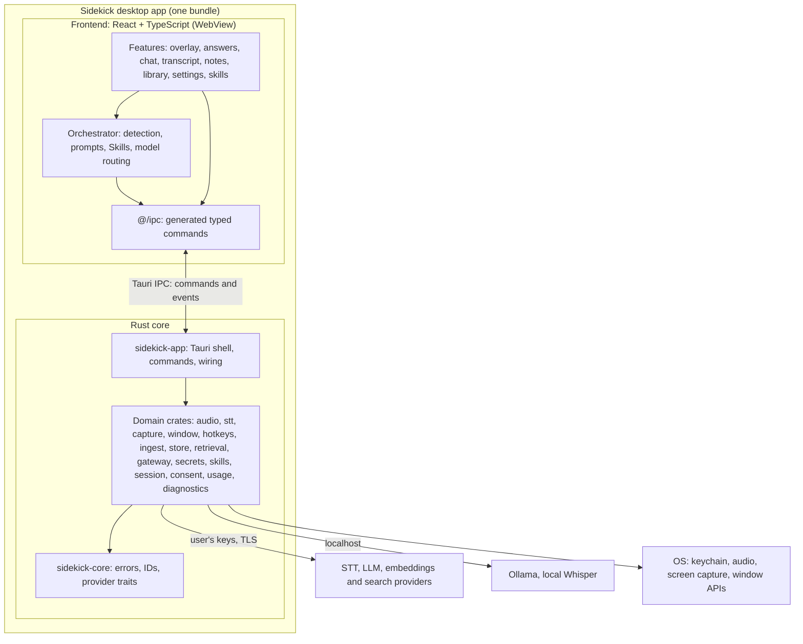
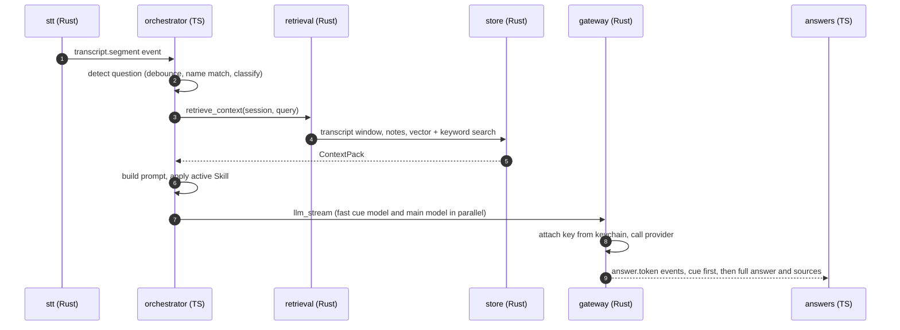

# Sidekick: Technical Documentation

Nov 5, 2026 · @nitesh

## 1. Overview and context

This document is the single source of truth for how Sidekick is built, run, tested, released and maintained. When code and this document disagree, one of them is a bug: fix whichever is wrong in the same pull request. Product requirements live in the Sidekick PRD; this document covers the engineering.

### 1.1 Purpose

Sidekick is a private, real-time AI meeting copilot for Windows and macOS. It listens to a live conversation, keeps rolling notes, detects questions (especially ones addressed to the user by name), and suggests grounded answers from the user's documents, the meeting so far, screenshots, and the web. Answers appear in a translucent overlay that is excluded from screen sharing.

The problem it solves: in context-heavy meetings, people can't recall details from pre-reads and earlier discussion fast enough to answer questions directed at them.

### 1.2 Scope

| In scope (v1) | Out of scope (v1) |
| --- | --- |
| Desktop app for Windows 10/11 and macOS 13+ | Mobile apps, Linux, web app |
| Live transcription of system audio and microphone | Meeting bots or Microsoft Teams app integration |
| Document upload, local indexing and retrieval | Hosted backend, user accounts, cloud sync |
| Question detection, Auto-answer, Chat | Speaking or posting into the meeting on the user's behalf |
| Screenshot capture and analysis | Team workspaces and admin controls |
| Skills and Agents | Pricing, billing and licensing |
| User-selected providers with their own API keys | Use in live hiring assessments or exams |
| Private overlay excluded from screen share |  |

### 1.3 Audience

| Reader | Read these sections first |
| --- | --- |
| Developer (building features) | 3, 5, 6, 7, 8 |
| Release owner | 8, 9 |
| Maintainer (fixing issues) | 10, 11, 13 |
| End user | 12 |
| Reviewer / architect | 2, 3, 4, 11 |

### 1.4 Glossary

| Term | Meaning |
| --- | --- |
| Session | One meeting in Sidekick: its documents, transcript, notes, screenshots and answers |
| Context library | The documents and screenshots attached to a session |
| Segment | One finalised piece of transcript from one speaker |
| Cue | A one-line hint shown before the full answer |
| Auto-answer | Mode where every detected question gets an answer (default on) |
| Directed question | A question that addresses the user by name or nickname |
| Skill | A Markdown file defining persona, instructions, knowledge and triggers |
| Agent | A Skill that may call tools (web search, doc search, calculator) |
| Provider | An external or local service for speech-to-text, LLM or web search |
| Adapter | Rust code implementing a provider behind a common interface |
| API gateway | The Rust module that attaches keys and calls providers |
| IPC | Inter-process communication between the React frontend and Rust core (Tauri commands and events) |
| STT | Speech-to-text |
| VAD | Voice activity detection: skipping silence before STT |
| RAG | Retrieval-augmented generation: adding retrieved document chunks to the prompt |
| Chunk | A section of a document (about 500 tokens) stored with its embedding |
| Embedding | A vector representing the meaning of a chunk, used for similarity search |
| Capture exclusion | OS feature that hides a window from screen sharing and recording |
| ADR | Architecture decision record |

### 1.5 Document control

| Field | Value |
| --- | --- |
| Version | 1.4 (draft) |
| Owner | @nitesh |
| Status | Draft, in development (Phase 0) |
| Review cadence | At every minor release, and whenever an ADR is added |

**Change log**

| Version | Date | Change |
| --- | --- | --- |
| 1.0 | Nov 5, 2026 | First full draft |
| 1.1 | Nov 5, 2026 | Repo scaffolded. Added ADR-011 (Cargo workspace, one crate per module) and ADR-012 (frontend feature boundaries); updated 3.2, 3.5, 6, 7.1, 9.1, 14; added 7.8 module boundaries; diagrams redrawn in Mermaid; proposed changes listed in 14.6 |
| 1.2 | Nov 5, 2026 | Added the implementation task list ([Task.md](Task.md)) and linked it from 1.6 and 14.1 |
| 1.3 | Nov 5, 2026 | Applied P1–P5 (14.6): `EmbeddingProvider` and ADR-013; `web_search` command; per-question concurrency; FTS sync triggers; name vocabulary P0 |
| 1.4 | Nov 5, 2026 | T-013: `session` crate (consent merged into it), migration 0002 (consent log outlives sessions), session commands and events; SQL ownership rule in 7.8 |

### 1.6 Related documents

- **[Sidekick PRD](PRD.md)**: product requirements, IDs referenced here (CTX, LIS, MEM, QA, SCR, MOD, SKL, UI, KEY).
- **Sidekick Technical Architecture**: earlier architecture summary, now superseded by this document (not kept in the repo).
- **[Implementation tasks](Task.md)**: every task with its tests and status; updated with each change.
- **[Architecture decision records](adr/README.md)**: one file per decision, summarised in section 3.5.
- External references: Tauri 2 docs, Deepgram / AssemblyAI / Soniox API docs, Anthropic / OpenAI / Gemini API docs, sqlite-vec docs.

## 2. Requirements

### 2.1 Functional requirements

Full requirements with priorities are in the PRD. This table maps each requirement group to the modules that implement it (module names are defined in section 3.2).

| PRD group | What it covers | Implementing modules |
| --- | --- | --- |
| CTX | Sessions, document upload, indexing, pre-meeting brief | `session`, `ingest`, `store`, frontend `library` |
| LIS | Audio capture, streaming STT, speaker labels, pause/resume | `audio`, `stt`, frontend `transcript` |
| MEM | Rolling notes, agenda tracking, recap, action items | frontend `orchestrator` (notes job), `store` |
| QA | Question detection, Auto-answer, retrieval, cited answers, code snippets, Chat | frontend `orchestrator`, `retrieval`, `gateway`, frontend `answers`, `chat` |
| SCR | Screenshot capture, answer from screen, capture-and-ask | `capture`, `store`, frontend `orchestrator` |
| MOD | Model choice, two-tier models, cost meter | `gateway`, `usage`, frontend `settings` |
| SKL | Skills and Agents, templates, import/export | `skills`, frontend `orchestrator`, frontend `skills` |
| UI | Overlay, opacity, resize, capture exclusion, hotkeys, tabs | `window`, `hotkeys`, frontend `overlay` |
| KEY | Provider dropdowns, keys in keychain, test connection | `secrets`, `gateway`, frontend `settings` |

### 2.2 Non-functional requirements

| ID | Category | Requirement | How it's verified |
| --- | --- | --- | --- |
| NFR-1 | Latency | Transcript lag under 1 s from end of speech | Timestamp diff in diagnostics panel |
| NFR-2 | Latency | Cue visible under 2 s (p50) and full answer starts under 4 s (p95) after a question ends | Latency metrics in local diagnostics |
| NFR-3 | Resource use | Under 10% CPU and under 800 MB RAM while listening, on an 8 GB laptop | 1-hour soak test (section 13) |
| NFR-4 | Reliability | No audio dropouts in the meeting app; STT auto-reconnects within 3 s | Soak test with network interruption |
| NFR-5 | Reliability | If the LLM fails, transcript and notes keep working | Fault-injection test (mock gateway errors) |
| NFR-6 | Privacy | Audio is never written to disk unless the user enables it | Code review + test asserting no audio files |
| NFR-7 | Security | API keys only in OS keychain; never in SQLite, logs, IPC responses or crash reports | Unit tests + log scanning test |
| NFR-8 | Security | Local data encrypted at rest | Integration test opening DB without key fails |
| NFR-9 | Privacy | Overlay excluded from screen capture on supported OS versions, with visible status | Manual checklist per OS and meeting app |
| NFR-10 | Accessibility | Full keyboard operation, screen-reader labels, adjustable font size | Axe checks in Playwright + manual pass |
| NFR-11 | Install | Installer under 30 MB; no extra installs needed | CI artifact size check |
| NFR-12 | Compatibility | Windows 10 (22H2+) and 11; macOS 13+ on Apple Silicon and Intel | CI matrix + manual smoke test |
| NFR-13 | Startup | App window ready under 2 s on a warm start | E2E timing test |

### 2.3 Assumptions

- The user runs Sidekick on their own machine and has permission to install apps and grant microphone and screen recording access.
- The user provides their own API keys, or uses local models (Whisper, Ollama).
- The user confirms participant consent before each session (PRD section 8).
- A stable internet connection is available for cloud providers; local mode works offline.
- Meetings are mostly in English, Indian English or Hinglish at launch.

### 2.4 Constraints

- No hosted backend: everything runs in the desktop app.
- Capture exclusion depends on OS behaviour and can't be guaranteed for every capture method (see ADR-007).
- macOS system audio capture requires macOS 14.6+ and the System Audio Recording permission (ADR-014). On macOS 13.0–14.5, sessions run in "Transcribe me only" mode.
- Provider rate limits and pricing are outside our control.
- Single developer at the start, so the design favours simplicity over flexibility.

### 2.5 Dependencies

| Dependency | Type | Impact if unavailable |
| --- | --- | --- |
| STT provider (Deepgram by default) | External API | No live transcript; fall back to another provider or local Whisper |
| LLM provider | External API | No answers; transcript and notes continue |
| Web search provider | External API | Answers rely on documents and transcript only |
| OS keychain | OS service | Keys can't be saved; app prompts for key each session |
| WebView2 (Windows) | OS component | App won't start; installer adds it |
| Tauri, Rust crates, npm packages | Open-source libraries | Pinned in lockfiles; see section 14.3 |

### 2.6 Acceptance criteria (v1)

v1 is accepted when all of the following pass on both Windows and macOS:

- [ ] All P0 PRD requirements are implemented and covered by at least one automated test.
- [ ] NFR-1, NFR-2 and NFR-3 targets are met in a 60-minute recorded test meeting.
- [ ] A directed question about a fact in an uploaded 50-page PDF gets a correct, cited answer in at least 8 of 10 trials.
- [ ] The overlay is not visible to other participants when sharing a full screen on Teams, Zoom, Google Meet and Webex.
- [ ] No API key appears in the database file, logs, or crash reports (automated scan).
- [ ] Installers are signed, install with no extra steps, and auto-update from the previous version.
- [ ] The consent confirmation blocks listening to others until confirmed.

## 3. Architecture and design

### 3.1 High-level architecture

Sidekick is one desktop app with three layers inside a single bundle, plus the external services it calls using the user's own keys.



The frontend never talks to the internet. It sends requests to the Rust core over Tauri IPC; the API gateway reads the right key from the OS keychain, calls the provider, and streams results back as events. Local models (Whisper in-process, Ollama on localhost) are reached the same way.

### 3.2 Components and responsibilities

**Rust core** (Cargo workspace, see [ADR-011](adr/0011-cargo-workspace-one-crate-per-module.md) and section 7.8)

Each module below is its own crate at `crates/<module>/`, named `sidekick-<module>`. `crates/core` (`sidekick-core`) holds shared types: `SidekickError`, IDs and provider traits. `src-tauri/` (`sidekick-app`) is the thin shell that registers IPC commands and wires crates together. Crates are created when their first code lands; the **Status** column tracks this.

| Crate | Responsibility | Status |
| --- | --- | --- |
| `audio` | Microphone and system audio as separate 16 kHz mono streams of 50 ms frames via cpal (WASAPI loopback on Windows, Core Audio tap on macOS 14.6+); windowed-sinc resampler; energy VAD flag per frame; pause/resume/stop; WAV `FixtureSource` for tests and `SIDEKICK_AUDIO_FIXTURE`; never writes audio (ADR-014) | Done (manual device checks pending) |
| `stt` | `SttProvider` (one `run` per audio stream), Deepgram Nova-3 WebSocket adapter (interim + final results, diarization for system audio, `keyterm` boosts, keep-alives, silence not sent with a `Timeline` mapping provider time back to meeting time, reconnect with backoff and replay of unfinalised and buffered audio, up to 10 s), `DeepgramVerifier` for key checks, mock provider; speaker labels `me` / `speaker_N` | Done (live latency check pending) |
| `capture` | Region, window and full-screen screenshots; downscale and encode | Not started |
| `window` | Capture-exclusion status rules per OS and version (Windows build 19041+ protected; macOS 13–14 protected, 15+ not guaranteed because ScreenCaptureKit can bypass it; Linux unavailable) and the auto-hide rule. Pure logic: the shell applies `set_content_protected(true)` to every window at startup. Transparency, click-through and screen-share detection still to come (T-029) | Started (status done; manual checklist pending) |
| `hotkeys` | Actions, defaults (12.3) and validation (normalise, one modifier minimum, no duplicates, every action once). The shell registers them with `tauri-plugin-global-shortcut`, handles show/hide itself, emits `hotkey-pressed`, and only saves a new set after the OS accepts it | Done (Linux verified; Windows/macOS check pending) |
| `ingest` | Parse documents, split into chunks, request embeddings, write to store | Not started |
| `store` | SQLCipher database (raw 256-bit key from `secrets`), WAL, foreign keys; migrations with pre-migration backups; sqlite-vec registered for every connection; `settings` (raw JSON) and `vectors` (per-model `chunk_vectors`) modules; repository modules added per feature | Done |
| `settings` | Typed `Settings` (providers and models for STT, LLM, embeddings, search; Auto-answer; retention) with defaults and partial `SettingsPatch` updates; one `settings` row per section; unreadable sections fall back to defaults | Done |
| `retrieval` | Vector and keyword search over chunks; assemble context packs (transcript window, notes, chunks, screenshot) | Not started |
| `gateway` | Provider catalog (all kinds, for Settings); `LlmProvider` adapters (Anthropic, mock; OpenAI, Gemini, Ollama in T-026); the only place keys are attached; streaming via an `AnswerSink` the shell implements; retries with backoff and `Retry-After`; cancellation; key checks before saving. `SearchProvider` and `EmbeddingProvider` arrive with T-046 and T-017 | Started (LLM done) |
| `secrets` | `KeyStore` trait with `KeychainStore` (OS keychain, service `sidekick`) and `MemoryStore` (tests, mock mode); keys as `SecretString`; `KeyStatus` exposes only the last 4 characters; account names restricted to `[a-z0-9-]` | Done |
| `skills` | Load, validate, import and export Skill files | Not started |
| `session` | Session lifecycle (draft → live ⇄ paused → ended) and consent rules as pure functions; SQL for `sessions`, `consent_log` and `transcript_segments`; `LiveSession` runs one audio capture + one STT run per allowed stream, falling back to the mic with a warning if system audio is unavailable | Started (T-013) |
| `consent` | Merged into `session`: consent is part of the session lifecycle (`streams_for(consent)` decides which streams may start) | Merged |
| `usage` | Count STT minutes and LLM tokens per provider; estimate cost | Not started |
| `diagnostics` | `Recorder`: per-stage latency samples (last 15 min, max 1,000) with nearest-rank p50/p95 and health against the 10.1/13.1 targets; the gateway records LLM first-token time; the frontend reports question→cue/answer via `record_latency`. Health checks and log export arrive with T-031 | Started (latency done) |
| `core` | `SidekickError` and error codes (5.4); IDs and provider traits as they are needed | Started |

**Frontend** (`src/`, see [ADR-012](adr/0012-frontend-feature-modules-with-public-index.md))

| Module | Responsibility |
| --- | --- |
| `overlay` | Window chrome: opacity, font size, compact/expanded, protection indicator, tabs |
| `answers` | Live Answers tab: cue, full answer, sources, follow-up chips, code blocks |
| `chat` | Chat tab: user questions with session context |
| `transcript` | Transcript tab: loads saved lines, applies live `transcript-partial` / `transcript-segment` events batched every 50 ms (`lib/batcher`), shows partial text until the final line arrives, rename/merge speakers, bookmarks, listening indicator |
| `notes` | Rolling notes, decisions, action items |
| `library` | Session documents and screenshot strip |
| `settings` | Settings window: provider and model dropdowns per kind (STT, LLM, embeddings, web search), masked key field with show/hide, paste, Save and test, Test connection, Remove; Auto-answer and retention. Opened with `open_settings`; Close hides the window |
| `skills` | Skill builder, templates, import/export |
| `orchestrator` | Question detection, prompt building, Skill application, notes job, two-tier model routing |
| `ipc` | Generated `bindings.ts` (section 5.6), browser mocks (`mock.ts`) that mirror every command, `answerEvents` for answer streams, and window helpers (`currentWindow`, `hideCurrentWindow`). The only module that imports Tauri |

### 3.3 Key workflow: answering a question



*Redrawn from the original embedded diagram, which did not survive export; step numbering may differ slightly from the original.*

Steps 3 to 8 must finish within the NFR-2 budget. The cue in step 9 comes from a small, fast model running in parallel with the full answer from the main model. Chat questions start at step 3. Screenshot questions add the latest screenshot to the context in step 4.

**Other key workflows**

| Workflow | Path |
| --- | --- |
| Document upload | `library` → `ingest_document` → `ingest` parses and chunks → `gateway` embeds with the active `EmbeddingProvider` → `store` writes chunks and vectors → `ingest.progress` events |
| Screenshot | Hotkey → `capture` → `store` saves image → `screenshot.captured` event → capture-and-ask continues at step 3 above |
| Rolling notes | Every 45 s, `orchestrator` sends new transcript plus current notes to the fast model → `save_notes` |
| Session start | `start_session` → `consent` checks confirmation → `audio` and `stt` start → `session.state` event |

### 3.4 Technology stack with versions

Major versions are fixed here; exact versions are pinned in `Cargo.lock` and `pnpm-lock.yaml`. Confirm current stable versions at project setup and update this table.

| Layer | Technology | Version |
| --- | --- | --- |
| App framework | Tauri | 2.x |
| Backend language | Rust (edition 2024) + Tokio | Stable toolchain, pinned in `rust-toolchain.toml` |
| Frontend | React + TypeScript | React 19.x, TypeScript 5.9 (TypeScript 7 is out but typescript-eslint doesn't support it yet) |
| Build tool | Vite | Current major |
| Package manager and runtime | pnpm 10 + Node.js | Node 24 LTS in CI; 22+ works locally (`engines` in `package.json`) |
| Styling | Tailwind CSS + shadcn/ui | Tailwind 4.x |
| State | Zustand | 5.x |
| Markdown and code | react-markdown + Shiki | Current major |
| Database | SQLite via rusqlite 0.37 (`bundled-sqlcipher-vendored-openssl`) + sqlite-vec 0.1 + rusqlite_migration 2 | OpenSSL is built from source, so builds need Perl (preinstalled on CI runners and macOS; on Windows use Strawberry Perl) |
| Secrets | keyring crate | Current |
| HTTP and WebSocket | reqwest + tokio-tungstenite | Current |
| Local STT | whisper.cpp via whisper-rs | Current |
| Audio I/O | cpal + hound (WAV fixtures) | cpal 0.18, hound 3 |
| VAD | Energy VAD with adaptive noise floor (ADR-014); Silero VAD (ONNX) only if measurements need it | n/a |
| Document parsing | pdf-extract, docx-rs, calamine, zip + quick-xml | Current |
| IPC types | tauri-specta + specta + specta-typescript | Pinned exactly (`=2.0.0-rc.21`, `=2.0.0-rc.22`, `=0.0.9`) because these are pre-release and must match each other |
| Logging | tracing + tracing-appender | Current |
| Linting | ESLint 9 (typescript-eslint strict, react-hooks, jsx-a11y) + Prettier; rustfmt + clippy | Current |
| Testing | cargo test, Vitest, React Testing Library, Playwright, WebdriverIO + @wdio/tauri-service | WebdriverIO 9.x |

### 3.5 Architecture decision records

| ID | Decision | Alternatives considered | Rationale and trade-offs |
| --- | --- | --- | --- |
| ADR-001 | Tauri 2 for the desktop app | Electron | Smaller installer and much lower RAM/CPU for an always-running app. Trade-off: Rust learning curve; Playwright can't drive the full app |
| ADR-002 | No hosted backend; app calls providers directly | Backend proxy server | Zero server cost, better privacy, simpler. Trade-off: no central usage tracking or key management |
| ADR-003 | Orchestration and prompts in TypeScript; OS, storage and network in Rust | All logic in Rust | Faster iteration and lower AI-assisted coding cost. Trade-off: two languages and an IPC boundary to maintain |
| ADR-004 | SQLite + sqlite-vec + SQLCipher for all local data | LanceDB, Chroma, separate files | One encrypted file, simple backup, mature tooling. Trade-off: brute-force vector search, fine below about 100k chunks |
| ADR-005 | Deepgram Nova-3 as default STT, behind a provider trait | Single vendor; local-only Whisper | Strong streaming latency and free credits; trait lets the user switch. Trade-off: adapters to maintain |
| ADR-006 | OS-level audio capture | Meeting bots per platform | Works with every meeting app, no platform approvals. Trade-off: OS-specific code and permissions |
| ADR-007 | Capture exclusion via OS APIs, with visible status and fallback (auto-hide, second device) | No exclusion | Keeps private notes off shared screens. Trade-off: depends on OS and capture method; can't be fully guaranteed |
| ADR-008 | API keys in OS keychain only | Encrypted file in app data | OS-grade protection, no key management code. Trade-off: keychain prompts on some systems |
| ADR-009 | Skills as Markdown files with YAML front matter | JSON, database rows | Human-readable, easy to share and diff. Trade-off: needs schema validation |
| ADR-010 | WebdriverIO for full-app E2E; Playwright for UI-only tests | Playwright only | Only WebdriverIO drives a Tauri app on both OSes. Trade-off: two test runners |
| ADR-011 | Cargo workspace: one crate per Rust module; `sidekick-core` for shared types; `src-tauri` is a thin shell | One crate with modules | Compiler-enforced boundaries, crates testable without Tauri, faster incremental builds. Trade-off: more `Cargo.toml` files |
| ADR-012 | Frontend features expose a public `index.ts`; all Rust calls through `@/ipc`; enforced by ESLint | Convention only; eslint-plugin-boundaries | Features can change freely behind their API; UI runs in a browser with mocks. Trade-off: relative cross-feature imports aren't caught, so use the `@/features/<name>` alias |
| ADR-013 | Embeddings behind their own `EmbeddingProvider`; default OpenAI `text-embedding-3-small`; vector table sized per model | Embed on `LlmProvider`; fixed 1024 dims | Anthropic has no embeddings API; any model can be used without a schema migration. Trade-off: changing model means re-embedding |
| ADR-014 | Audio capture with cpal (WASAPI loopback, Core Audio tap); macOS system audio needs 14.6+; energy VAD first | ScreenCaptureKit (macOS 13+); Silero VAD now | One tested code path; smaller installer. Trade-off: macOS 13.0–14.5 transcribe the user only |

Each decision has its own file in [`docs/adr/`](adr/README.md). New decisions get the next ADR number (copy [`docs/adr/template.md`](adr/template.md)) and are added here in the same pull request as the code change.

### 3.6 Integration points

| Service | Protocol | Auth | Used for |
| --- | --- | --- | --- |
| Deepgram | WebSocket (streaming, `wss://api.deepgram.com/v1/listen`, Nova-3, linear16 16 kHz) | `Authorization: Token <key>`; key check via `GET /v1/projects` | Default live STT |
| AssemblyAI | WebSocket (streaming) | API key in header | Alternative STT |
| Soniox | WebSocket (streaming) | API key | Alternative STT, multilingual |
| Anthropic | HTTPS + server-sent events (`anthropic-version: 2026-10-21`, so no sampling parameters) | `x-api-key` header | LLM answers, vision. Defaults: `claude-opus-5-5` for full answers, `claude-haiku-5-5` for cues (MOD-3). Server-side refusal fallback (`fallbacks: "default"`, beta `server-side-fallback-2026-07-01`) is on for models that support it; a final `refusal` stop reason is shown as a neutral notice |
| OpenAI | HTTPS + server-sent events | Bearer token | LLM answers, vision, embeddings (default: `text-embedding-3-small`, 1536 dims) |
| Voyage AI | HTTPS | Bearer token | Embeddings (Anthropic's recommended partner; Anthropic has no embeddings API) |
| Google Gemini | HTTPS streaming | API key header | LLM answers, vision, embeddings |
| Ollama | HTTP on localhost:11434 | None | Local LLM and embeddings |
| Tavily / Brave | HTTPS | API key | Web search tool |
| OS keychain | OS API | User login | Secret storage |
| GitHub Releases | HTTPS | Signed update manifest | Auto-updates |

### 3.7 Deployment topology

Sidekick runs entirely on the user's machine; there are no servers, regions or networks to operate.

| Element | Detail |
| --- | --- |
| Processes | Tauri main process (Rust core); WebView process (UI); optional Ollama process run by the user |
| Windows | One overlay window (transparent, always on top, capture-excluded) and one Settings window |
| Network egress | Only to the selected providers and the update server, over TLS 1.2+ |
| Data location (Windows) | `%APPDATA%/com.sidekick.app` (Roaming AppData) |
| Data location (macOS) | `~/Library/Application Support/com.sidekick.app` |
| Environments | Local dev build; Beta update channel; Stable update channel (section 9.2) |

## 4. Data

All data lives in one SQLCipher-encrypted SQLite file, `sidekick.db`, in the app data folder (section 3.7). The database key is a random 256-bit value generated on first run and stored in the OS keychain as `sidekick/db-key`.

### 4.1 Data model

| Entity | Relationship | Notes |
| --- | --- | --- |
| Session | Has many documents, segments, screenshots, questions, bookmarks, action items; one notes record; one consent record | Root of everything captured in a meeting |
| Knowledge pack | Has many documents | Reusable docs attachable to any session |
| Document | Belongs to a session or a knowledge pack; has many chunks | Original file not kept by default, only extracted text |
| Chunk | Belongs to a document; has one vector and one full-text row | About 500 tokens with 50-token overlap |
| Transcript segment | Belongs to a session | One finalised utterance from one speaker |
| Screenshot | Belongs to a session | Image stored as an encrypted BLOB |
| Question | Belongs to a session; may link to a segment | Source: detected, chat or screenshot |
| Answer | Belongs to a question | Cue, full answer, sources, model, latency, tokens |
| Skill | Indexed from a Markdown file | The file is the source of truth |
| Usage record | May belong to a session | STT minutes, tokens, searches per provider |
| Setting | Key-value | Active providers, models, preferences (never keys) |

### 4.2 Schema

```sql
-- Migration 0001_init.sql (schema version tracked with PRAGMA user_version)
CREATE TABLE sessions (
  id              TEXT PRIMARY KEY,            -- UUID v7
  title           TEXT NOT NULL,
  status          TEXT NOT NULL CHECK (status IN ('draft','live','paused','ended')),
  stt_provider    TEXT NOT NULL,
  llm_provider    TEXT NOT NULL,
  llm_model       TEXT NOT NULL,
  skill_id        TEXT REFERENCES skills(id),
  auto_answer     INTEGER NOT NULL DEFAULT 1,
  retention       TEXT NOT NULL DEFAULT '30d',  -- 'session','7d','30d','forever'
  created_at      INTEGER NOT NULL,             -- Unix ms
  started_at      INTEGER,
  ended_at        INTEGER
);

CREATE TABLE knowledge_packs (
  id TEXT PRIMARY KEY, name TEXT NOT NULL, created_at INTEGER NOT NULL
);

CREATE TABLE documents (
  id              TEXT PRIMARY KEY,
  session_id      TEXT REFERENCES sessions(id) ON DELETE CASCADE,
  pack_id         TEXT REFERENCES knowledge_packs(id) ON DELETE CASCADE,
  name            TEXT NOT NULL,
  mime_type       TEXT NOT NULL,
  size_bytes      INTEGER NOT NULL,
  sha256          TEXT NOT NULL,
  page_count      INTEGER,
  embedding_model TEXT NOT NULL,
  status          TEXT NOT NULL CHECK (status IN ('queued','parsing','embedding','ready','failed')),
  error           TEXT,
  created_at      INTEGER NOT NULL,
  CHECK (session_id IS NOT NULL OR pack_id IS NOT NULL)
);

CREATE TABLE chunks (
  id          INTEGER PRIMARY KEY,
  document_id TEXT NOT NULL REFERENCES documents(id) ON DELETE CASCADE,
  ord         INTEGER NOT NULL,
  page        INTEGER,
  text        TEXT NOT NULL,
  token_count INTEGER NOT NULL
);
CREATE INDEX idx_chunks_document ON chunks(document_id, ord);

-- chunk_vectors is NOT created by this migration: its size depends on the active
-- embedding model (ADR-013). The store creates it on first use:
--   CREATE VIRTUAL TABLE chunk_vectors USING vec0(chunk_id INTEGER PRIMARY KEY, embedding float[<dims>]);
-- and records the dimension in settings key 'embedding.dims'. Changing model drops
-- and recreates it, then the re-embedding job refills it (section 4.5).

CREATE VIRTUAL TABLE chunks_fts USING fts5(text, content='chunks', content_rowid='id');

-- Keep the external-content FTS table in sync with chunks.
CREATE TRIGGER chunks_ai AFTER INSERT ON chunks BEGIN
  INSERT INTO chunks_fts(rowid, text) VALUES (new.id, new.text);
END;
CREATE TRIGGER chunks_ad AFTER DELETE ON chunks BEGIN
  INSERT INTO chunks_fts(chunks_fts, rowid, text) VALUES ('delete', old.id, old.text);
END;
CREATE TRIGGER chunks_au AFTER UPDATE ON chunks BEGIN
  INSERT INTO chunks_fts(chunks_fts, rowid, text) VALUES ('delete', old.id, old.text);
  INSERT INTO chunks_fts(rowid, text) VALUES (new.id, new.text);
END;

CREATE TABLE transcript_segments (
  id            INTEGER PRIMARY KEY,
  session_id    TEXT NOT NULL REFERENCES sessions(id) ON DELETE CASCADE,
  speaker_label TEXT NOT NULL,                  -- 'me', 'speaker_1', or a renamed label
  is_user       INTEGER NOT NULL,
  text          TEXT NOT NULL,
  start_ms      INTEGER NOT NULL,               -- offset from session start
  end_ms        INTEGER NOT NULL,
  confidence    REAL
);
CREATE INDEX idx_segments_session ON transcript_segments(session_id, start_ms);

CREATE TABLE screenshots (
  id TEXT PRIMARY KEY,
  session_id TEXT NOT NULL REFERENCES sessions(id) ON DELETE CASCADE,
  image BLOB NOT NULL, mime_type TEXT NOT NULL,
  width INTEGER NOT NULL, height INTEGER NOT NULL,
  description TEXT, created_at INTEGER NOT NULL
);

CREATE TABLE notes (
  session_id TEXT PRIMARY KEY REFERENCES sessions(id) ON DELETE CASCADE,
  content_md TEXT NOT NULL, version INTEGER NOT NULL, updated_at INTEGER NOT NULL
);

CREATE TABLE action_items (
  id TEXT PRIMARY KEY,
  session_id TEXT NOT NULL REFERENCES sessions(id) ON DELETE CASCADE,
  text TEXT NOT NULL, owner TEXT, due TEXT, done INTEGER NOT NULL DEFAULT 0
);

CREATE TABLE bookmarks (
  id TEXT PRIMARY KEY,
  session_id TEXT NOT NULL REFERENCES sessions(id) ON DELETE CASCADE,
  at_ms INTEGER NOT NULL, label TEXT
);

CREATE TABLE questions (
  id         TEXT PRIMARY KEY,
  session_id TEXT NOT NULL REFERENCES sessions(id) ON DELETE CASCADE,
  segment_id INTEGER REFERENCES transcript_segments(id),
  source     TEXT NOT NULL CHECK (source IN ('detected','chat','screenshot')),
  directed   INTEGER NOT NULL DEFAULT 0,
  text       TEXT NOT NULL,
  created_at INTEGER NOT NULL
);

CREATE TABLE answers (
  id            TEXT PRIMARY KEY,
  question_id   TEXT NOT NULL REFERENCES questions(id) ON DELETE CASCADE,
  cue           TEXT,
  body_md       TEXT NOT NULL,
  sources_json  TEXT NOT NULL,                  -- [{type, ref, label}]
  provider      TEXT NOT NULL,
  model         TEXT NOT NULL,
  latency_ms    INTEGER NOT NULL,
  input_tokens  INTEGER, output_tokens INTEGER,
  rating        INTEGER,                        -- 1 up, -1 down, NULL unrated
  created_at    INTEGER NOT NULL
);

CREATE TABLE skills (
  id TEXT PRIMARY KEY, name TEXT NOT NULL, file_path TEXT NOT NULL,
  schema_version INTEGER NOT NULL, enabled INTEGER NOT NULL DEFAULT 1,
  updated_at INTEGER NOT NULL
);

-- Replaced by migration 0002: the consent log has no foreign key, so it
-- outlives a deleted session (section 4.4), and keeps a copy of the title.
CREATE TABLE consent_log (
  id            TEXT PRIMARY KEY,
  session_id    TEXT NOT NULL,
  session_title TEXT NOT NULL DEFAULT '',
  option        TEXT NOT NULL CHECK (option IN ('participants_agreed','me_only')),
  confirmed_at  INTEGER NOT NULL
);
CREATE INDEX idx_consent_session ON consent_log(session_id);

CREATE TABLE usage (
  id INTEGER PRIMARY KEY,
  session_id TEXT REFERENCES sessions(id) ON DELETE SET NULL,
  provider TEXT NOT NULL,
  kind TEXT NOT NULL CHECK (kind IN ('stt','llm','embed','search')),
  units REAL NOT NULL, unit_type TEXT NOT NULL,   -- 'minutes','input_tokens','output_tokens','requests'
  cost_estimate_usd REAL, created_at INTEGER NOT NULL
);

CREATE TABLE settings (key TEXT PRIMARY KEY, value_json TEXT NOT NULL);
```

Foreign keys are enforced (`PRAGMA foreign_keys = ON`), and the database runs in WAL mode for concurrent reads during writes.

### 4.3 Data dictionary (key fields)

| Field | Type | Meaning | Example |
| --- | --- | --- | --- |
| `sessions.id` | TEXT (UUID v7) | Time-ordered unique ID | `0193b2c4-...` |
| `sessions.status` | TEXT | Lifecycle state | `live` |
| `sessions.retention` | TEXT | How long data is kept after the session ends | `30d` |
| `documents.sha256` | TEXT | Hash of the file, to skip duplicate uploads | `9f86d0...` |
| `documents.embedding_model` | TEXT | Model used for this document's vectors; re-embed if it changes | `openai/text-embedding-3-small` |
| `chunks.page` | INTEGER | Source page, used in citations | `14` |
| `transcript_segments.start_ms` | INTEGER | Milliseconds from session start, used in citations | `754000` |
| `transcript_segments.is_user` | INTEGER (0/1) | 1 if the segment came from the user's microphone | `0` |
| `questions.directed` | INTEGER (0/1) | 1 if the question named the user | `1` |
| `answers.sources_json` | TEXT (JSON) | Citations: document page, transcript time or URL | `[{"type":"doc","ref":"d1#p14","label":"Spec v2, p.14"}]` |
| `answers.latency_ms` | INTEGER | Question end to first answer token | `1840` |
| `consent_log.option` | TEXT | Consent choice made at session start | `participants_agreed` |
| `usage.cost_estimate_usd` | REAL | Estimated cost using rates in settings | `0.0042` |
| `settings.key` | TEXT | Section name; the value is that section as JSON | `llm` → `{"provider":"anthropic","model":null}` |

### 4.4 Retention, archival and deletion

| Data | Default retention | Rule |
| --- | --- | --- |
| Raw audio | Never stored | Streamed to STT and discarded; optional "keep audio" setting is off by default |
| Session data (transcript, notes, Q&A, screenshots) | 30 days after session ends | Per-session setting: session only, 7 days, 30 days, forever |
| Documents and chunks | Same as their session; knowledge packs until deleted | Deleted with the session or pack |
| Consent log | 1 year | Kept longer than session data so the user can show consent later |
| Usage records | 12 months | Aggregated monthly after that |
| Logs | 14 days, max 50 MB | Rotated daily |

A cleanup job runs at app start and every 6 hours (section 10.7). "Delete session" removes all its rows immediately via cascading deletes, then runs `VACUUM` on the next idle period so deleted data is not left in free pages. There is no archival tier: deleted means gone.

### 4.5 Migrations and seed data

- Migrations use the `rusqlite_migration` crate with numbered SQL files in `crates/store/migrations/` (`0001_init.sql`, `0002_...`), listed in order in `crates/store/src/migrations.rs`.
- Migrations are forward-only. Pending migrations run inside one transaction at app start, after an automatic backup of the database file (`sidekick.db.bak-v<from>-<unix_ms>`, last 3 kept).
- If a migration fails, the transaction rolls back, the backup is kept, and the app shows a recovery screen with "Restore backup" and "Export logs".
- Changing embedding model requires re-embedding: a background job processes documents whose `embedding_model` differs from the active one.
- Seed data on first run: built-in Skill templates (Interview Coach, Sales Discovery, Technical Architect, Teacher, Negotiation Coach) copied to the Skills folder, and default settings (Deepgram for STT, Auto-answer on, retention 30 days).

### 4.6 Backup and restore

- **Automatic:** a copy of `sidekick.db` is made before every migration, keeping the last 3.
- **Manual export:** Settings → Data → Export creates a `.sidekickbak` file using SQLite's online backup API, re-encrypted with a passphrase the user chooses (because the keychain key doesn't move between machines).
- **Restore:** Settings → Data → Restore asks for the passphrase and replaces the current database after confirmation.
- API keys are never included in backups; the user re-enters them on a new machine.

## 5. APIs and interfaces

Sidekick has no HTTP API. Its interfaces are the IPC contract between frontend and Rust core (commands and events), the provider adapter traits, and the Skill file format.

### 5.1 IPC commands

Commands are request/response calls from the frontend to Rust (`invoke`). All return `Result<T, SidekickError>`.

| Command | Arguments | Returns | Purpose |
| --- | --- | --- | --- |
| `create_session` | `title, skill_id?` | `Session` | Create a draft session |
| `confirm_consent` | `session_id, option` | `()` | Record consent choice; required before `start_session` |
| `start_session` | `session_id` | `SessionStarted` (`session`, `warnings`) | Start audio capture and STT for the streams the consent allows; `CONSENT_REQUIRED` without consent; one live session at a time. With `SIDEKICK_AUDIO_FIXTURE`, the file plays as a single stream |
| `pause_session` / `resume_session` | `session_id` | `Session` | Pause or resume listening (paused audio is dropped, never sent) |
| `end_session` | `session_id` | `Session` | Stop capture and let STT flush; the summary arrives with T-024 |
| `delete_session` | `session_id` | `()` | Delete all session data (the consent record is kept, 4.4) |
| `list_sessions` | `cursor?, limit?` | `SessionPage` (`items`, `nextCursor`) | Session history, newest first |
| `get_transcript` | `session_id` | `Transcript` (`lines`, `bookmarks`) | Saved transcript in time order, for opening the Transcript tab |
| `rename_speaker` | `session_id, from, to` | `u32` (lines changed) | Rename a speaker in every line; renaming to an existing name merges (LIS-3) |
| `add_bookmark` | `session_id, at_ms, label?` | `Bookmark` | Mark a moment (ms from session start) |
| `ingest_document` | `session_id or pack_id, file_path` | `DocumentId` | Queue a document for parsing and embedding |
| `delete_document` | `document_id` | `()` | Remove document and its chunks |
| `capture_screenshot` | `mode: region / window / screen` | `Screenshot` | Capture and store a screenshot |
| `retrieve_context` | `session_id, query, opts` | `ContextPack` | Transcript window, notes, top chunks, screenshot |
| `llm_stream` | `request_id, provider?, model?, messages, tools?` | `()` (tokens arrive as events) | Start a streaming LLM call |
| `cancel_stream` | `request_id` | `()` | Abort an in-flight LLM call |
| `web_search` | `request_id, query, max_results?` | `SearchResult[]` | Run a web search for a model tool call; the orchestrator sends results back to the model |
| `save_answer` | `Answer` | `AnswerId` | Persist a completed answer |
| `rate_answer` | `answer_id, rating` | `()` | Thumbs up/down |
| `save_notes` | `session_id, content_md, version` | `NotesVersion` | Update rolling notes (optimistic version check) |
| `list_providers` | `kind: stt / llm / embed / search` | `ProviderInfo[]` | Dropdown options, with key status |
| `set_api_key` | `provider, key` | `KeyStatus` | Test and store a key (key never returned) |
| `test_api_key` | `provider` | `KeyStatus` | Re-test a stored key |
| `delete_api_key` | `provider` | `()` | Remove a key from the keychain |
| `list_models` | `provider` | `ModelInfo[]` | Models for the model dropdown |
| `open_settings` | none | `()` | Show and focus the Settings window (overlay only) |
| `get_settings` / `update_settings` | `patch?` | `Settings` | Read or change preferences. A patch replaces only the sections it names; unknown fields are rejected; `search: null` disables web search; `shortcuts` (the full set) is validated and registered with the OS before it is saved |
| `list_skills` / `save_skill` / `delete_skill` | `skill?` | `Skill[]` / `Skill` / `()` | Manage Skills |
| `import_skill` / `export_skill` | `file_path` / `skill_id, file_path` | `Skill` / `()` | Share Skills as files |
| `set_overlay` | `opacity?, click_through?, compact?` | `OverlayState` | Overlay appearance |
| `get_capture_protection` | none | `ProtectionStatus` (`state`: protected / not_guaranteed / unavailable / disabled, plus a one-sentence `reason`) | Whether capture exclusion is active; shown as the shield in the overlay header |
| `get_usage` | `range` | `UsageSummary` | Minutes, tokens and estimated cost |
| `get_diagnostics` / `export_logs` | none / `file_path` | `Diagnostics` / `()` | App version, OS, protection status and per-stage latency stats; log bundle (T-031) |
| `record_latency` | `stage, ms` | `()` | Overlay reports a measured stage (e.g. question → cue) |
| `export_backup` / `restore_backup` | `file_path, passphrase` | `()` | Backup and restore |

### 5.2 Events

Events are pushed from Rust to the frontend. Payloads are typed and versioned with the app. Tauri event names can't contain dots, so the wire names use a dash (`answer-token`); the table keeps the dotted names for readability. In TypeScript, features subscribe through `answerEvents` from `@/ipc`, which also works with the browser mocks. Status: `answer.*`, `session.state` (`session-changed`, payload `{ session }`), `transcript.partial`, `transcript.segment` (already saved, with its row `id`) and `stt.status` (`stt-status-changed`) and `hotkey.pressed` (`hotkey-pressed`, payload `{ action }`) are implemented. Features subscribe through `answerEvents` and `sessionEvents` from `@/ipc`.

| Event | Payload | When |
| --- | --- | --- |
| `session.state` | `{ session_id, status, error? }` | Any session lifecycle change |
| `transcript.partial` | `{ session_id, speaker, text }` | Interim STT text (replaced by final) |
| `transcript.segment` | `{ session_id, segment }` | Finalised segment |
| `stt.status` | `{ provider, state: connecting / live / reconnecting / failed }` | STT connection changes |
| `ingest.progress` | `{ document_id, status, percent }` | Document processing progress |
| `screenshot.captured` | `{ screenshot }` | New screenshot stored |
| `answer.token` | `{ request_id, delta }` | Each streamed token batch |
| `answer.tool_call` | `{ request_id, tool, args }` | Model called a tool (e.g. web search) |
| `answer.done` | `{ request_id, usage, finish_reason }` | Stream finished |
| `answer.error` | `{ request_id, error }` | Stream failed |
| `hotkey.pressed` | `{ action }` | Global shortcut triggered |
| `capture.protection` | `{ status }` | Capture exclusion status changed |
| `screen_share.detected` | `{ active }` | Screen sharing started or stopped (used by auto-hide fallback) |

### 5.3 Example

Request from the orchestrator:

```ts
await commands.llmStream({
  requestId: "q_0193b2c4",
  provider: "anthropic",
  model: "claude-sonnet-4-6",
  messages: [
    { role: "system", content: skill.instructions + contextPackToText(ctx) },
    { role: "user", content: "What's the API rate limit for the Pro tier?" }
  ],
  tools: ["web_search"]
});
```

Events received:

```json
{ "event": "answer.token", "payload": { "requestId": "q_0193b2c4", "delta": "Pro tier: 600 requests/min" } }
{ "event": "answer.done",  "payload": { "requestId": "q_0193b2c4", "usage": { "inputTokens": 3120, "outputTokens": 142 }, "finishReason": "end_turn" } }
```

### 5.4 Errors

Every error crossing IPC is a `SidekickError` with a stable `code`, a user-facing `message`, and a `retryable` flag. Messages never include keys or document content.

| Code | Meaning | Retryable | UI behaviour |
| --- | --- | --- | --- |
| `CONSENT_REQUIRED` | Session started without consent confirmation | No | Show consent dialog |
| `PERMISSION_DENIED` | Microphone, System Audio Recording or Screen Recording permission missing, or no device | No | Open permission help with a link to OS settings |
| `KEY_MISSING` | No key saved for the selected provider | No | Open Settings at that provider |
| `KEY_INVALID` | Provider rejected the key (401/403) | No | Mark key invalid in Settings |
| `RATE_LIMITED` | Provider returned 429 | Yes | Retry with backoff; show "busy" hint |
| `PROVIDER_UNAVAILABLE` | Provider 5xx or network failure | Yes | Retry; suggest switching provider |
| `STT_DISCONNECTED` | STT WebSocket dropped | Yes | Auto-reconnect; buffer audio up to 10 s |
| `UNSUPPORTED_FILE` | Document type not supported | No | Show supported types |
| `PARSE_FAILED` | Document couldn't be parsed | No | Mark document failed with reason |
| `CONTEXT_TOO_LARGE` | Prompt exceeds model limit after trimming | No | Answer with reduced context; log warning |
| `CAPTURE_EXCLUSION_UNAVAILABLE` | OS doesn't support exclusion | No | Show warning; enable auto-hide fallback |
| `DB_ERROR` | Database read/write failed | Maybe | Log; show recovery options if persistent |
| `CANCELLED` | Request cancelled by user or newer question | No | None |
| `INTERNAL` | Unexpected error | No | Generic message; log with correlation ID |

### 5.5 Rate limits, pagination and versioning

- **Provider rate limits:** the gateway retries `RATE_LIMITED` and `PROVIDER_UNAVAILABLE` up to 3 times with exponential backoff and jitter (0.5 s, 1 s, 2 s), respecting any `Retry-After` header.
- **Internal throttling:** at most 2 questions in flight (each uses up to 2 streams: cue and full answer, so at most 4 streams); a new detected question cancels the oldest unfinished question's streams. Detection is debounced 600 ms after a segment ends.
- **Pagination:** list commands use an opaque `cursor` and a `limit` (default 50, max 200).
- **Versioning:** the IPC contract ships with the app, so frontend and backend always match; there is no separate API version. Breaking changes are allowed between releases but must regenerate bindings (section 5.6). Skill files carry `schema_version`; the database uses `user_version`.
- **Deprecation:** settings keys and Skill fields are kept readable for 2 minor releases after being renamed, with a migration in between.

### 5.6 Machine-readable contract

- `tauri-specta` generates `src/ipc/bindings.ts` from Rust command and event signatures. CI fails if the generated file is out of date.
- Skill files are validated against `schemas/skill.schema.json` (JSON Schema).
- Provider adapters implement these Rust traits:

```rust
// In crates/stt: one call transcribes one audio stream until it ends.
#[async_trait]
pub trait SttProvider: Send + Sync {
    fn id(&self) -> &'static str;
    async fn run(&self, config: SttConfig, key: Option<SecretString>, frames: Receiver<AudioFrame>,
                 sink: Arc<dyn SttSink>, cancel: CancellationToken) -> SidekickResult<()>;
}

// In sidekick-core: how the gateway checks non-LLM keys before saving them.
#[async_trait]
pub trait KeyVerifier: Send + Sync {
    async fn verify(&self, key: &SecretString) -> SidekickResult<()>;
}

#[async_trait]
pub trait LlmProvider: Send + Sync {
    fn id(&self) -> ProviderId;
    async fn list_models(&self, key: &SecretString) -> Result<Vec<ModelInfo>, SidekickError>;
    async fn stream(&self, req: LlmRequest, key: &SecretString) -> Result<TokenStream, SidekickError>;
}

/// Separate from LlmProvider because not every LLM vendor offers embeddings (ADR-013).
#[async_trait]
pub trait EmbeddingProvider: Send + Sync {
    fn id(&self) -> ProviderId;
    fn model(&self) -> &str;
    fn dims(&self) -> usize;
    async fn embed(&self, texts: &[String], key: Option<&SecretString>) -> Result<Vec<Vec<f32>>, SidekickError>;
}

#[async_trait]
pub trait SearchProvider: Send + Sync {
    fn id(&self) -> ProviderId;
    async fn search(&self, query: &str, key: &SecretString) -> Result<Vec<SearchResult>, SidekickError>;
}
```

### 5.7 Skill file format

```markdown
---
schema_version: 1
id: interview-coach
name: Interview Coach
description: Gives hints and answer frameworks during mock interviews
triggers: [question_detected, chat]
tools: [doc_search, web_search]
answer_format: cue_then_full
knowledge: [resume.pdf, job-description.pdf]
---
You are a supportive interview coach. For behavioural questions, suggest a STAR outline...
```

### 5.8 Authorization per command

There are no users or roles; access control is about which window may call which command. Tauri capability files in `src-tauri/capabilities/` grant:

| Window | Allowed commands |
| --- | --- |
| Overlay | Session, capture, retrieval, LLM, web search, answers, notes, overlay, protection status |
| Settings | Providers, keys, models, settings, skills, usage, diagnostics, backup |

Key commands (`set_api_key`, `delete_api_key`) are only exposed to the Settings window. No window gets filesystem or shell access beyond the dialogs it needs.

## 6. Setup and installation

This section is for developers building Sidekick from source. End-user installation is in section 12.1.

### 6.1 Prerequisites

| Tool | Windows | macOS |
| --- | --- | --- |
| OS | Windows 10 22H2+ or 11 | macOS 13+ |
| Rust | rustup (stable, version pinned by `rust-toolchain.toml`) | Same |
| Node.js | Node 24 LTS, with pnpm enabled via Corepack | Same |
| C/C++ toolchain | Microsoft C++ Build Tools ("Desktop development with C++") | Xcode Command Line Tools |
| CMake and Clang | Required to build whisper.cpp | Same (`brew install cmake`) |
| WebView2 | Preinstalled on Windows 11; install the Evergreen runtime on Windows 10 if missing | Not needed |
| Git | Any recent version | Same |
| Accounts (optional) | Provider API keys for manual testing | Apple Developer account only for signing releases |

**Linux (development and CI only).** Linux isn't a supported target (section 1.2), but the app builds and runs there, which CI and cloud development use. Install the Tauri system libraries first:

```bash
sudo apt-get install -y libwebkit2gtk-4.1-dev libgtk-3-dev librsvg2-dev libssl-dev libasound2-dev
```

### 6.2 Local environment setup

```bash
# 1. Clone
git clone https://github.com/<you>/sidekick.git
cd sidekick

# 2. Toolchains (rustup reads rust-toolchain.toml automatically)
corepack enable
pnpm install

# 3. Fetch Rust dependencies and models
cargo fetch
pnpm run models:download     # Optional Whisper model (added with local Whisper, T-027)

# 4. Local config
cp .env.example .env.local

# 5. Run
pnpm tauri dev
```

On first launch, grant Microphone (and on macOS, System Audio Recording) permission, then add at least one STT and one LLM key in Settings, or set `SIDEKICK_MOCK_PROVIDERS=1` to work without keys.

### 6.3 Dependency installation and version pinning

- Rust toolchain: `rust-toolchain.toml`. Crates: `Cargo.lock` (committed).
- Node: `engines` field in `package.json`; packages: `pnpm-lock.yaml` (committed). CI uses `pnpm install --frozen-lockfile`.
- ML models: versions and SHA-256 hashes listed in `models/manifest.json`; the download script verifies hashes.

### 6.4 Configuration

**Files**

| File | Purpose |
| --- | --- |
| `src-tauri/tauri.conf.json` | App ID (`com.sidekick.app`), windows, bundle settings, updater endpoint and public key |
| `src-tauri/capabilities/*.json` | Which window may call which command (section 5.8) |
| `rust-toolchain.toml` | Rust version |
| `.env.example` | Documented development variables (copy to `.env.local`, never commit it) |
| `models/manifest.json` | Model files, versions and hashes |

**Development environment variables**

| Variable | Default | Required | Purpose |
| --- | --- | --- | --- |
| `SIDEKICK_LOG` | `info` | No | Log level: `error`, `warn`, `info`, `debug`, `trace` |
| `SIDEKICK_DATA_DIR` | OS app data folder | No | Use a separate data folder for development |
| `SIDEKICK_MOCK_PROVIDERS` | `0` | No | `1` replaces all providers with deterministic mocks (used in tests) |
| `SIDEKICK_AUDIO_FIXTURE` | unset | No | Path to a WAV file played instead of live audio (tests and demos) |
| `SIDEKICK_DISABLE_EXCLUSION` | `0` | No | `1` disables capture exclusion so the overlay can be screenshotted for docs |
| `SIDEKICK_UPDATE_CHANNEL` | `stable` | No | `beta` or `stable` (release builds only) |

**Secrets handling:** API keys are never read from environment variables or files, even in development; they are entered in Settings and stored in the OS keychain. Signing credentials for releases live only in GitHub Actions secrets (section 9.3).

### 6.5 Run, build and test

Run from the repository root. Cargo commands apply to the whole workspace.

| Task | Command | Available |
| --- | --- | --- |
| Run in development (hot reload) | `pnpm tauri dev` | Yes |
| Frontend only in a browser (mocked backend) | `pnpm dev:web` | Yes |
| Production build and installer | `pnpm tauri build` | Yes (unsigned) |
| Rust unit and integration tests | `cargo test --workspace` (one crate: `cargo test -p sidekick-<name>`) | Yes |
| Frontend unit and component tests | `pnpm test` | Yes |
| Type check | `pnpm typecheck` | Yes |
| UI tests (Playwright, mocked backend) | `pnpm test:ui` | Not yet |
| Full-app end-to-end tests | `pnpm test:e2e` (builds a debug app first) | Not yet |
| Lint and format check | `pnpm lint`, `cargo clippy --workspace --all-targets -- -D warnings`, `cargo fmt --all --check` | Yes |
| Format everything | `pnpm format` and `cargo fmt --all` | Yes |
| Regenerate IPC bindings | `pnpm ipc:gen` | Yes |
| Regenerate app icons from `src-tauri/app-icon.png` | `pnpm icons` (then delete `icons/android` and `icons/ios`) | Yes |
| Everything CI runs (except E2E) | `pnpm verify` (not `pnpm ci`, which is a built-in pnpm command) | Yes |

### 6.6 Troubleshooting setup

| Problem | Likely cause | Fix |
| --- | --- | --- |
| `linker 'link.exe' not found` (Windows) | C++ Build Tools missing | Install "Desktop development with C++" workload |
| whisper-rs build fails | CMake or Clang missing | Install CMake and LLVM/Clang; restart the terminal |
| Blank window on Windows 10 | WebView2 runtime missing | Install the WebView2 Evergreen runtime |
| No system audio on macOS | macOS older than 14.6, or System Audio Recording permission not granted to the dev build | Update macOS; System Settings → Privacy & Security → Screen & System Audio Recording → enable the terminal or app under System Audio Recording, then restart it |
| Keychain prompts every launch (macOS dev) | Unsigned dev builds get a new identity each build | Click "Always Allow", or sign dev builds with a local certificate |
| `bindings.ts is out of date` in CI | Command signatures changed | Run `pnpm ipc:gen` and commit |
| Database locked errors | Two dev instances using the same data folder | Close the other instance or set `SIDEKICK_DATA_DIR` |

## 7. Codebase and development guide

### 7.1 Repository structure

```text
sidekick/
├── README.md                 # Project overview and links to every document
├── Cargo.toml                # Cargo workspace (ADR-011)
├── rust-toolchain.toml       # Pinned Rust version
├── package.json              # Frontend deps and all pnpm scripts (6.5)
├── eslint.config.js          # Lint rules, including module boundaries (7.8)
├── src/                      # React + TypeScript frontend (ADR-012)
│   ├── main.tsx              # Entry point
│   ├── app/                  # App shell: picks what each window renders
│   ├── features/<name>/      # One folder per feature; index.ts is its public API
│   │   ├── index.ts
│   │   ├── <Component>.tsx (+ .test.tsx)
│   │   └── store.ts          # Feature state (Zustand)
│   ├── orchestrator/         # Detection, prompt builder, notes job, model routing
│   ├── ipc/                  # bindings.ts (generated), mock.ts, index.ts (the only Rust gateway)
│   ├── components/ui/        # Shared UI primitives (shadcn/ui)
│   ├── stores/               # State shared by several features only
│   ├── lib/                  # Shared utilities
│   └── test/                 # Test setup
├── crates/                   # Rust domain crates, one per module (ADR-011)
│   ├── core/                 # sidekick-core: SidekickError, IDs, provider traits
│   ├── store/migrations/     # 0001_init.sql, ... (SQL migrations live with the store crate)
│   └── <module>/             # sidekick-<module>: audio, stt, store, gateway, ...
│       ├── Cargo.toml
│       ├── src/lib.rs        # Small public API
│       └── tests/            # Integration tests
├── src-tauri/                # sidekick-app: thin Tauri shell
│   ├── src/
│   │   ├── main.rs / lib.rs  # Tauri builder and startup
│   │   ├── ipc.rs            # The list of commands and events; source of bindings.ts
│   │   ├── commands/         # One file per command group; thin wrappers over crates
│   │   └── logging.rs
│   ├── build.rs              # Declares app commands for capability checks
│   ├── capabilities/         # Window permissions (5.8)
│   ├── icons/
│   └── tauri.conf.json
├── skills/templates/         # Built-in Skill files
├── schemas/                  # skill.schema.json
├── models/manifest.json      # ML model versions and hashes
├── tests/
│   ├── ui/                   # Playwright (mocked backend)
│   ├── e2e/                  # WebdriverIO (full app)
│   └── fixtures/             # Audio, documents, screenshots
├── docs/
│   ├── PRD.md                # Product requirements
│   ├── TECHNICAL.md          # This document
│   └── adr/                  # One Markdown file per ADR
└── .github/workflows/        # CI and release pipelines
```

Folders are created when their first file lands; the tree shows where things go, not what exists today.

### 7.2 Coding standards

**Rust**

- `rustfmt` defaults; `clippy` with `-D warnings` and `clippy::pedantic` for new modules.
- No `unwrap()` or `expect()` outside tests and startup; return `SidekickError`.
- Keys are wrapped in `secrecy::SecretString` and never implement `Debug` or `Display`.
- Async with Tokio; no blocking calls on async threads (use `spawn_blocking` for parsing and Whisper).
- Each module exposes a small public API in its `mod.rs`; internals stay private.

**TypeScript and React**

- `strict` TypeScript, no `any` (use `unknown` and narrow).
- Function components and hooks only; one feature per folder under `features/`.
- All IPC through `src/ipc`; components never call `invoke` directly.
- Tailwind for styling; no inline style objects except dynamic values like opacity.
- Accessible by default: every interactive element has a label and keyboard support.

**Naming:** Rust `snake_case`, TypeScript `camelCase`, React components `PascalCase`, events `domain-action` on the wire (e.g. `answer-token`; Tauri rejects dots), generated from Rust structs named `DomainAction` (e.g. `AnswerToken`).

### 7.3 Branching and commits

- Trunk-based: `main` is always releasable. Work on short-lived branches named `feat/...`, `fix/...`, `chore/...`, `docs/...`.
- Commits follow Conventional Commits (`feat(stt): add Soniox adapter`), which drives the changelog and version bumps.
- Squash-merge pull requests; delete branches after merge.

### 7.4 Code review and pull requests

Every change goes through a pull request, even as a solo developer, so CI runs and history stays readable. A PR is ready to merge when:

- [ ] CI is green on Windows and macOS (lint, unit, UI and E2E tests).
- [ ] New behaviour has tests; bug fixes include a regression test.
- [ ] IPC bindings regenerated if commands or events changed.
- [ ] This document updated if architecture, interfaces, data or setup changed (including a new ADR when a significant decision was made).
- [ ] No keys, personal data or meeting content in code, logs, fixtures or screenshots.
- [ ] UI changes include a screenshot or short recording in the PR description.

### 7.5 How to add things

**A new provider (STT, LLM or search)**

1. Create `src-tauri/src/<stt|gateway>/providers/<name>.rs` implementing the matching trait (section 5.6).
2. Register it in the provider registry with its `ProviderInfo` (display name, key required, docs link).
3. Add a mock response fixture in `tests/fixtures/providers/<name>/`.
4. Add unit tests for request building, streaming parsing and error mapping (401 → `KEY_INVALID`, 429 → `RATE_LIMITED`).
5. The provider then appears in the Settings dropdown automatically via `list_providers`.

**A new IPC command**

1. Add the function in `src-tauri/src/commands/<group>.rs` with `#[tauri::command]` and `#[specta::specta]`.
2. Register it in `lib.rs` and grant it in the right capability file.
3. Run `pnpm ipc:gen`; use the generated function from `src/ipc`.
4. Add it to the table in section 5.1.

**A database change**

1. Add the next numbered file in `crates/store/migrations/` and append it to `MIGRATIONS` in `crates/store/src/migrations.rs`; never edit a released migration.
2. Update repository functions and tests; add a migration test using a fixture database from the previous version.
3. Update sections 4.2 and 4.3.

**A built-in Skill template**

1. Add a Markdown file in `skills/templates/` that validates against `skill.schema.json`.
2. Add a golden-answer test case for it (section 8.3).

### 7.6 Dependency management

- Prefer the standard library and existing dependencies; a new dependency needs a reason in the PR description.
- Only well-maintained packages with permissive licenses (MIT, Apache-2.0, BSD, ISC, MPL-2.0); `cargo deny` and `license-checker` enforce this in CI.
- Dependabot opens weekly update PRs; security updates are merged within 7 days (section 11.6).
- Major version upgrades get their own PR.

### 7.7 Logging and error handling

- Rust uses `tracing` with structured fields; the frontend forwards its logs to Rust through a `log` command so there is one log file.
- Levels: `error` (user-visible failure), `warn` (degraded but working, e.g. reconnecting), `info` (lifecycle events), `debug` / `trace` (development only).
- **Never log:** API keys, full prompts, transcript text, document content, screenshots or answer text. Log IDs, lengths, timings and error codes instead. A CI test scans logs from the E2E run for key patterns and fixture phrases.
- Every user-initiated request gets a correlation ID (e.g. the `request_id`) carried through logs and errors.
- Errors are mapped to `SidekickError` codes at module boundaries; the UI decides what to show based on the code, not the message text.

### 7.8 Module boundaries

These rules keep each part replaceable on its own. The compiler (Rust) and ESLint (TypeScript) enforce the ones marked *enforced*; CI fails on a violation.

**Rust**

| Rule | How |
| --- | --- |
| `sidekick-core` depends on no other Sidekick crate and not on Tauri | *Enforced* by its `Cargo.toml` |
| Domain crates depend on `sidekick-core` and only the other crates they genuinely need; no cycles | *Enforced* by Cargo (cycles don't compile) |
| Domain crates never depend on `tauri`. If a crate must emit events or touch windows, the shell passes it a trait or callback | Code review; `cargo tree -p sidekick-<name> -i tauri` should be empty |
| `store` owns the schema and migrations; each domain crate owns the SQL for its own tables (through `Database::conn()`), e.g. `session::repo` for `sessions`, `consent_log`, `transcript_segments` | Code review |
| `src-tauri` has no business logic: commands validate, call a crate, map the result | Code review |
| Shared dependency versions live in `[workspace.dependencies]`; crates use `dep.workspace = true` | Code review |
| Provider adapters live inside their crate (`crates/stt/src/providers/deepgram.rs`), behind the trait from `sidekick-core` | Code review |

**TypeScript**

| Rule | How |
| --- | --- |
| Import another feature only through `@/features/<name>` (its `index.ts`) | *Enforced* (`no-restricted-imports`) |
| Only `src/ipc` imports `@tauri-apps/api/core`; everything else uses `@/ipc` | *Enforced* |
| Nothing imports `src/ipc/bindings` or `src/ipc/mock` directly; tests use `@/ipc/testing`, which non-test files may not import | *Enforced* |
| Feature state lives in the feature; `src/stores/` only for state shared by several features | Code review |
| Every command in `bindings.ts` has a mock in `src/ipc/mock.ts` | *Enforced* by the type checker |

**Adding a crate**

1. Create `crates/<name>/` with `Cargo.toml` using `version.workspace = true` (and the other workspace fields) and `[lints] workspace = true`.
2. Add `sidekick-<name> = { path = "crates/<name>" }` to `[workspace.dependencies]` in the root `Cargo.toml`.
3. Keep the public API in `src/lib.rs` small; everything else private.
4. Set the crate's status to "Started" in section 3.2.

## 8. Testing and quality

### 8.1 Test strategy

| Level | Tool | What it covers | Runs |
| --- | --- | --- | --- |
| Rust unit | `cargo test` | Chunking, retrieval ranking, provider request/response mapping, error mapping, consent rules, retention logic | Every PR |
| Rust integration | `cargo test` (tests/ folder) | Database migrations, ingest pipeline end to end with fixture files, gateway with a mock HTTP server (`wiremock`) | Every PR |
| Frontend unit and component | Vitest + React Testing Library | Orchestrator logic (detection, prompt building, routing), stores, components | Every PR |
| UI | Playwright with mocked IPC | Overlay flows: Auto-answer toggle, Chat, code copy, settings dropdowns, accessibility (axe) | Every PR |
| End-to-end | WebdriverIO + @wdio/tauri-service | Real app on Windows and macOS: session start with consent, fixture audio → transcript → answer, screenshot ask, settings and keys (mock providers) | Every PR (smoke), nightly (full) |
| Answer quality | Custom eval script | Golden question set against fixture docs and transcripts with real providers; scores accuracy and citation correctness | Weekly and before release |
| Performance | Soak script + diagnostics | 60-minute session with fixture audio: CPU, RAM, latency percentiles (section 13) | Nightly and before release |
| Security | `cargo audit`, `cargo deny`, `pnpm audit`, log scan, secret scan | Vulnerable deps, licenses, keys in logs or repo | Every PR |
| Regression | All of the above | Every bug fix adds a test at the lowest level that reproduces it | Every PR |
| Manual | Checklist | Capture exclusion per OS and meeting app, permissions on fresh machines, installer and update | Before every release |

### 8.2 Running tests and reading results

- Commands are listed in section 6.5. `pnpm verify` runs everything except nightly and manual tests.
- Playwright and WebdriverIO write HTML reports to `test-results/`; failures include screenshots and logs. CI uploads them as build artifacts.
- The quality eval writes `eval-results/<date>.json` with per-question pass/fail and a summary score; compare against the previous run before releasing.
- Flaky tests are quarantined with a linked issue within one day, never silently retried.

### 8.3 Test data and environments

| Fixture | Contents |
| --- | --- |
| `fixtures/audio/` | Recorded and synthetic meetings (English, Indian English, Hinglish), 2 to 60 minutes, with expected transcripts |
| `fixtures/docs/` | Sample PDF, DOCX, PPTX, XLSX and images, including a 50-page spec and a corrupted file |
| `fixtures/screenshots/` | Slides, code with an error, a table, a dashboard |
| `fixtures/providers/` | Recorded provider responses for mocks (streaming chunks, 401, 429, 500) |
| `fixtures/golden/` | Question, expected answer facts, expected source for the quality eval |
| `fixtures/db/` | Databases from each previous schema version for migration tests |

All fixtures use invented content; no real meeting recordings or personal data. Tests run against a temporary data folder (`SIDEKICK_DATA_DIR`) and mock providers (`SIDEKICK_MOCK_PROVIDERS=1`) unless a test is explicitly marked as using real providers.

### 8.4 Coverage targets and quality gates

| Gate | Threshold | Blocks |
| --- | --- | --- |
| Rust line coverage (`cargo llvm-cov`) | 75% overall; 90% for `gateway`, `secrets`, `consent`, `store` | Merge |
| Frontend coverage (Vitest) | 70% overall; 90% for `orchestrator` | Merge |
| Lint, format, type check | Zero errors | Merge |
| E2E smoke | 100% pass on both OSes | Merge |
| Known vulnerabilities | No high or critical | Merge |
| Answer quality eval | 80% or higher, no drop over 5 points from last release | Release |
| Performance | NFR-1, NFR-2, NFR-3 met | Release |
| Manual checklist | All items pass | Release |

### 8.5 Known issues and limitations

| Limitation | Impact | Mitigation |
| --- | --- | --- |
| Capture exclusion isn't honoured by every capture method or OS version | Overlay may appear in some screen shares | Status indicator, auto-hide fallback, second-device mode |
| Full-app E2E can't capture real system audio in CI | Audio capture tested with fixtures, not real devices | Manual checklist on real machines |
| Speaker separation is approximate | Speaker labels may merge or split | User can rename and merge speakers |
| Brute-force vector search | Slows beyond about 100k chunks | Per-session indexes; revisit ADR-004 if needed |
| Hinglish accuracy varies by provider | Some missed words | Provider choice in Settings; custom vocabulary |
| macOS needs 14.6+ and the System Audio Recording permission for system audio | Extra setup step; older macOS transcribes the user only | Onboarding walkthrough; ScreenCaptureKit path if needed (ADR-014) |

## 9. Deployment and release

Sidekick is "deployed" by publishing signed installers and an update manifest. There are no servers to deploy.

### 9.1 CI/CD pipeline

Two GitHub Actions workflows live in `.github/workflows/`. **Today only `ci.yml` exists**, with these jobs: *Frontend* (Ubuntu: lint, format, type check, Vitest, build), *Rust* (Ubuntu, Windows, macOS: fmt, clippy, tests) and *IPC bindings* (Ubuntu: regenerate and fail on diff). The remaining stages below are added as their tools arrive.

**`ci.yml`: on every pull request and push to `main`**

| Stage | Runs on | Steps |
| --- | --- | --- |
| Checks | Ubuntu | Install with frozen lockfiles, lint, format check, type check, `bindings.ts` up to date, secret scan |
| Unit and integration | Windows, macOS | `cargo test`, Vitest, coverage gates |
| UI | Ubuntu | Playwright with mocked backend, axe accessibility checks |
| E2E smoke | Windows, macOS | Debug build, WebdriverIO smoke suite with mock providers, log scan for secrets |
| Security | Ubuntu | `cargo audit`, `cargo deny`, `pnpm audit` |

**`release.yml`: on a version tag (`v1.2.0`, `v1.3.0-beta.1`)**

| Stage | Steps |
| --- | --- |
| Verify | Re-run full CI on the tagged commit |
| Build | `tauri-action` builds Windows (MSI and NSIS) and macOS (universal DMG for Apple Silicon and Intel) |
| Sign | Windows code signing; macOS Developer ID signing, notarization and stapling |
| Update manifest | Generate `latest.json` signed with the Tauri updater private key |
| Publish | Create a GitHub Release (draft for stable, pre-release for beta) with installers, manifest and release notes |
| Promote | Stable releases are published manually after the release checklist passes |

### 9.2 Environments and promotion

| Environment | Who uses it | How it's built | Updates from |
| --- | --- | --- | --- |
| Dev | Developer | `pnpm tauri dev`, separate data folder | Local |
| Beta | Developer and invited testers | Pre-release tags (`-beta.N`) | Beta update channel |
| Stable | All users | Release tags | Stable update channel |

Promotion path: dev → beta (at least 3 days of real meetings, no P0/P1 bugs) → stable. Users can switch channel in Settings.

### 9.3 Build, packaging and signing

| Platform | Artifacts | Signing |
| --- | --- | --- |
| Windows | `.msi` (managed installs) and `-setup.exe` (NSIS, per-user) | Code signing via a cloud signing service or certificate; WebView2 bootstrapper embedded |
| macOS | Universal `.dmg` and `.app.tar.gz` (for updates) | Developer ID Application certificate, hardened runtime, notarization; entitlements for microphone and screen capture |
| Both | `latest.json` update manifest | Tauri updater key pair; public key in `tauri.conf.json`, private key in Actions secrets |

Secrets used by the release workflow: Windows signing credentials, Apple certificate and password, Apple ID app-specific password and team ID, Tauri updater private key and password. All are GitHub Actions encrypted secrets, scoped to the release environment, and rotated yearly.

### 9.4 Infrastructure as code

There is no cloud infrastructure. The only "infrastructure" is defined as code in the repository: GitHub Actions workflows (`.github/workflows/`), Tauri bundle configuration (`tauri.conf.json`), and capability files. Update files are hosted on GitHub Releases.

### 9.5 Versioning and release checklist

**Versioning:** Semantic Versioning (`MAJOR.MINOR.PATCH`). Version is set in `package.json` and `Cargo.toml` and kept in sync by the release script. Conventional Commits determine the bump: `feat` → minor, `fix` → patch, `BREAKING CHANGE` → major. The database schema version and Skill `schema_version` are tracked separately.

**Release checklist**

- [ ] All quality gates in section 8.4 pass, including answer quality and performance.
- [ ] Manual checklist passed on Windows 11, Windows 10, macOS (Apple Silicon) and macOS (Intel): fresh install, permissions, consent flow, capture exclusion on Teams, Zoom, Meet and Webex, update from the previous version.
- [ ] Database migration tested from the last two released versions.
- [ ] Release notes written (generated from commits, then edited for users).
- [ ] This document's change log and version updated.
- [ ] Beta has run for at least 3 days with no P0/P1 issues.

### 9.6 Rollback

1. Unpublish the bad release (mark it as draft) and restore the previous `latest.json` so no more users update.
2. If users already updated, publish a new patch release built from the last good commit with a higher version number (the updater never downgrades).
3. If a migration was involved, the patch release must handle the newer schema, or include a reverse migration; the automatic pre-migration backup (section 4.6) is the last resort.
4. Record what happened in the decision log (section 14.5).

### 9.7 Feature flags and configuration

- Feature flags are local settings (`flags.*` keys in the `settings` table) with defaults compiled into each release.
- Experimental features (e.g. auto-capture of screenshots, local Whisper) ship behind flags that are off on stable and can be toggled in Settings → Labs.
- Flags are removed within 2 releases of a feature becoming default; removal is tracked in the changelog.

## 10. Operations and maintenance

Because Sidekick runs on the user's machine, "operations" means local health monitoring, diagnosable logs, and clear runbooks for problems a user or developer can fix.

### 10.1 Monitoring and metrics

A **Diagnostics** panel (Settings → Diagnostics) shows live and per-session metrics, computed locally and never sent anywhere:

| Metric | Source | Healthy |
| --- | --- | --- |
| STT connection state | `stt.status` | Live |
| Transcript lag (p50 / p95) | Speech end vs segment received | Under 1 s / under 1.5 s |
| Question-to-cue latency (p50) | Segment end vs first cue token | Under 2 s |
| Question-to-answer latency (p95) | Segment end vs first answer token | Under 4 s |
| CPU and RAM of Sidekick processes | OS process stats | Under 10% / under 800 MB |
| Provider error rate (last 15 min) | Gateway | Under 2% |
| Capture exclusion status | `window` | Active |
| Usage today | `usage` table | Informational |

Optional crash reporting via Sentry is opt-in, off by default, and sends only stack traces, app version and OS, with meeting content and keys scrubbed before sending.

### 10.2 Alerting

There's no on-call; alerts are in-app notices shown to the user:

| Condition | Threshold | Notice |
| --- | --- | --- |
| STT disconnected | Not reconnected within 10 s | "Transcription paused: reconnecting" with Retry and Switch provider |
| Slow answers | p95 over 6 s for 5 consecutive questions | "Answers are slow" with a suggestion to use a faster model |
| Key invalid | Any 401/403 | "Your \<provider> key was rejected" with a link to Settings |
| Provider errors | Error rate over 10% in 5 min | "\<Provider> is having problems" |
| Capture exclusion off | Status not active while screen sharing | Prominent warning; auto-hide if enabled |
| Low disk space | Under 500 MB free | Warning; pause screenshot capture |

### 10.3 Logs

| Item | Detail |
| --- | --- |
| Location (Windows) | `%APPDATA%/com.sidekick.app/logs/` |
| Location (macOS) | `~/Library/Logs/com.sidekick.app/` |
| Format | JSON lines: `timestamp`, `level`, `target` (module), `message`, `request_id`, `session_id`, plus structured fields |
| Rotation | Daily, keep 14 days, max 50 MB total |
| Content rules | No keys, prompts, transcript, document content or answers (section 7.7) |
| Export | Settings → Diagnostics → Export logs creates a zip with logs and a diagnostics snapshot for bug reports |

### 10.4 Runbooks

| Symptom | Check | Fix |
| --- | --- | --- |
| No transcript at all | Diagnostics: STT state; Settings: key status; OS microphone permission | Re-test key; grant permission; switch provider; check internet |
| Only my voice transcribed, not others | macOS version (14.6+) and System Audio Recording permission; Windows output device | Grant permission and restart the app; make sure the meeting audio plays through the default output device |
| Overlay visible in screen share | Diagnostics: capture exclusion status; OS version | Update OS; enable auto-hide on share; use second-device mode; report the meeting app and OS version |
| Answers slow | Diagnostics latency; model chosen; context size | Pick a faster model for cues; reduce attached documents; check provider status page |
| Answers wrong or uncited | Document status is "ready"; question in transcript is correct | Re-ingest the document; check transcript accuracy; rate the answer down for eval |
| Document stuck "processing" | Logs for `PARSE_FAILED`; embedding key | Retry; convert to PDF; check the embeddings provider key |
| App won't start after update | Logs; migration error screen | Use "Restore backup" on the recovery screen; export logs and report |
| High CPU | Diagnostics; local Whisper enabled? | Switch to cloud STT; close other heavy apps |
| Keychain errors | OS keychain locked or access denied | Unlock keychain; re-enter keys; on macOS allow access in the prompt |

### 10.5 Incident response and escalation

For a personal or small-team project:

1. **Detect:** user report, crash report (if enabled), or failing nightly test.
2. **Triage:** classify P0 (data loss, keys exposed, overlay leaking into shares with no warning), P1 (core feature broken), P2 (degraded), P3 (minor).
3. **Respond:** P0 within 24 hours (pull the release per section 9.6 if needed), P1 within 3 days, others in the next release.
4. **Fix and verify:** patch release with a regression test.
5. **Review:** short write-up in the decision log for P0 and P1.

Escalation contact is the owner listed in section 14.2.

### 10.6 Backup, disaster recovery, RTO and RPO

| Item | Target | How |
| --- | --- | --- |
| Source code | RPO: last push | GitHub, plus a local clone |
| Release signing keys | RPO: zero | Stored in Actions secrets and an offline encrypted backup; loss of the updater key breaks auto-update |
| User data | RPO: last manual export; RTO: under 10 minutes | Export/restore (section 4.6); automatic pre-migration backups |
| Release pipeline | RTO: under 1 day | Workflows in the repo; rebuild from tag |

### 10.7 Scheduled jobs

| Job | When | What it does |
| --- | --- | --- |
| Retention cleanup | App start and every 6 hours | Deletes data past its retention period |
| Vacuum | When idle after deletions | Reclaims space and clears deleted pages |
| Log rotation | Daily | Rotates and prunes logs |
| Update check | App start and every 12 hours | Checks the update manifest for the user's channel |
| Re-embedding | When embedding model changes | Re-embeds affected documents in the background |
| Key health check | Weekly, and on session start | Lightweight call to confirm active keys still work |

### 10.8 Capacity planning

| Resource | Expected use | Limit and action |
| --- | --- | --- |
| Disk | About 1 to 5 MB per hour of meeting (text, notes); screenshots about 200 KB each | Warn under 500 MB free; retention cleanup keeps growth bounded |
| RAM | Under 800 MB while listening; more with local Whisper (model size dependent) | Recommend cloud STT on 8 GB machines |
| Vector index | Fine up to about 100k chunks (roughly 5,000 pages) | Beyond that, revisit ADR-004 (ANN index or LanceDB) |
| Provider quotas | Set by the user's plan | Usage view and cost estimates in Settings |

## 11. Security

### 11.1 Authentication and authorization model

- **Users:** there are no Sidekick accounts. The person logged into the OS account is the only user; OS login protects the keychain and app data.
- **Providers:** Sidekick authenticates to each provider with the user's API key, attached only inside the Rust gateway.
- **Inside the app:** Tauri capabilities restrict which window can call which command (section 5.8). The WebView has a strict content security policy: no remote scripts, `connect-src` limited to IPC, no `eval`.
- **Updates:** update packages are verified against the Tauri updater public key before installing.

### 11.2 Roles and permissions

Sidekick is single-user, so there is no role matrix. The permission model that matters is OS permissions:

| Permission | Why it's needed | When requested |
| --- | --- | --- |
| Microphone | Capture the user's voice | First session start |
| System Audio Recording (macOS 14.6+) | System audio capture | First session start |
| Screen Recording (macOS) | Screenshots | First screenshot |
| Keychain access | Store and read API keys and the database key | First key save |
| Network | Call providers and check updates | Always (no prompt) |
| File access (dialogs only) | Upload documents, import/export Skills and backups | When the user picks a file |

### 11.3 Data classification and encryption

| Class | Examples | Protection |
| --- | --- | --- |
| Secret | API keys, database key, updater private key | OS keychain or CI secrets only; never on disk in plain text, never logged |
| Confidential | Transcripts, notes, documents, screenshots, answers | Encrypted at rest (SQLCipher, AES-256); sent only to the user's chosen providers over TLS |
| Internal | Settings, usage, logs | Encrypted at rest (settings, usage) or content-free (logs) |
| Public | Built-in Skill templates, app binaries | Signed binaries |

**In transit:** TLS 1.2+ for every provider and update call, with certificate validation (no custom trust stores). Ollama on localhost uses plain HTTP and never leaves the machine.

**At rest:** the SQLCipher database uses a random 256-bit key from the keychain. Audio is never stored by default. Temporary files (screenshot staging, parsed documents) are written to the app data folder and deleted immediately after use.

### 11.4 Secrets and key management

| Secret | Stored in | Rotation |
| --- | --- | --- |
| Provider API keys | OS keychain (`sidekick/<provider>`) | User-controlled; remove and re-add in Settings |
| Database key | OS keychain (`sidekick/db-key`) | Rotate via Settings → Data → Re-encrypt (uses `PRAGMA rekey`) |
| Backup passphrase | Not stored | Chosen at export |
| Signing and updater keys | GitHub Actions secrets plus an offline encrypted backup | Yearly, or immediately if exposed |

In memory, keys are held in `SecretString` (zeroed on drop) only for the duration of a request.

### 11.5 Threat model

| Threat | Example | Mitigation |
| --- | --- | --- |
| Key theft from disk | Malware reads a config file | Keys only in OS keychain; nothing in files, env vars or logs |
| Key leak via frontend | XSS in rendered answer steals key | Keys never reach the WebView; strict CSP; Markdown rendered with sanitisation, no raw HTML |
| Prompt injection | A document or web page tells the LLM to ignore instructions or exfiltrate data | Retrieved content wrapped as untrusted data in prompts; tools limited to read-only search; no tool can read keys or files outside the session; answers shown to the user, never auto-executed |
| Malicious Skill file | Imported Skill requests dangerous tools | Schema validation; tools limited to an allowlist; import shows the Skill's tools for approval |
| Data exposure on a shared or lost laptop | Someone opens the app data folder | Database encrypted; OS login protects the key |
| Overlay leak during screen share | Private answers seen by others | Capture exclusion, status indicator, auto-hide fallback (ADR-007) |
| Malicious update | Tampered installer | Signed installers, notarization, updater signature check |
| Supply-chain attack | Compromised dependency | Lockfiles, `cargo deny`, `pnpm audit`, Dependabot, minimal dependencies |
| Recording without consent | User captures others without agreement | Consent confirmation required before capturing others; "Transcribe me only" mode; consent log |
| Provider data handling | Provider retains meeting content | User chooses providers; local mode (Whisper, Ollama) for sensitive meetings; link to each provider's data policy in Settings |

### 11.6 Vulnerability management and patching

- Automated scans on every PR (`cargo audit`, `cargo deny`, `pnpm audit`, secret scanning).
- Dependabot weekly; critical and high vulnerabilities patched and released within 7 days, medium within 30.
- Tauri and WebView2/WebKit security updates tracked; Tauri patch releases adopted within 14 days.
- Security issues reported privately via a `SECURITY.md` contact, not public issues.

### 11.7 Compliance and audit

| Area | Requirement | How Sidekick supports it |
| --- | --- | --- |
| Recording consent | All-party consent in some regions | Mandatory consent confirmation; local consent log |
| GDPR (EU) / DPDP Act (India) | Transparency, data minimisation, deletion | Local-first storage, configurable retention, delete session, no audio stored |
| Provider terms | Each provider's usage and data policies | User accepts them when adding a key; links shown in Settings |
| Audit trail | Evidence of consent and data handling | Consent log (1 year), usage records, release history |

This is not legal advice; confirm requirements with legal counsel before any public release (PRD section 8).

## 12. User guide

### 12.1 Install and first run

1. Download the installer for your system (`.exe` or `.msi` for Windows, `.dmg` for macOS) and run it.
2. Open Sidekick. The onboarding screen asks for Microphone permission, and on macOS, System Audio Recording permission (macOS 14.6 or later). Grant both and restart Sidekick if macOS asks.
3. Open **Settings → Providers**. Choose a speech-to-text provider (Deepgram is the default), paste your key, and click **Test connection**. Do the same for an LLM provider and pick a model.
4. Optional: add a web search key (Tavily or Brave).

### 12.2 Feature walkthroughs

**Run a meeting**

1. Click **New session**, give it a name, and drag in the agenda and any related documents. Wait until each shows "Ready".
2. Optional: choose a Skill (e.g. Interview Coach for mock interview practice).
3. Click **Start**. Confirm that participants are aware of transcription, or choose **Transcribe me only**.
4. Sidekick listens. Answers appear in **Live Answers**: a one-line cue first, then the full answer and sources.
5. Click **End** when the meeting finishes to get a summary, decisions and action items.

**Auto-answer:** on by default, so every detected question gets an answer. Turn it off with the **Auto** button in the overlay header (or `Ctrl/Cmd+Shift+A`) to answer only questions that use your name.

**Chat:** open the **Chat** tab and type or speak your own question at any time. Sidekick uses everything in the session to answer.

**Screenshots:** press `Ctrl/Cmd+Shift+S`, select an area, and optionally type a question about it. The screenshot joins the session so later answers can use it.

**Overlay:** drag to move, drag edges to resize, use the slider to set transparency, and `Ctrl/Cmd+Shift+H` to show or hide. The shield icon shows whether the overlay is hidden from screen sharing: green means protected, amber means not guaranteed.

**Skills:** Settings → Skills → **New Skill**, or start from a template. Describe how Sidekick should behave, attach reference documents, and save.

### 12.3 Keyboard shortcuts

| Action | Windows | macOS |
| --- | --- | --- |
| Show / hide overlay | `Ctrl+Shift+H` | `Cmd+Shift+H` |
| Ask (focus Chat) | `Ctrl+Shift+Space` | `Cmd+Shift+Space` |
| Screenshot | `Ctrl+Shift+S` | `Cmd+Shift+S` |
| Auto-answer on/off | `Ctrl+Shift+A` | `Cmd+Shift+A` |
| Pause / resume listening | `Ctrl+Shift+P` | `Cmd+Shift+P` |
| Switch Skill | `Ctrl+Shift+K` | `Cmd+Shift+K` |
| Bookmark this moment | `Ctrl+Shift+B` | `Cmd+Shift+B` |

All shortcuts can be changed in Settings → Shortcuts.

### 12.4 Configuration tasks

| Task | Where |
| --- | --- |
| Change providers, keys or models | Settings → Providers |
| Set how long sessions are kept | Settings → Data → Retention |
| Export or restore all data | Settings → Data → Export / Restore |
| Add your name and nicknames for directed questions (also sent to speech-to-text as words to expect) | Settings → Profile |
| Add custom vocabulary (product names, people) | Settings → Transcription |
| Turn on auto-hide when screen sharing | Settings → Privacy |
| Switch to beta updates | Settings → About → Update channel |
| View usage and estimated cost | Settings → Usage |

### 12.5 FAQs

**Do others see Sidekick when I share my screen?** It's designed not to: the overlay is excluded from screen capture. Check the shield icon; if it's amber, turn on auto-hide in Settings → Privacy.

**Where is my data stored?** On your computer, encrypted. It only goes to the providers you choose, to transcribe and answer.

**Does Sidekick record audio?** No. Audio is streamed for transcription and not saved.

**Why does it only transcribe me?** On macOS, hearing other participants needs macOS 14.6 or later and the System Audio Recording permission. Also check you didn't choose "Transcribe me only".

**How much will it cost?** You pay providers directly for what you use. See Settings → Usage for estimates.

**Can I use it offline?** Yes, with local Whisper for transcription and Ollama for answers (Settings → Providers).

### 12.6 Support

Use **Settings → Diagnostics → Export logs** and attach the file to a GitHub issue, or contact the owner listed in section 14.2. Never include API keys in a report.

## 13. Performance and reliability

### 13.1 Latency budget

The cue target (under 2 s from the end of a question) is split across the pipeline. Each stage is measured in Diagnostics so regressions can be traced to a stage.

| Stage | Budget (p50) |
| --- | --- |
| End-of-speech detection (VAD + STT endpointing) | 300 ms |
| STT final segment delivered | 400 ms |
| Question detection (debounce + classify) | 150 ms |
| Context retrieval (transcript window, vector + keyword search) | 100 ms |
| Prompt build and IPC | 50 ms |
| LLM time to first token (fast cue model) | 900 ms |
| Render | 50 ms |
| **Total** | **1,950 ms** |

### 13.2 Benchmarks and baselines

Targets are set now; measured baselines are filled in after the Phase 0 prototype and updated every release.

| Benchmark | Target | Baseline (measured) |
| --- | --- | --- |
| Transcript lag p50 / p95 | Under 1 s / under 1.5 s | To be measured |
| Question to cue p50 | Under 2 s | To be measured |
| Question to full answer start p95 | Under 4 s | To be measured |
| CPU while listening (cloud STT) | Under 10% | To be measured |
| RAM while listening | Under 800 MB | To be measured |
| Ingest a 50-page PDF (parse + embed) | Under 30 s | To be measured |
| Vector search over 20k chunks | Under 50 ms | To be measured |
| Cold start to usable overlay | Under 3 s | To be measured |
| Installer size | Under 30 MB | To be measured |

Reference machines: an 8 GB Windows 11 laptop (recent mid-range CPU) and an 8 GB Apple Silicon MacBook Air.

### 13.3 Load and stress tests

| Test | Scenario | Pass criteria | Results |
| --- | --- | --- | --- |
| Soak | 60-minute fixture meeting, Auto-answer on, a question every 2 minutes | NFR-1 to NFR-3 met; no memory growth over 10% after warm-up | Pending |
| Long meeting | 3-hour fixture meeting | No crash; transcript complete; RAM under 1 GB | Pending |
| Question burst | 10 questions in 30 seconds | Oldest unfinished answers cancelled cleanly; newest answered within targets | Pending |
| Large library | 20 documents, 2,000 pages total | Ingest completes; search under 100 ms | Pending |
| Network flaps | Drop network for 5 s every 2 minutes | STT reconnects within 3 s; no lost segments beyond buffer | Pending |
| Provider failure | Mock LLM returns 500s for 2 minutes | Transcript and notes continue; clear notice shown | Pending |

Results are recorded in this table with the release version and date.

### 13.4 SLOs and SLIs

There's no service, so these are product-quality objectives measured locally (and in the nightly soak test):

| SLI | SLO |
| --- | --- |
| Share of questions with a cue within 2 s | 90% |
| Share of answers started within 4 s | 95% |
| Share of session time with STT live (excluding user pauses) | 99% |
| Sessions ending without a crash | 99.5% |
| Answers with at least one citation when documents are loaded | 90% |

### 13.5 Known bottlenecks and optimisation notes

- **LLM time to first token** dominates latency. Use a small, fast model for cues; keep prompts lean (trim transcript to the last 3 minutes plus notes, top 5 chunks).
- **STT endpointing** adds delay: tune silence thresholds per provider; use interim results to start detection early for directed questions.
- **Embedding during ingest** is network-bound: batch chunks (up to 100 per request) and run documents in parallel (max 3).
- **Screenshot payloads:** downscale to a maximum of 1568 px on the long side before sending to vision models.
- **Vector search** is brute force: keep per-session filtering in the query; move to an ANN index if libraries exceed about 100k chunks.
- **Local Whisper** is CPU/GPU heavy: use the smallest model that meets accuracy needs and only on capable machines.
- **React re-renders** on token streams: batch tokens every 50 ms before updating state.

## 14. Governance and project info

### 14.1 Roadmap

The phased roadmap (Prototype, MVP, V1 launch, V2) and its gates are maintained in the PRD, section 10, so there is one source of truth. Engineering work is broken into tasks with tests and status in [Task.md](Task.md). Phase 0 milestones:

- [x] Tauri 2 project scaffolded (Cargo workspace, React frontend, typed IPC, lint and test setup).
- [x] CI green on Windows and macOS.
- [ ] Audio capture (system + mic) working on both OSes (code and fixture tests done; device check pending).
- [ ] Deepgram streaming with latency measured against NFR-1.
- [ ] Capture exclusion tested on Teams, Zoom, Meet and Webex.
- [x] Settings screen with provider dropdowns and keychain storage.
- [ ] Baselines recorded in section 13.2.

### 14.2 Ownership and contacts

| Area | Owner |
| --- | --- |
| Product and architecture | @nitesh |
| Rust core, frontend, releases | @nitesh |
| This document | @nitesh |
| Security reports | Contact in `SECURITY.md` |

### 14.3 Licensing and third-party dependencies

Sidekick's own license is to be decided (private repository for now). All dependencies must be under permissive licenses (section 7.6); a full list is generated into `THIRD_PARTY_NOTICES` at build time and shipped with the app.

| Dependency | License |
| --- | --- |
| Tauri | MIT or Apache-2.0 |
| React, Vite, Tailwind CSS, shadcn/ui, Zustand, Shiki | MIT |
| SQLite | Public domain |
| SQLCipher (community edition) | BSD-style |
| sqlite-vec | MIT or Apache-2.0 |
| whisper.cpp and Whisper models | MIT |
| cpal, hound | Apache-2.0 |
| Tokio, reqwest, rusqlite, keyring (most Rust crates) | MIT or Apache-2.0 |
| Playwright | Apache-2.0 |
| WebdriverIO | MIT |

Provider APIs (Deepgram, AssemblyAI, Soniox, Anthropic, OpenAI, Google, Tavily, Brave) are used under each provider's terms, accepted by the user with their own key.

### 14.4 Contribution guidelines

- Read sections 6 and 7 first; follow the PR checklist in section 7.4.
- Open an issue before large changes; significant design changes need an ADR.
- Keep PRs small and focused; one concern per PR.
- No real meeting data, personal data or keys in issues, fixtures or screenshots.
- Be respectful; a `CODE_OF_CONDUCT.md` applies if the project becomes public.

### 14.5 Decision log

| Date | Decision | Reference |
| --- | --- | --- |
| Nov 5, 2026 | Tauri 2 chosen over Electron | ADR-001 |
| Nov 5, 2026 | No hosted backend; providers called directly from the app | ADR-002 |
| Nov 5, 2026 | Deepgram Nova-3 as default STT; AssemblyAI, Soniox and local Whisper selectable | ADR-005 |
| Nov 5, 2026 | Auto-answer on by default | PRD section 11 |
| Nov 5, 2026 | No Microsoft Teams app integration; OS-level capture for all meeting apps | ADR-006 |
| Nov 5, 2026 | User confirms consent before each session; no automatic notice | PRD section 8 |
| Nov 5, 2026 | Cargo workspace, one crate per Rust module | ADR-011 |
| Nov 5, 2026 | Frontend feature boundaries enforced by lint | ADR-012 |
| Nov 5, 2026 | Separate embeddings provider; OpenAI text-embedding-3-small default | ADR-013 |
| Nov 5, 2026 | Audio via cpal; macOS system audio 14.6+; energy VAD first | ADR-014 |

### 14.6 Open issues

- [ ] Compare Deepgram, Soniox and local Whisper on real Hinglish audio; confirm default.
- [x] Choose embeddings provider and dimension: OpenAI `text-embedding-3-small` default, dimension per model (ADR-013).
- [ ] Decide Sidekick's own license.
- [ ] Verify capture exclusion behaviour on the latest macOS and Windows releases.
- [ ] Confirm the consent flow with legal counsel before any public release.
- [ ] Fill in the PRD roadmap (section 10): the original diagram didn't survive export.

**Changes P1–P5 (applied in version 1.3).** Found while reviewing this document and applied with the recommended defaults so Phase 0 could proceed; revert any of them by editing the sections named.

| # | Proposal | Sections affected |
| --- | --- | --- |
| P1 | Move `embed()` out of `LlmProvider` into a separate `EmbeddingProvider` trait (OpenAI, Gemini, Voyage, Ollama). Anthropic has no embeddings API, and `voyage-3` is used in 4.3 but isn't a listed provider. Suggested default: OpenAI `text-embedding-3-small` (1536 dimensions), which fixes the `chunk_vectors` size | 3.6, 4.2, 4.3, 5.6, PRD 4.9 |
| P2 | Add a `web_search` (or general `run_tool`) IPC command: tool calls are handled in the TypeScript orchestrator (ADR-003) but no command lets it run a search | 5.1, 5.8 |
| P3 | Count the concurrency limit per question, not per stream: "at most 2 questions in flight", since each question already uses 2 streams (cue + full answer) | 5.5, 13.3 |
| P4 | Add insert, update and delete triggers on `chunks` to keep the external-content `chunks_fts` table in sync | 4.2 |
| P5 | Make the user's name and nicknames part of STT custom vocabulary as P0 (general vocabulary stays P1 under LIS-5), so directed-question detection survives misspelled names | PRD 4.2, 4.4 |

## Appendix: Documentation standards

This document is only useful if it stays true. These rules keep it that way:

- **Versioned with the code.** Changes to architecture, interfaces, data, setup or operations update this document in the same pull request (section 7.4). The change log in section 1.5 records each version.
- **One source of truth.** Product requirements stay in the PRD; this document references PRD IDs rather than copying them. ADR details live in `docs/adr/`, summarised in section 3.5.
- **Consistent terms.** Use the glossary in section 1.4; add new terms there before using them.
- **Show, don't just tell.** Use diagrams for structure and flows, tables for comparisons, and runnable commands and code for procedures.
- **Written for the reader.** Each section states who it's for (section 1.3); keep developer detail out of the user guide and vice versa.
- **Reviewed regularly.** Full review at every minor release; owner in section 14.2. Stale sections are marked "needs review" rather than left silently wrong.
- **Easy to navigate.** Numbered sections and stable headings, so other documents and code comments can link to them (e.g. "see Tech Doc 5.4").
